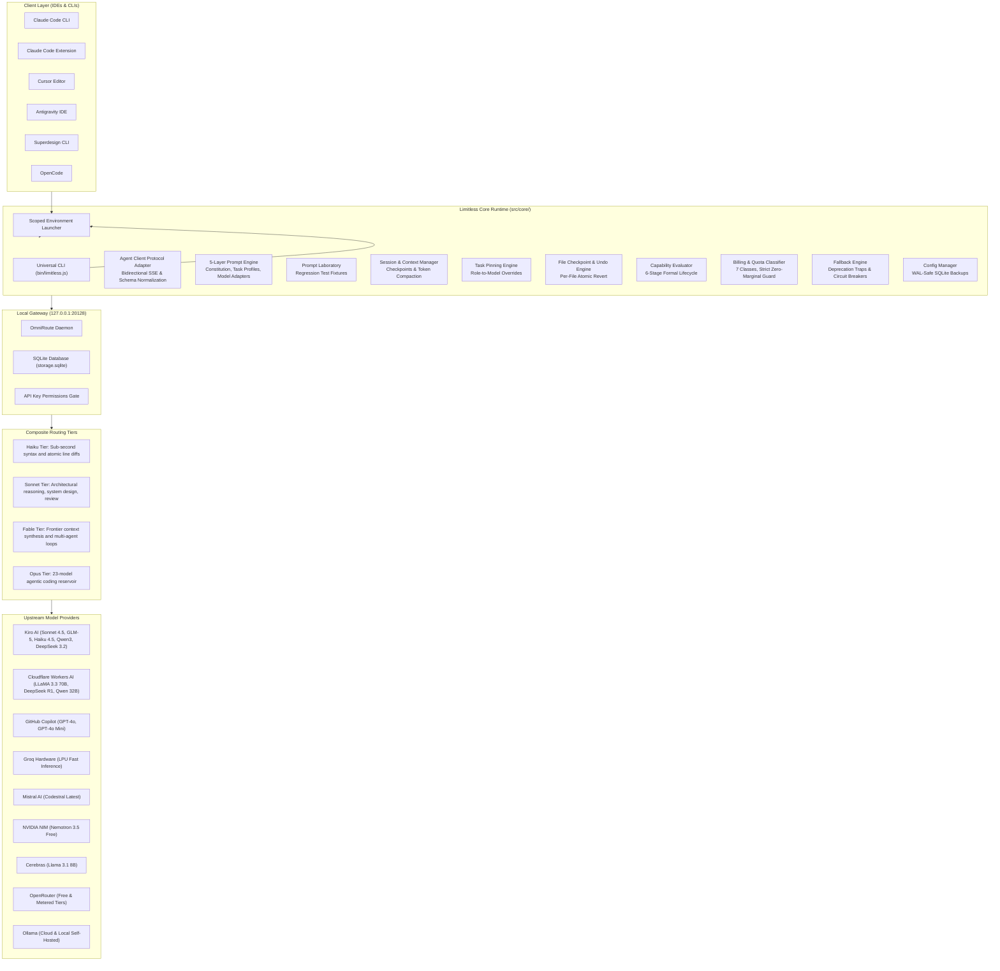
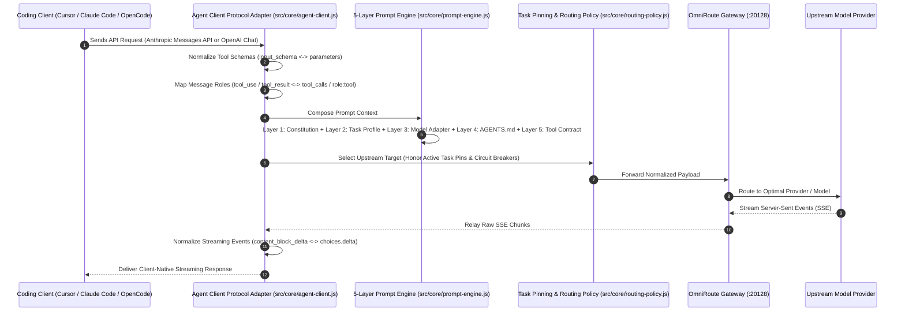
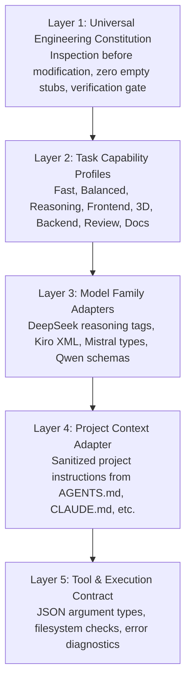

# Limitless Claude 8.1

[](package.json)
[](package.json)
[](https://github.com/mahik504/limitless-claude/actions/workflows/test.yml)
[](LICENSE)
[](test/)
[](scripts/e2e-acceptance.js)
[](scripts/doctor.js)

Limitless Claude routes coding-agent traffic across local and hosted model providers through a local OmniRoute gateway (`http://127.0.0.1:20128`). It connects Claude Code CLI, Cursor, Antigravity, OpenCode, and Superdesign to models from Kiro, Cloudflare, Groq, Mistral, GitHub Copilot, Cerebras, NVIDIA, and OpenRouter without altering agent tool calls or workflow configurations.

---

## Architecture Overview



### Layer Responsibilities

1. **Client Layer:** Tools like Claude Code CLI, Cursor, and Antigravity send standard OpenAI or Anthropic API requests to `http://127.0.0.1:20128`.
2. **Core Runtime Layer:** Normalizes schemas, translates tool calling arguments, checks task pins, evaluates rate-limit circuit breakers, and composes five-layer instructions.
3. **Gateway Layer:** An OmniRoute proxy running locally with a WAL-mode SQLite database (`~/.omniroute/storage.sqlite`) managing credentials, keys, and combo definitions.
4. **Composite Routing Tiers:** Four aliases that distribute requests across pools of models according to task latency, context requirements, and cost.
5. **Upstream Providers:** Connected inference endpoints spanning commercial APIs, developer subscriptions, and free vendor quotas.

---

## How It Works

Limitless Claude provides bidirectional translation between Anthropic Messages API and OpenAI Chat formats, allowing clients expecting Anthropic-formatted tools and streaming SSE chunks to communicate with any OpenAI-compatible provider:



### Five-Layer Prompt Engine

Rather than maintaining a static prompt string, `src/core/prompt-engine.js` composes instructions from five independent layers:



1. **Universal Constitution (`prompts/universal/constitution.md`):** Requires inspecting existing files before modification, forbids empty placeholders (`// TODO`), and requires test execution before claiming fixes.
2. **Task Capability Profiles (`prompts/capabilities/`):** Loads specialized instructions for `fast` (atomic diffs), `balanced` (features with tests), `reasoning` (architectural analysis), `frontend` (React 19 and CSS), `3d` (Three.js and R3F disposal), `backend` (PostgreSQL RLS), `review` (vulnerability audits), and `documentation`.
3. **Provider Adapters (`prompts/providers/`):** Formats instructions for specific model behaviors, including DeepSeek `<think>` reasoning tags, Kiro XML tags, and Mistral type signatures.
4. **Project Context:** Reads repository instructions and wraps them in security delimiters (`<<<PROJECT_CONTEXT_START>>>`) to defend against prompt injection.
5. **Tool Contract (`prompts/contracts/standard-contract.md`):** Specifies exact JSON types, filesystem boundaries, and error recovery behavior.

---

## Operating Modes

Limitless Claude supports two modes depending on your workspace setup:

### Mode A: Standalone Mode
Runs independently without external orchestrators. The engine inspects standard repository files (`AGENTS.md`, `CLAUDE.md`, `GEMINI.md`, `.cursorrules`) and composes them into task instructions. The core runtime under `src/core/` does not import external framework code.

### Mode B: Orchestra Interoperability
When an Orchestra installation is detected (such as `C:\projects\orchestra-workflow`), the adapter at `src/integrations/orchestra/adapter.js` activates automatically. Orchestra coordinates high-level tasks and memory, while Limitless Claude handles upstream model routing, prompt composition, and protocol translation. If Orchestra is removed or disabled, Limitless Claude continues operating under Mode A.

---

## Four Composite Routing Tiers

OmniRoute groups upstream models into four composite aliases. Every model is verified against live HTTP 200 responses before entering production combos:

| Tier | Primary Purpose | Verified Model Endpoints | Billing Classes |
| :--- | :--- | :--- | :--- |
| **Haiku** (`limitless-haiku-4.5`) | Syntax checks, atomic line diffs, quick tool checks (< 1s) | Kiro Claude Haiku 4.5, Cloudflare LLaMA 3.3 70B, GitHub GPT-4o Mini, Groq LPU, Cloudflare GLM 4.7 Flash, OpenRouter Nemotron Free | `provider_free_quota`, `subscription-entitled` |
| **Sonnet** (`limitless-sonnet-5.5`) | System architecture, deep reasoning, code review, debugging | Kiro Claude Sonnet 4.5, Kiro GLM-5, GitHub GPT-4o, Cloudflare DeepSeek R1, Kiro Qwen3 Coder, Kiro DeepSeek 3.2 | `subscription-entitled`, `provider_free_quota` |
| **Fable** (`limitless-fable-reasoning`) | Frontier context synthesis, multi-agent coordination | Kiro Claude Sonnet 4.5, GitHub GPT-4o, Mistral Codestral, Kiro GLM-5, Cloudflare DeepSeek R1 | `subscription-entitled`, `paid-token` |
| **Opus** (`limitless-opus-4.6`) | Long coding loops, fullstack features, 3D scenes | 23-model pool across Mistral Codestral, Kiro, Cloudflare, GitHub, Groq, and OpenRouter free tiers | `provider_free_quota`, `subscription-entitled`, `paid-token` |

### Billing Taxonomy
- `provider_free_quota`: Vendor free tier with rate limits (Groq, Cloudflare Workers AI, Cerebras, NVIDIA NIM).
- `subscription-entitled`: Flat monthly subscription covering inference without per-token charges (GitHub Copilot, Kiro AI).
- `paid-token`: Metered per-token commercial APIs (Mistral, OpenAI, Anthropic, OpenRouter paid).
- `local`: Self-hosted local inference (Ollama, vLLM).
- `unknown`: Pricing is unverified. Returns `null` cost and is excluded in free-only mode.

---

## Recommended Provider Setup (Admin Stack)

To replicate the admin's multi-provider setup, connect these providers in your OmniRoute dashboard (`http://localhost:20128`):

| Provider | Type | Typical Quotas & Models Provided |
| :--- | :--- | :--- |
| **Kiro AI** | Subscription | Claude Sonnet 4.5, Claude Haiku 4.5, GLM-5, Qwen3 Coder, DeepSeek 3.2 |
| **Cloudflare Workers AI** | Free Tier | 10,000 neurons/day. LLaMA 3.3 70B, DeepSeek R1 32B, Qwen 2.5 Coder 32B |
| **Groq Hardware** | Free Tier | Up to 14,400 requests/day (30 RPM). GPT-OSS 20B, LLaMA models on LPU silicon |
| **GitHub Copilot** | Subscription | GPT-4o, GPT-4o Mini flat monthly quota without per-token charges |
| **Mistral AI** | Commercial / Free | Codestral Latest (premier 80+ language coding model) |
| **OpenRouter** | Free & Metered | 50 req/day free (unfunded), or 1,000 req/day on `:free` models with a \$10 deposit |
| **Cerebras** | Free Tier | High-throughput LPU inference for Llama 3.1 8B (up to 30 RPM) |
| **NVIDIA NIM** | Free Tier | 1,000 free inference credits for Nemotron 3.5 Lightning |
| **Ollama (Local / Cloud)** | Local / Free | Unlimited self-hosted token throughput or cloud free tier |

> **Recommendation:** Configure the free providers (Cloudflare, Groq, OpenRouter, Cerebras, NVIDIA NIM) first. Once connected, running `limitless init` will automatically discover them and build out the four tiers. Connecting developer subscriptions (GitHub Copilot, Kiro AI) unlocks the heavier frontier models.

---

## Token Capacity & Daily Quota Estimates

By distributing traffic across multiple free and subscription providers, Limitless Claude provides high daily token throughput without running into single-provider rate limits:

| Setup Configuration | Daily Requests Available | Estimated Daily Tokens | Cost Profile |
| :--- | :---: | :---: | :---: |
| **Pure Free Tier Only**<br/>(Groq + Cloudflare + Cerebras + OpenRouter Free + NVIDIA) | ~25,000 req/day | **15M to 25M tokens/day** | **\$0.00 / month** |
| **Admin Setup (Free + Developer Subscriptions)**<br/>(Above Free Tier + GitHub Copilot + Kiro AI) | Unlimited concurrency | **35M to 50M+ tokens/day** | Flat subscriptions only |
| **Expanded Setup**<br/>(Admin Setup + Local Ollama / vLLM Models) | Hardware bounded | **Virtually Unlimited** | Self-hosted electricity |

### Workload Throughput Reference Table

| Workload Profile | Average Tokens / Req | 50 Req/Day (Unfunded OpenRouter) | 1,000 Req/Day (\$10 Deposit) | Full Admin Multi-Provider Stack |
| :--- | :---: | :---: | :---: | :---: |
| **Micro-Patch / Syntax** (1k in / 1k out) | 2,000 | 0.10M tokens/day | 2.00M tokens/day | **25M+ tokens/day** |
| **Standard Feature / Tests** (4k in / 1k out) | 5,000 | 0.25M tokens/day | 5.00M tokens/day | **20M+ tokens/day** |
| **Full Architecture / RLS** (10k in / 2k out) | 12,000 | 0.60M tokens/day | 12.00M tokens/day | **15M+ tokens/day** |

Run `limitless budget` or read [`docs/TOKEN-CAPACITY.md`](docs/TOKEN-CAPACITY.md) for custom scenario modeling.

---

## Task-to-Model Pinning

Assign dedicated model endpoints to specific engineering tasks:

```bash
limitless pin --list                                        # Show active pin overrides
limitless pin --task backend --model kiro/claude-sonnet-4.5 # Pin backend tasks to Sonnet 4.5
limitless pin --task fast --model groq/openai/gpt-oss-20b   # Pin fast edits to Groq LPU
limitless pin --remove backend                              # Clear backend pin override
limitless pin --reset                                       # Reset all task pin overrides
```

Pinned models automatically receive top priority during candidate selection when their matching capability profile is requested.

---

## File Checkpoint & Undo

Capture atomic snapshots of target files before running autonomous agent loops and roll back individual changes when needed:

```bash
# Capture a snapshot before edits
limitless checkpoint --create "pre-refactor auth" src/auth.js src/db.js

# Review and list stored snapshots
limitless checkpoint --list

# Verify what would change without modifying files
limitless undo --dry-run

# Revert files to the latest checkpoint
limitless undo

# Restore a specific historical checkpoint
limitless undo --id ckpt-2026-11-07T19-09-41-274Z-604909
```

---

## Universal CLI Commands

The `limitless` binary runs globally from any working directory:

```bash
# Core operations
limitless init               # Run zero-config self-healing initialization wizard
limitless doctor             # Run 15-point diagnostic sweep
limitless status             # Print active profile, gateway URL, and routing tiers
limitless verify             # Test HTTP 200 connectivity across all tiers
limitless setup              # Sync live OmniRoute models into composite tiers
limitless launcher           # Launch Claude Code under scoped profile

# Catalog and providers
limitless discover           # Scan and record live gateway models and providers
limitless models list        # List catalogued models (--free-only, --profile <name>)
limitless models inspect <id># View capability profile for a specific model
limitless providers list     # List connected providers and billing classes
limitless providers test     # Ping upstream provider endpoints through gateway

# Task pinning and file safety
limitless pin                # Pin specific models to engineering tasks
limitless checkpoint         # Create file-level snapshots before autonomous runs
limitless undo               # Revert modified files to the previous checkpoint

# Prompts and budget
limitless prompt list        # List capability profiles and provider adapters
limitless prompt compose     # Render 5-layer prompt with hash and section previews
limitless prompt test        # Run Prompt Laboratory regression fixtures
limitless budget             # View spend controls and daily token capacity estimates

# Benchmarking and recovery
limitless benchmark          # Run 12-task standardized benchmark
limitless acceptance         # Run 6-test end-to-end acceptance suite
limitless dashboard          # Open live terminal observability dashboard
limitless rollback --create  # Create a WAL-safe SQLite and config snapshot
limitless rollback --list    # List available database and config snapshots
limitless rollback --latest  # Restore most recent snapshot
```

---

## Installation & Setup

Choose the installation method that matches your environment:

### Method 1: One-Line Instant Installation

Run the automated installer script for your platform:

#### Windows (PowerShell)
```powershell
irm https://raw.githubusercontent.com/mahik504/limitless-claude/master/install.ps1 | iex
```

#### macOS & Linux (Terminal)
```bash
curl -fsSL https://raw.githubusercontent.com/mahik504/limitless-claude/master/install.sh | bash
```

The installer verifies Node.js 22+, clones the repository, installs dependencies, registers the global `limitless` CLI command via `npm link`, checks/starts the OmniRoute gateway daemon, auto-provisions a local SQLite API key, configures `~/.claude/settings.json`, and synchronizes all routing tiers.

---

### Method 2: AI Agent Master Installation Prompts

If you are using an AI coding assistant (such as Antigravity, Cursor, or Claude Code), paste one of these master prompts to handle the setup automatically:

#### Prompt 1: Clean Installation (New Environment)

```text
Set up a clean installation of Limitless Claude 8.1 on this machine following these steps:

1. Repository setup:
   - Check if the repository exists at C:\projects\limitless-claude (or clone from https://github.com/mahik504/limitless-claude.git).
   - Ensure Node.js is version 22 or higher. Run `npm install` inside the project root.

2. Run self-healing initialization wizard:
   - Run `node bin/limitless.js init`.
   - The wizard automatically verifies Node 22+, checks/starts the OmniRoute gateway daemon, auto-provisions a local SQLite API key if none exists, configures ~/.claude/settings.json, captures a safety snapshot, discovers models, and configures the 4 composite tiers.

3. Diagnostic check:
   - Run `node bin/limitless.js doctor`.
   - Confirm all 15 checkpoints pass, including database integrity, API key permissions, gateway reachability, model catalog, and billing guards.

4. Verification:
   - Run `node bin/limitless.js verify` to confirm HTTP 200 connectivity on all 4 tiers.
   - Run `node bin/limitless.js acceptance` to execute the 6-test acceptance suite.
   - Run `npm test` to verify unit and contract tests pass.

5. Completion:
   - Run `node bin/limitless.js status` to display the active tier configuration.
   - Use `limitless launcher` to start a Claude Code session.
```

#### Prompt 2: Repair, Update & Re-Sync (Existing Setup)

```text
Repair and re-synchronize an existing Limitless Claude installation using these steps:

1. Create snapshot:
   - Run `node bin/limitless.js rollback --create pre-repair` to capture a WAL-safe SQLite and configuration snapshot before making modifications.
   - Keep existing API keys, provider configurations, and user credentials intact.

2. Database and key checks:
   - Check that ~/.omniroute/storage.sqlite is accessible.
   - Run `node bin/limitless.js doctor`. If the API key is in restricted mode, ensure all composite tiers are included in allowed_combos.
   - Remove deprecated endpoints from primary positions.

3. Discovery and classification:
   - Run `node bin/limitless.js discover` to read live gateway endpoints.
   - Update model records with formal lifecycle states (ESTIMATED, SMOKE_TESTED, PRODUCTION_APPROVED).
   - Verify unknown model pricing returns null, preventing unintended charges in free-only mode.

4. Re-sync tiers:
   - Run `node bin/limitless.js setup` to update Haiku, Sonnet, Opus, and Fable tiers with active models.
   - Update the 5-layer Universal Engineering Constitution in combos.system_message.

5. Verification:
   - Run `node bin/limitless.js verify` to confirm HTTP 200 connectivity across all tiers.
   - Run `node bin/limitless.js prompt test` to verify Prompt Laboratory fixtures pass.
   - Run `npm test` to confirm test suites pass.
   - Run `limitless status` to display the verified configuration.
```

---

### Method 3: Manual Installation

If you prefer installing step by step without scripts:

1. Ensure Node.js version 22 or higher is installed (`node -v`).
2. Clone the repository and install dependencies:
   ```bash
   git clone https://github.com/mahik504/limitless-claude.git
   cd limitless-claude
   npm install
   npm link
   ```
3. Run the zero-config initialization wizard:
   ```bash
   limitless init
   ```
4. Verify the installation:
   ```bash
   limitless doctor
   limitless verify
   ```

---

## Verification Results

The 8.1.0 release passed all local automated verification gates:

```text
Unit & Contract Tests (`npm test`)        : 91/91 passed (13 suites)
System Diagnostic Doctor (`limitless doctor`): 15/15 passed (Orchestra Mode B Active)
Tier Connectivity (`limitless verify`)     : 8/8 routes HTTP 200 OK
End-to-End Acceptance (`limitless acceptance`): 6/6 passed
Prompt Laboratory (`limitless prompt test`) : 4/4 fixtures passed (100% score)
```

---

## License

Distributed under the MIT License. See [`LICENSE`](LICENSE) for details.
