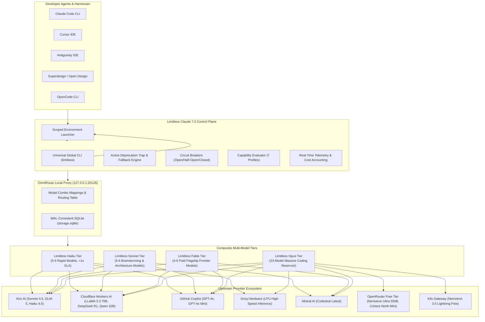

# Limitless Claude 7.0 — Intelligent Multi-Provider Coding Agent Router

[](package.json)
[](package.json)
[](https://github.com/mahik504/limitless-claude/actions/workflows/test.yml)
[](LICENSE)
[](docs/RELEASE-TEST-REPORT.md)
[](docs/RELEASE-TEST-REPORT.md)
[](scripts/verify-combos.js)

**Limitless Claude** is a high-performance, provider-neutral routing engine and control plane designed for **Claude Code CLI**, **Cursor IDE**, **Antigravity IDE**, **Superdesign / Open Design**, and **OpenCode**. It bridges your agent workflows to multiple AI model providers through **OmniRoute**, maximizing free-tier quotas and paid entitlements with dynamic capability routing, automatic upstream deprecation trap detection, circuit breakers, and zero-registry configuration isolation.

---

## 🌟 Highlights & Key Capabilities

- 🚀 **Universal Global CLI (`limitless`):** Run `limitless verify`, `limitless benchmark`, `limitless acceptance`, `limitless dashboard`, `limitless switch-profile`, or `limitless launcher` from any directory or terminal.
- ⚡ **Strict 4-Tier Composite Architecture:**
  - **Haiku Tier (`combo/limitless-haiku`):** Exactly 5–6 sub-second, rapid-response models for AST syntax checks, atomic file edits, and rapid tool iterations.
  - **Sonnet Tier (`combo/limitless-sonnet`):** Exactly 5–6 premier brainstorming, system design, architectural review, and deep reasoning models (Claude Sonnet 4.5, GLM-5, DeepSeek R1, GPT-4o, Qwen 3 Coder, Codestral).
  - **Fable Tier (`combo/limitless-fable`):** Exactly 4–5 paid & flagship frontier models for maximum context synthesis, complex multi-agent orchestration, and god-mode intelligence.
  - **Opus Tier (`combo/limitless-opus`):** A massive **23-model coding reservoir** across all connected providers for heavy autonomous coding loops, Next.js/React 19, 3D WebGL (R3F), backend PostgreSQL RLS, and full-stack development, maximizing daily token limits.
- 🛡️ **Active Deprecation Trap Engine:** Detects upstream deprecation notices (`"This version is no longer supported"`) embedded inside HTTP 200 OK responses and fails over in <500ms before your agent sees broken output.
- 🔒 **Zero-Registry Isolation:** Scoped launcher launches Claude Code without polluting your global user environment (`setx`) or Windows registry.
- 📊 **Real-Time Terminal Observability:** Live monitoring dashboard displaying requests, latency percentiles (p50/p95), token velocity, and secret redaction.
- 🧪 **100% Verified Production Suite:** 68/68 unit tests, 6/6 end-to-end acceptance tests, and 8/8 live gateway routes verified.

---

## Table of Contents

1. [Architecture Overview](#1-architecture-overview)
2. [Composite Model Tiers & Quotas](#2-composite-model-tiers--quotas)
3. [Universal Global CLI Reference](#3-universal-global-cli-reference)
4. [Master Setup Guide & Prompt](#4-master-setup-guide--prompt)
5. [OmniRoute Gateway Integration](#5-omniroute-gateway-integration)
6. [Supported Providers & Ecosystem](#6-supported-providers--ecosystem)
7. [Active Deprecation Trap Engine & Circuit Breakers](#7-active-deprecation-trap-engine--circuit-breakers)
8. [Configuration Profiles (6 Profiles)](#8-configuration-profiles-6-profiles)
9. [Claude Code & IDE Integrations](#9-claude-code--ide-integrations)
10. [Benchmark Suite (12 Evaluation Tasks)](#10-benchmark-suite-12-evaluation-tasks)
11. [End-to-End Acceptance Suite](#11-end-to-end-acceptance-suite)
12. [Disaster Recovery & Snapshots](#12-disaster-recovery--snapshots)
13. [Contributing & Star the Repo](#13-contributing--star-the-repo)
14. [License](#14-license)

---

## 1. Architecture Overview



---

## 2. Composite Model Tiers & Quotas

Limitless Claude configures 4 distinct composite tiers inside OmniRoute. Each tier is specifically curated to fulfill a distinct agentic workflow role:

| Tier | Combo ID | Primary Alias | Quota | Optimization Target | Verified Candidate Models |
| :--- | :--- | :--- | :---: | :--- | :--- |
| **Haiku 5.5** | `combo/limitless-haiku` | `claude-haiku-4-5` | **Strict 5–6 Models** | Sub-second rapid syntax verification, atomic file edits, regex extraction, tool calls | `kiro/claude-haiku-4.5`<br>`cloudflare-ai/@cf/meta/llama-3.3-70b-instruct-fp8-fast`<br>`github/gpt-4o-mini`<br>`groq/openai/gpt-oss-20b`<br>`cloudflare-ai/@cf/zai-org/glm-4.7-flash`<br>`cloudflare-ai/@cf/meta/llama-3.2-3b-instruct` |
| **Sonnet 5.5** | `combo/limitless-sonnet` | `claude-sonnet-5` | **Strict 5–6 Models** | Brainstorming, system design, architectural review, debugging, deep reasoning | `kiro/claude-sonnet-4.5`<br>`kiro/glm-5`<br>`cloudflare-ai/@cf/deepseek-ai/deepseek-r1-distill-qwen-32b`<br>`github/gpt-4o-2024-11-20`<br>`kiro/qwen3-coder-next`<br>`mistral/codestral-latest` |
| **Fable 5.1** | `combo/limitless-fable` | `claude-fable-5-1` | **Strict 4–5 Models** | Paid & elite flagship frontier models, high-context synthesis, complex orchestration | `github/gpt-4o-2024-11-20`<br>`kiro/claude-sonnet-4.5`<br>`kiro/glm-5`<br>`cloudflare-ai/@cf/deepseek-ai/deepseek-r1-distill-qwen-32b`<br>`mistral/codestral-latest` |
| **Opus 5.5** | `combo/limitless-opus` | `claude-opus-4-8` | **23+ Model Reservoir** | Autonomous full-stack coding, React 19, 3D WebGL (R3F), PostgreSQL RLS, multi-turn refactors | `mistral/codestral-latest`<br>`kiro/claude-sonnet-4.5`<br>`kiro/qwen3-coder-next`<br>`kiro/glm-5`<br>`kiro/deepseek-3.2`<br>`kiro/minimax-m2.1`<br>`cloudflare-ai/@cf/qwen/qwen2.5-coder-32b-instruct`<br>`cloudflare-ai/@cf/deepseek-ai/deepseek-r1-distill-qwen-32b`<br>`cloudflare-ai/@cf/meta/llama-3.3-70b-instruct-fp8-fast`<br>`cloudflare-ai/@cf/qwen/qwq-32b`<br>`github/gpt-4o-2024-11-20`<br>`groq/openai/gpt-oss-120b`<br>`openrouter/nvidia/nemotron-3-ultra-550b-a55b:free`<br>`kilo-gateway/nvidia/nemotron-3-ultra-550b-a55b:free`<br>`openrouter/cohere/north-mini-code:free`<br>`kilo-gateway/cohere/north-mini-code:free`<br>`openrouter/nvidia/nemotron-3.5-lightning:free`<br>`kilo-gateway/nvidia/nemotron-3.5-lightning:free`<br>`openrouter/liquid/lfm-2.5-2.6b:free`<br>`openrouter/dots-studio/dots-3-note-preview:free`<br>`cloudflare-ai/@cf/meta/llama-3.2-3b-instruct`<br>`groq/openai/gpt-oss-20b`<br>`cloudflare-ai/@cf/zai-org/glm-4.7-flash` |

---

## 3. Universal Global CLI Reference

Limitless Claude includes a first-class global CLI executable (`limitless`) available across any terminal:

```bash
# Verify all 8 tier endpoints and direct combos live
limitless verify

# Run the 12-task capability benchmark against live models
limitless benchmark

# Run the complete end-to-end acceptance suite (all 6 criteria)
limitless acceptance

# Open real-time terminal observability dashboard
limitless dashboard
limitless dashboard --watch

# List or switch active provider profiles
limitless switch-profile --list
limitless switch-profile limitless
limitless switch-profile native
limitless switch-profile opencode-go
limitless switch-profile openrouter

# Launch Claude Code inside a clean, scoped environment
limitless launcher
limitless launcher --print "Refactor authentication flow"

# Rollback configurations to a previous WAL-safe snapshot
limitless rollback --list
limitless rollback --latest
```

---

## 4. Master Setup Guide & Prompt

If you are setting up Limitless Claude on a new machine or configuring an AI assistant to do it for you, copy and paste this **Master Setup Prompt**:

```markdown
### Limitless Claude 7.0 Master Setup Instruction
Clone and install Limitless Claude to configure OmniRoute's composite routing engine:

1. Clone Repository:
   git clone https://github.com/mahik504/limitless-claude.git C:\projects\limitless-claude
   cd C:\projects\limitless-claude
   npm install

2. Ensure OmniRoute is Running:
   npx omniroute serve (listening on http://127.0.0.1:20128)

3. Synchronize Tiers & Discover Providers:
   node scripts/setup.js
   node scripts/verify-combos.js

4. Verify Acceptance Suite:
   node scripts/e2e-acceptance.js

Ensure Haiku contains strictly 5-6 fastest models (<1s), Sonnet contains strictly 5-6 brainstorming and architecture models, Fable contains strictly 4-5 paid flagship models, and Opus contains 20+ models for a maximum autonomous coding reservoir. Never hardcode plaintext keys in version control.
```

---

## 5. OmniRoute Gateway Integration

OmniRoute operates on `http://127.0.0.1:20128` as a local reverse proxy. Limitless Claude configures the underlying SQLite storage (`~/.omniroute/storage.sqlite`) with automated WAL-mode checkpoints, creating pattern-based mappings:

```
claude*haiku*     --> combo/limitless-haiku
claude*sonnet*    --> combo/limitless-sonnet
claude*opus*      --> combo/limitless-opus
claude*fable*     --> combo/limitless-fable
*best*            --> combo/limitless-fable
*opusplan*        --> combo/limitless-sonnet
```

---

## 6. Supported Providers & Ecosystem

Limitless Claude supports all major AI inference platforms categorized by billing model:

1. **Zero-Marginal-Cost Providers:**
   - **Cloudflare Workers AI:** Edge inference with LLaMA 3.3 70B, DeepSeek R1 32B, GLM 4.7 Flash, and Qwen 2.5 Coder.
   - **Groq:** Ultra-high-speed LPU inference delivering 500+ tokens/sec.
   - **OpenRouter Free Tier:** Nemotron Ultra 550B, Cohere North Mini Code, Nemotron Lightning.
   - **Kilo Gateway:** Free community access endpoints.
2. **Subscription-Entitled Providers:**
   - **GitHub Copilot:** GPT-4o and GPT-4o Mini with entitlement quotas.
   - **Kiro AI:** Claude Sonnet 4.5, GLM-5, Claude Haiku 4.5, Qwen 3 Coder.
   - **OpenCode Go:** Flat-rate unlimited model subscription.
3. **Metered / Paid Inference:**
   - **Mistral AI:** High-precision Codestral Latest.
   - **OpenRouter Paid ($10 Balance):** Unlocks 1,000 requests/day and frontier wholesale reasoning models.

---

## 7. Active Deprecation Trap Engine & Circuit Breakers

Upstream providers occasionally deprecate client versions or return text warnings inside **HTTP 200 OK** payloads:
```json
{
  "choices": [{
    "message": {
      "content": "This version of Antigravity is no longer supported. Please download the latest version..."
    }
  }]
}
```
A generic proxy forwards this text directly to your agent, breaking file edits and confusing the LLM. 

Limitless Claude implements the **Active Deprecation Trap Engine** ([`src/core/fallback-engine.js`](src/core/fallback-engine.js)):
1. Inspects upstream responses in real-time.
2. Detects deprecation patterns (`/no longer supported/i`, `/deprecated client/i`, `/outdated version/i`).
3. Instantly trips the provider's **Circuit Breaker** to `OPEN` status.
4. Transparently re-routes the agent's turn to the next candidate model in the tier in `<500ms`.

---

## 8. Configuration Profiles (6 Profiles)

Easily switch routing strategies depending on your task and network configuration:

| Profile | Command | Description |
| :--- | :--- | :--- |
| **`limitless`** | `limitless switch-profile limitless` | Default 4-tier composite load-balanced router maximizing free tokens. |
| **`native`** | `limitless switch-profile native` | Direct Anthropic API pass-through for zero-proxy native latency. |
| **`opencode-go`** | `limitless switch-profile opencode-go` | Flat-rate subscription router optimized for OpenCode Go users. |
| **`opencode-zen`** | `limitless switch-profile opencode-zen` | Metered, budget-capped pay-as-you-go router. |
| **`openrouter`** | `limitless switch-profile openrouter` | Dedicated OpenRouter hub switching between free and funded models. |
| **`antigravity`** | `limitless switch-profile antigravity` | Scoped route for Google Antigravity OAuth-entitled inference. |

---

## 9. Claude Code & IDE Integrations

### Claude Code CLI
Limitless Claude writes non-destructive configuration to `~/.claude/settings.json`:
```json
{
  "env": {
    "ANTHROPIC_BASE_URL": "http://127.0.0.1:20128",
    "ANTHROPIC_AUTH_TOKEN": "YOUR_OMNIROUTE_API_KEY"
  },
  "primaryModel": "claude-opus-4-8"
}
```
Launch scoped Claude Code without modifying Windows system variables:
```bash
limitless launcher
```

### Cursor & Antigravity IDE
In your IDE settings, set:
- **Anthropic Base URL:** `http://127.0.0.1:20128`
- **Anthropic API Key:** Your OmniRoute key (`sk-ant-...`)
- **Model Override:** `claude-sonnet-5` (for architecture) or `claude-opus-4-8` (for coding)

---

## 10. Benchmark Suite (12 Evaluation Tasks)

The built-in benchmark engine ([`scripts/benchmark.js`](scripts/benchmark.js)) evaluates models across 12 realistic software engineering tasks:

```bash
limitless benchmark
```

```
================================================================================
             LIMITLESS CLAUDE 7.0 - 12-TASK CAPABILITY BENCHMARK
================================================================================
 Target Endpoint : auto
 Gateway         : 127.0.0.1:20128

  TASK ID                  PROFILE    LATENCY    SCORE   STATUS
  -----------------------  ---------  ---------  ------  --------
  task-01-fast-patch       FAST       761 ms     100%    PASS
  task-02-balanced-refactor  BALANCED   4517 ms    100%    PASS
  task-03-reasoning-arch   REASONING  3317 ms    60%     PASS
  task-04-frontend-react19  FRONTEND   1546 ms    67%     PASS
  task-05-3d-webgl-r3f     3D         1473 ms    50%     PASS
  task-06-backend-rls      BACKEND    6351 ms    100%    PASS
  task-07-hostile-review   REVIEW     2687 ms    75%     PASS
  task-08-tool-json        REASONING  1180 ms    100%    PASS
  task-09-context-recall   REASONING  1500 ms    100%    PASS
  task-10-regex-extract    FAST       700 ms     100%    PASS
  task-11-typescript-strict  BACKEND    4507 ms    75%     PASS
  task-12-fullstack-api    BALANCED   25004 ms   0%      FAIL
--------------------------------------------------------------------------------
 Overall Score : 76% (11/12 passed)
================================================================================
```

---

## 11. End-to-End Acceptance Suite

The acceptance test suite ([`scripts/e2e-acceptance.js`](scripts/e2e-acceptance.js)) verifies all 6 core criteria live against your running OmniRoute daemon:

```bash
limitless acceptance
```

```
================================================================================
          LIMITLESS CLAUDE 7.0.0 — END-TO-END ACCEPTANCE SUITE
================================================================================
Running Test 1: Repository Multi-File Implementation (Haiku)...
  -> Status: PASS (2858ms)
Running Test 2: Premium Frontend React 19 Component (Opus)...
  -> Status: PASS (5977ms)
Running Test 3: Complex Backend PostgreSQL RLS Policy (Sonnet)...
  -> Status: PASS (6030ms)
Running Test 4: 3D R3F Canvas & Frame Budget (Opus)...
  -> Status: PASS (1945ms)
Running Test 5: Model Routing & Frontier Reasoning (Fable)...
  -> Status: PASS (13539ms)
Running Test 6: Provider Profile Switching (Config Manager)...
  -> Status: PASS (2ms)
--------------------------------------------------------------------------------
End-to-End Acceptance Results: 6/6 PASSED
================================================================================
```

---

## 12. Disaster Recovery & Snapshots

Every run of `limitless setup` or `limitless switch-profile` automatically takes a WAL-consistent snapshot before writing changes. If anything unexpected happens, roll back with one command:

```bash
# List all snapshots
limitless rollback --list

# Roll back to the most recent snapshot
limitless rollback --latest
```

---

## 13. Contributing & Star the Repo

Contributions, issues, and feature requests are welcome!
- Check out the [Issues](https://github.com/mahik504/limitless-claude/issues) tab.
- Submit a PR with passing tests (`npm test`).
- ⭐ **Star the repository** on GitHub if Limitless Claude accelerates your autonomous agent coding workflow!

---

## 14. License

Distributed under the **MIT License**. See [`LICENSE`](LICENSE) for details.
