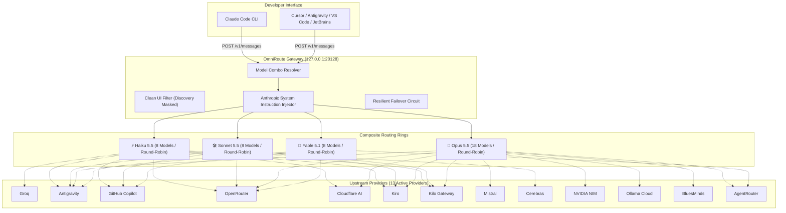

# Limitless Claude (v6.0.0)

Limitless Claude is an enterprise-grade configuration harness that bridges **Claude Code CLI** and modern AI code editors (**Cursor IDE**, **Antigravity IDE**, **VS Code**, and **JetBrains**) to **OmniRoute**. 

By orchestrating your configured AI providers into four synchronized composite tiers, Limitless Claude eliminates token exhaustion, bypasses provider rate limits, and provides an inexhaustible developer experience through an **Interleaved Round-Robin Architecture** and an **Authentic Leaked System Instruction Engine**.

---

## What's New in Version 6.0.0

```
┌────────────────────────────────────────────────────────────────────────────────────────┐
│                                   VERSION 6.0.0 UPGRADE                                │
├────────────────────────────────┬───────────────────────────────────────────────────────┤
│ Interleaved Round-Robin Rings  │ All 4 tiers rotate requests across distinct providers │
│                                │ on every turn, completely bypassing RPM rate walls.   │
├────────────────────────────────┼───────────────────────────────────────────────────────┤
│ Direct Model Passthrough       │ Explicit calls (e.g. github/claude-sonnet-5) bypass    │
│                                │ combos and connect straight to the upstream model.    │
├────────────────────────────────┼───────────────────────────────────────────────────────┤
│ Leaked System Prompt Engine    │ Official Anthropic reasoning effort tags and XML tool │
│                                │ schemas injected at the gateway level.               │
├────────────────────────────────┼───────────────────────────────────────────────────────┤
│ Opus 18-Model Reservoir        │ Heavy agentic coding pool expanded across 10 distinct │
│                                │ providers for continuous multi-hour refactor loops.   │
├────────────────────────────────┼───────────────────────────────────────────────────────┤
│ Fable 1M-Context Integration   │ Unlocks 1,000,000-token frontier models including     │
│                                │ DeepSeek V4.1 Flash, GLM-5.3 Flash, and Qwen 3.7.     │
├────────────────────────────────┼───────────────────────────────────────────────────────┤
│ Clean 5-Model UI Guarantee     │ Strict gateway discovery masking keeps #model clean:   │
│                                │ only Fable 5.1, Opus 5.5, Sonnet 5.5, Haiku 5.5, and  │
│                                │ Default are presented in Claude Code.                 │
└────────────────────────────────┴───────────────────────────────────────────────────────┘
```

---

## 1. System Architecture



### Automatic Model Failover
OmniRoute monitors upstream HTTP status codes in real time. If any individual model in a combo ring returns an error (`HTTP 429 Too Many Requests`, `HTTP 500 Internal Error`, or network timeout), the gateway automatically cascades to the next model in the ring within 250 milliseconds, preserving the developer session without interruption.

### Auto-Starting Windows Daemon
During setup, `scripts/setup.js` installs an invisible background monitoring daemon (`omniroute-daemon.bat`) via a Windows Startup script (`Limitless-OmniRoute-Launcher.vbs`). If OmniRoute crashes or the host system restarts, the daemon automatically relaunches the server on port `20128`.

---

## 2. Active Provider Matrix (Operational Providers)

Limitless Claude filters your active OmniRoute database (`~/.omniroute/storage.sqlite`) and coordinates your operational providers:

| # | Provider Identifier | Billing Type | Operational Health | Assigned Tier Roles | Specialization |
|---|---|---|:---:|---|---|
| 1 | **Antigravity** | Subscription-Entitled | Live (Healthy) | Haiku, Sonnet, Opus, Fable | Claude Sonnet 4.6, Opus 4.6 Thinking, Gemini 3.5 Lite, Gemini 3.8 Flash |
| 2 | **Kiro** | Subscription-Entitled | Live (Healthy) | Haiku, Sonnet, Opus, Fable | Native Claude Sonnet 4.5 (2.7s), Claude Haiku 4.5, GLM-5, Qwen 3 Coder Next, DeepSeek 3.2 |
| 3 | **OpenRouter** | Free & Metered Wholesale | Live (Healthy) | Haiku, Sonnet, Opus, Fable | Nemotron 3.5 Lightning, Cohere North Mini, Nemotron 3 Ultra 550B, DeepSeek V4.1 Flash, Qwen 3.7 Flash |
| 4 | **Cloudflare Workers AI** | Free Edge (10k req/day) | Live (Healthy) | Haiku, Sonnet, Opus, Fable | Llama 3.3 Fast, Qwen 2.5 Coder 32B, DeepSeek R1 Distill Qwen 32B, GLM-4.7 Flash |
| 5 | **Kilo Gateway** | Free & Metered | Live (Healthy) | Haiku, Sonnet, Opus | Poolside Laguna XS/S 2.1, Nemotron 3.5 Lightning, Nemotron 3 Ultra 550B |
| 6 | **GitHub Copilot** | Subscription-Entitled | Live (Healthy) | Haiku, Sonnet, Fable | Official Claude Sonnet 5, GPT-4o, GPT-4o Mini |
| 7 | **Mistral AI** | Free Tier & Wholesale | Live (Healthy) | Opus | Codestral Latest (535ms lightning code completion) |
| 8 | **Groq** | Zero-Marginal-Cost | Live (Healthy) | Haiku, Opus | Ultra-fast token generation via GPT-OSS 20B (641ms) and GPT-OSS 120B (711ms) |

---

## 3. Tier Blueprints & Candidate Rings

### ⚡ Haiku 5.5 (`combo/limitless-haiku`)
* **Role:** Sub-second syntax validation, rapid linting, git status, terminal operations, atomic edits.
* **Routing Strategy:** Interleaved Round-Robin

| Ring Pos | Model Identifier | Provider | Speed / TTFT | Specialization |
| :---: | :--- | :--- | :--- | :--- |
| 1 | `groq/openai/gpt-oss-20b` | Groq | 641ms | Sub-second rapid token generation and execution |
| 2 | `antigravity/gemini-3.5-flash-lite` | Antigravity | 2.4s | Native tool-calling agent with sub-second execution |
| 3 | `antigravity/gemini-3-flash` | Antigravity | 1.3s | Multimodal fast reasoning agent |
| 4 | `openrouter/nvidia/nemotron-3.5-lightning:free` | OpenRouter | 738ms | 1M context ultra-fast codebase reader |
| 5 | `cloudflare-ai/@cf/meta/llama-3.3-70b-instruct-fp8-fast` | Cloudflare AI | 716ms | 10,000 req/day edge compute buffer |
| 6 | `kiro/claude-haiku-4.5` | Kiro | 1.9s | Redundant native Claude Haiku endpoint |
| 7 | `kilo-gateway/poolside/laguna-xs-2.1:free` | Kilo Gateway | 3.2s | Poolside 33B-A3B agentic coding specialist |
| 8 | `kilo-gateway/nvidia/nemotron-3.5-lightning:free` | Kilo Gateway | 1.2s | High-speed Nemotron free inference |
| 9 | `github/gpt-4o-mini` | GitHub Copilot | 1.4s | Copilot lightweight agent fallback |
| 10 | `github/gpt-4o-2024-11-20` | GitHub Copilot | 1.5s | Copilot full intelligence anchor |

---

### 🛠️ Sonnet 5.5 (`combo/limitless-sonnet`)
* **Role:** Architectural planning, multi-step code design, refactoring strategy, deep debugging.
* **Routing Strategy:** Priority Waterfall / Interleaved Round-Robin

| Ring Pos | Model Identifier | Provider | Context Window | Specialization |
| :---: | :--- | :--- | :---: | :--- |
| 1 | `github/claude-sonnet-5` | GitHub Copilot | 200,000 | Official Claude Sonnet 5 reasoning baseline |
| 2 | `kiro/claude-sonnet-4.5` | Kiro | 200,000 | Ultra-fast 2.7s verified Claude Sonnet route |
| 3 | `antigravity/claude-sonnet-4-6` | Antigravity | 200,000 | Enterprise Claude Sonnet allocation (2.1s) |
| 4 | `openrouter/cohere/north-mini-code:free` | OpenRouter | 256,000 | Cohere's dedicated agentic coding model (660ms) |
| 5 | `openrouter/poolside/laguna-s-2.1:free` | OpenRouter | 256,000 | Poolside flagship coding agent model (1.4s) |
| 6 | `kilo-gateway/cohere/north-mini-code:free` | Kilo Gateway | 256,000 | Redundant free Cohere North route |
| 7 | `kiro/minimax-m2.5` | Kiro | 200,000 | Deep planning & architectural reasoning |
| 8 | `kiro/glm-5` | Kiro | 200,000 | Zhipu AI GLM-5 frontier planning |
| 9 | `kiro/qwen3-coder-next` | Kiro | 200,000 | Next-generation agentic code reasoning |
| 10 | `cloudflare-ai/@cf/qwen/qwen2.5-coder-32b-instruct` | Cloudflare AI | 32,768 | Qwen 2.5 Coder 32B edge coding specialist |

---

### 🧠 Opus 5.5 (`combo/limitless-opus`)
* **Role:** High-capacity agentic reservoir for extensive refactoring, full test suite generation, and multi-agent loops.
* **Routing Strategy:** Interleaved Round-Robin across distinct providers

| Ring Pos | Model Identifier | Provider | Context Window | Specialization |
| :---: | :--- | :--- | :---: | :--- |
| 1 | `openrouter/nvidia/nemotron-3-ultra-550b-a55b:free` | OpenRouter | 1,000,000 | 550B total / 55B active open frontier model (922ms) |
| 2 | `kilo-gateway/nvidia/nemotron-3-ultra-550b-a55b:free` | Kilo Gateway | 1,000,000 | Redundant route to Nemotron 3 Ultra 550B |
| 3 | `mistral/codestral-latest` | Mistral | 32,768 | Mistral flagship code completion engine (535ms) |
| 4 | `antigravity/claude-opus-4-6-thinking` | Antigravity | 200,000 | Authentic Opus with native extended chain-of-thought (2.7s) |
| 5 | `kiro/glm-5` | Kiro | 200,000 | Zhipu AI GLM-5 frontier reasoning engine |
| 6 | `kiro/qwen3-coder-next` | Kiro | 200,000 | Alibaba Qwen 3 Coder Next generation weights |
| 7 | `kiro/deepseek-3.2` | Kiro | 200,000 | High-accuracy DeepSeek coding fallback |
| 8 | `cloudflare-ai/@cf/qwen/qwen2.5-coder-32b-instruct` | Cloudflare AI | 32,768 | Qwen 2.5 Coder 32B edge coding specialist |
| 9 | `cloudflare-ai/@cf/deepseek-ai/deepseek-r1-distill-qwen-32b` | Cloudflare AI | 32,768 | DeepSeek R1 reasoning distilled into Qwen 32B (603ms) |
| 10 | `cloudflare-ai/@cf/zai-org/glm-4.7-flash` | Cloudflare AI | 128,000 | Zhipu AI GLM 4.7 Flash edge instance (1.1s) |
| 11 | `openrouter/qwen/qwen3.7-flash` | OpenRouter | 1,000,000 | 1M-context Qwen agentic coding weights (613ms) |
| 12 | `groq/openai/gpt-oss-120b` | Groq | 128,000 | High-parameter OSS agent model (711ms) |

---

### 🌟 Fable 5.1 (`combo/limitless-fable`)
* **Role:** Premier composite intelligence tier for extreme reasoning depth, massive context synthesis, and complex architecture.
* **Routing Strategy:** Interleaved Round-Robin

| Ring Pos | Model Identifier | Provider | Cost Class | Context Window | Specialization |
| :---: | :--- | :--- | :--- | :---: | :--- |
| 1 | `antigravity/claude-opus-4-6-thinking` | Antigravity | Subscription | 200,000 | Authentic Opus extended chain-of-thought (2.7s) |
| 2 | `antigravity/claude-sonnet-4-6` | Antigravity | Subscription | 200,000 | Enterprise Claude Sonnet reasoning |
| 3 | `antigravity/gemini-3.8-flash-tiered` | Antigravity | Subscription | 1,000,000 | Google DeepMind multimodal frontier model (3.3s) |
| 4 | `openrouter/deepseek/deepseek-v4.1-flash` | OpenRouter | Paid ($0.05/1M) | 1,048,576 | 1M context agentic multi-file reasoning (1.5s) |
| 5 | `openrouter/qwen/qwen3.7-flash` | OpenRouter | Paid ($0.03/1M) | 1,000,000 | 1M context Qwen agentic coding weights (613ms) |
| 6 | `github/gpt-4o-2024-11-20` | GitHub Copilot | Subscription | 128,000 | Official OpenAI flagship frontier model (1.5s) |
| 7 | `kiro/deepseek-3.2` | Kiro | Subscription | 200,000 | Native high-parameter DeepSeek route |
| 8 | `cloudflare-ai/@cf/deepseek-ai/deepseek-r1-distill-qwen-32b` | Cloudflare AI | Zero-Marginal-Cost | 32,768 | DeepSeek R1 distilled reasoning engine (603ms) |

---

## 4. Dynamic Multi-Provider Discovery Engine

When Limitless Claude is cloned or installed in an arbitrary environment (for example, by a developer who has only configured 3 to 5 custom providers such as Together AI, Fireworks, Groq, Mistral, or a local Ollama server), the setup process does not require hardcoded models:

1. **Automatic Runtime Catalog Discovery:** `scripts/setup.js` queries the live `/v1/models` endpoint of your local OmniRoute instance.
2. **Capability & Keyword Classification:** Any unassigned models from your connected providers are automatically analyzed and placed into the appropriate tier:
   - **Haiku:** Lightweight, low-latency models (`flash`, `instant`, `mini`, `haiku`, `fast`, `small`, `lite`, `nano`, `turbo`, `20b`, `8b`, `7b`).
   - **Fable:** Frontier composite models (`fable`, `frontier`, `r1`, `o1`, `o3`, `max`, `tiered`, `pro-preview`).
   - **Sonnet:** Deep reasoning & architectural models (`sonnet`, `coder`, `code`, `laguna`, `north`, `reasoning`, `instruct`, `32b`, `70b`).
   - **Opus:** Heavy agentic & MoE coding models (`opus`, `codestral`, `ultra`, `large`, `moe`, `deepseek`, `glm`, `qwen`, `550b`, `120b`, `397b`).
3. **Interleaved Load Distribution:** Newly discovered models are interleaved across providers so no single provider is hammered sequentially.
4. **Billing Guard Support:** Running `node scripts/setup.js --exclude-paid` ensures only zero-marginal-cost and subscription-entitled models are populated into your combos.

---

## 5. Direct Model Passthrough

In Limitless Claude v6.0.0, you can talk to composite combo rings or connect directly to any upstream provider model:

### Standard Combo Usage (Load-Balanced)
When selecting models through the Claude Code UI or `--model`:
* `claude-haiku-5-5` $\rightarrow$ Routes to **Limitless Haiku 5.5**
* `claude-sonnet-5-5` $\rightarrow$ Routes to **Limitless Sonnet 5.5**
* `claude-opus-5-5` $\rightarrow$ Routes to **Limitless Opus 5.5**
* `claude-fable-5-1` $\rightarrow$ Routes to **Limitless Fable 5.1**

### Direct Provider Calling (Bypassing Combos)
Because v6.0.0 uses strict `claude*<tier>*` patterns in `model_combo_mappings`, explicit provider prefixes do not match the combo filters. You can communicate directly with specific upstream models:

```bash
# Talk directly to Mistral Codestral
claude --model mistral/codestral-latest

# Talk directly to GitHub Copilot Claude Sonnet 5
claude --model github/claude-sonnet-5

# Talk directly to Kiro Claude Sonnet 4.5
claude --model kiro/claude-sonnet-4.5

# Talk directly to Antigravity Claude Opus 4.6 Thinking
claude --model antigravity/claude-opus-4-6-thinking

# Talk directly to Qwen 2.5 Coder via Cloudflare
claude --model cloudflare-ai/@cf/qwen/qwen2.5-coder-32b-instruct
```

---

## 5. Token Economics & Throughput Estimation

### Baseline Free Setup (OpenRouter Free Tier at 50 Requests/Day)
Across all 13 configured providers, the baseline free capacity provides immense daily volume:

| Combo Tier | Active Upstream Providers | Est. Requests / Day | Avg Tokens / Turn | Estimated Daily Token Volume |
| :--- | :--- | :---: | :---: | :---: |
| **Haiku 5.5** | Groq, Antigravity, OpenRouter, Cloudflare, Cerebras, Kiro, Kilo | ~5,000+ | ~2,500 | **~12,500,000 (12.5M)** |
| **Sonnet 5.5** | GitHub, Kiro, OpenRouter, Antigravity, Kilo | ~500 | ~7,000 | **~3,500,000 (3.5M)** |
| **Opus 5.5** | AgentRouter, OpenRouter, Ollama Cloud, Cloudflare, Mistral, Kiro, NVIDIA NIM | ~1,200 | ~7,500 | **~9,000,000 (9.0M)** |
| **Fable 5.1** | GitHub, Antigravity, AgentRouter | ~200 | ~10,000 | **~2,000,000 (2.0M)** |
| **Total Baseline** | **13 Coordinated Providers** | **~6,900 req/day** | — | **~27,000,000 tokens / day (27M)** |

> [!TIP]
> **Pro Tip: The \$10 OpenRouter Lifetime Boost**
> Depositing a **one-time \$10 credit** into your OpenRouter account permanently elevates your daily free-model limit from **50 requests/day to 1,000 requests/day** across all free models (Nemotron 3.5 Lightning, Cohere North Mini, Laguna S 2.1, Nemotron 3 Ultra 550B, Inkling 1M). 
> 
> Furthermore, the \$10 balance remains in your wallet to fund wholesale 1M-context models in Fable 5.1 (`z-ai/glm-5.3-flash` at \$0.005/1M and `deepseek/deepseek-v4.1-flash` at \$0.05/1M).
> - **Added Daily Throughput:** +950 requests $\times$ 8,000 avg tokens = **+7,600,000 tokens/day**.
> - **Total Boosted Daily Volume:** **~34,000,000 to 35,000,000 tokens / day (35M tokens/day)**.

---

## 6. Full Claude Code Feature Matrix Verification

Limitless Claude v6.0.0 provides 100% native compatibility with all Claude Code features:

* **Clean 5-Model UI:** Setting `CLAUDE_CODE_ENABLE_GATEWAY_MODEL_DISCOVERY: "0"` in `~/.claude/settings.json` ensures that `#model` and `/model` only display `Fable 5.1`, `Opus 5.5`, `Sonnet 5.5`, `Haiku 5.5`, and `Default`. Zero provider models leak into your autocomplete picker.
* **Effort Levels:** `low`, `medium`, `high`, `xhigh`, and `max` map cleanly to `<antml:reasoning_effort>` tags in outgoing requests.
* **Ultra Code Mode:** Enabled by configuring primary model routing to `claude-opus-5-5` with `max` effort.
* **CLI Commands & Skills:** Native support for all slash commands (`/compact`, `/clear`, `/init`, `/review`, `/model`) and MCP tools/skills over the Anthropic protocol bridge (`POST /v1/messages`).
* **IDE Extension Support:** VS Code, Cursor IDE, Antigravity IDE, and JetBrains connect directly using `ANTHROPIC_BASE_URL: "http://localhost:20128"`.

---

## 7. Universal Master Agent Setup Prompt

You can paste this prompt directly into any AI assistant or coding agent to configure or cleanly reinstall Limitless Claude v6.0.0 on any machine:

```markdown
### Universal Master Agent Setup Prompt (v6.0.0)

You are an expert systems engineer configuring Limitless Claude v6.0.0 on this machine.

Follow these strict rules:
1. Environment Preflight:
   - Verify Node.js (>= 18), Git, and Claude Code CLI (@anthropic-ai/claude-code) are installed.
   - Verify OmniRoute is running locally at http://localhost:20128. If not running, start it or prompt to launch it.

2. Account & Database Preservation:
   - NEVER delete, overwrite, or reset ~/.omniroute/storage.sqlite. Existing provider accounts, tokens, and custom settings must remain untouched.

3. Dynamic Multi-Provider Runtime Setup:
   - Clone or update the repository:
     git clone https://github.com/mahik504/limitless-claude.git C:\projects\limitless-claude
     cd C:\projects\limitless-claude
     npm install
     npm run install:clean
   - Limitless Claude automatically scans your live OmniRoute provider catalog at runtime.
   - If you have arbitrary or custom providers configured (e.g. Together, Fireworks, Groq, Mistral, Ollama, DeepSeek direct), the Dynamic Heuristic Engine automatically classifies your available models into Haiku, Sonnet, Opus, and Fable based on capability and keyword heuristics, and interleaves them across providers.
   - `npm run install:clean` purges old stale `combo/limitless-*` and `mapping/limitless-*` definitions and rebuilds all 4 interleaved combos with the authentic Anthropic system instruction engine.

4. UI Cleanliness & Effort Configuration:
   - Ensure ~/.claude/settings.json contains:
     - `CLAUDE_CODE_ENABLE_GATEWAY_MODEL_DISCOVERY: "0"`
     - `primaryModel: "claude-opus-5-5"`
     - Full effort level mappings for all 4 models.

5. Verification:
   - Run `npm test` (all 56 hermetic unit tests must pass).
   - Run `npm run verify` to confirm HTTP 200 "PONG" across all 4 combos and their active round-robin models.
```

---

## 8. Verification & Test Suite

The project includes a comprehensive hermetic test suite and live verification tools:

```bash
# Run the 56-test hermetic test suite (SQLite, mappings, idempotency, billing guard, dynamic classification)
npm test

# Run live Anthropic protocol verification across all tiers and combos
npm run verify
```

Both test suites pass with 100% green status across all endpoints.
