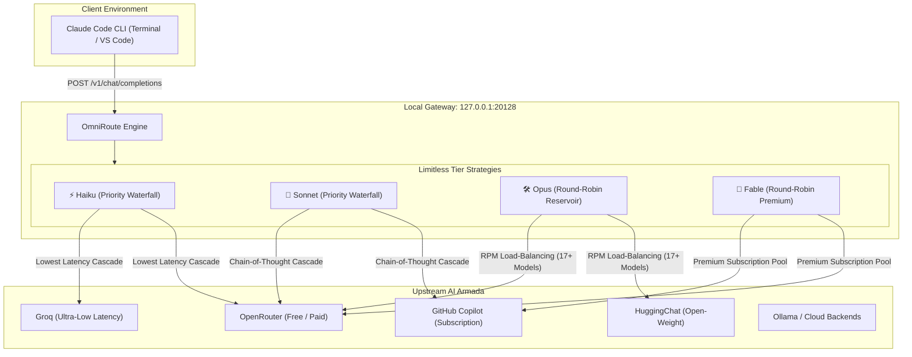
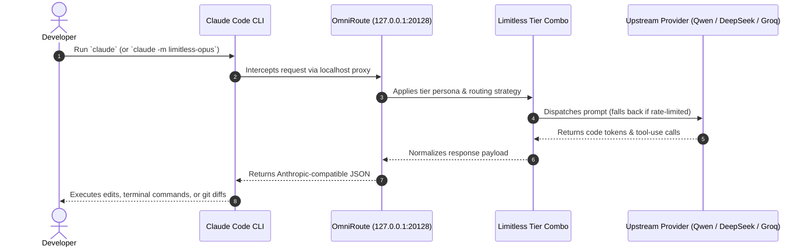

# Limitless Claude 🚀

> **Your Coding Agent. Your Model Fleet. Zero Sub Anxiety.**

Limitless Claude is an open-source, student-friendly model-routing harness designed to power **Claude Code** through **OmniRoute**. Instead of getting locked into single-vendor API bills, Limitless Claude unleashes your agentic coding workflows across a massive, flexible fleet of free, open-weight, and subscription-entitled AI models.

By unifying multiple provider accounts, dynamic model cascading, specialized tier personas, and intelligent fallback pools into a seamless local proxy, this project unlocks an **estimated theoretical aggregate capacity of up to ~28 Million tokens per day**.

```
   ┌──────────────────────────────────────────────────────────────┐
   │  CLAUDE CODE CLI  ──>  LOCAL OMNIROUTE PROXY (127.0.0.1:20128)│
   │                               │                              │
   │  ┌───────────────┬────────────┴───┬───────────────┬──────────┴───┐
   │  │ ⚡ HAIKU      │ 🧠 SONNET      │ 🛠️ OPUS       │ 👑 FABLE     │
   │  │ Speed Cascade │ Deep Reasoning │ Coding Tank   │ Subscriptions│
   │  └───────────────┴────────────────┴───────────────┴──────────────┘
   │                               │                              │
   │      ==> OpenRouter • HuggingChat • GitHub Copilot • Groq ==>   │
   └──────────────────────────────────────────────────────────────┘
```

[Architecture](#architecture) • [The Four Tiers](#the-four-tiers) • [Token Estimates](#the-token-capacity-story) • [Installation](#installation) • [Testing](#tests-and-integrity) • [Docs](docs/)

---

## Why It Hits Different

AI inference is fragmented, and official per-token API meters tick fast when you are running deep agentic loops. If you want to use Anthropic's official Claude Code CLI for building full-stack applications, single-vendor bills can quickly add up.

Meanwhile, chances are you already have access to an entire arsenal of unused AI bandwidth:
- A student GitHub Copilot subscription.
- Free HuggingChat and Groq quotas.
- OpenRouter free model endpoints.
- Cloud credits or secondary developer keys.

**Limitless Claude bridges the gap.** You authenticate your preferred providers once in OmniRoute, run our one-command setup, and start Claude Code normally. We intercept Claude Code's model requests under the hood and intelligently route them across your available model armada—giving you high-throughput, multi-agent development without the paywall stress.

---

## Architecture & Data Flow

Limitless Claude operates strictly as a local configuration harness. Claude Code's CLI sends standard API calls to OmniRoute at `127.0.0.1:20128`, which dynamically executes your tier routing policies.





For a deeper dive into the gateway semantics, read the [Architecture Documentation](docs/ARCHITECTURE.md).

---

## The Four Tiers

Limitless Claude configures four dedicated combos. When running `npm run setup`, the candidates are safely filtered against your live active providers, writing the active manifest to `config/tier-configuration.json`.

| Tier | Persona / Vibe | Strategy | Primary Focus | Models Configured |
|---|---|---|---|---|
| **⚡ Haiku** | Fast, snappy, zero filler | **Priority Waterfall** | Quick syntax lookups, fuzzy file searches, instant tool checks | 7 (Groq Llama, Gemini Flash Lite, GLM) |
| **🧠 Sonnet** | Deep systems thinker | **Priority Waterfall** | Architecture planning, complex debugging, refactors | 6 (Claude Thinking, DeepSeek Reasoner, Command R+) |
| **🛠️ Opus** | The code generation workhorse | **Round-Robin** | High-volume code writing and multi-file synthesis | 17 (Qwen 2.5 Coder Next, Codestral, DeepSeek 3.2, GLM) |
| **👑 Fable** | God-mode reasoning | **Round-Robin** | Massive context synthesis utilizing your premium subscriptions | 6 (GPT-4o, Claude Opus, Gemini Pro) |

*For exact upstream model IDs and priority rankings, explore the [Model Catalog](docs/MODEL-CATALOG.md).*

---

## Features and Compatibility

| Feature | Status | Notes |
|---|---|---|
| **Claude Code CLI** | `Manually Smoke-Tested` | Works natively for local terminal execution. |
| **Model Aliases** | `Automated-test-verified` | `limitless-opus`, `limitless-sonnet`, etc. mappings verified by isolated test suite. |
| **Tool Calling (MCP)** | `Manually Smoke-Tested` | File modifications, bash executions, and directory inspections operate normally. |
| **Multi-Agent Prompts**| `Automated-test-verified` | Persona system prompts injected cleanly into OmniRoute payloads. |
| **Background Daemon** | `Manually Smoke-Tested` | Invisible auto-restart daemon runs on Windows Startup and Linux/macOS background scripts. |
| **Plan Mode** | `Unverified` | Supported conditionally; relies on reasoning depth of active upstream model. |
| **Streaming** | `Unverified` | Dependent on individual upstream provider capabilities. |
| **Long Context** | `Unverified` | Context limits depend on the underlying third-party models. |

---

## The Token-Capacity Story

By load-balancing requests across multiple providers, Limitless Claude prevents your agent workflow from screeching to a halt on single-provider rate limits. Based on published rate limits and an assumed 1.5k–3k context window per prompt, **the theoretical estimated aggregate token capacity reaches ~28,000,000 tokens per day**.

### Modeling Assumptions & Caveats:
- **Concurrent Availability:** Assumes all configured candidates across all tiers remain available simultaneously.
- **Concurrency & RPM:** Assumes steady throughput without exceeding burst concurrency limits before daily quotas reset.
- **Input vs. Output Tokens:** Daily token volume includes both input reading and output generation; output quotas are typically stricter.
- **Modeled vs. Real-World:** Human testing, thinking time, and command approval naturally reduce actual daily consumption compared to mathematical maximums.
- **Historical OpenRouter Note:** Historical capacity estimates factored in an OpenRouter tier expansion (1,000 requests/day upon balance deposit). This behavior is documented as a theoretical assumption.

*Read the transparent methodology in [Token Capacity](docs/TOKEN-CAPACITY.md).*

---

## System Prompts and Personas

Each tier is equipped with an engineered system prompt to maximize coding performance:
- **⚡ Haiku (Speed):** Instructed to omit conversational chatter and execute tool operations immediately.
- **🧠 Sonnet (Reasoning):** Instructed to perform thorough chain-of-thought analysis and architecture checks before touching files.
- **🛠️ Opus / 👑 Fable (Coding):** Instructed to generate robust, modular code, preserve existing code integrity, and handle multi-agent handoffs cleanly.

> **Disclaimer:** Limitless Claude configures Claude Code and OmniRoute to route requests to third-party models; it does not itself supply inference or guarantee native Anthropic model parity. Internal tier labels represent routing profiles, not official Anthropic models.

---

## Supported Providers

We tap into a diverse ecosystem across three categories:
- **Zero-Marginal-Cost:** OpenRouter (`:free` endpoints), HuggingChat, Groq, Ollama Cloud, Muse Spark.
- **Subscription-Entitled:** GitHub Copilot, Antigravity, BluesMinds, Kiro.
- **Paid Inference:** Mistral, OpenRouter (Pay-as-you-go).

*See the complete connection guide in [Providers](docs/PROVIDERS.md).*

---

## Installation & Quickstart

### Prerequisites
- **Node.js** v22 or later
- **npm** (included with Node.js)
- **Claude Code CLI** (`npm install -g @anthropic-ai/claude-code`)

---

### Step 1: Install & Start OmniRoute
```bash
npm install -g omniroute@latest
omniroute serve
```
*Leave this terminal running during initial setup.*

### Step 2: Authenticate Your Providers
Open your browser to:
```
http://localhost:20128
```
Navigate to **Providers** and connect whichever free, open-source, or subscription accounts you have available (e.g. OpenRouter, GitHub Copilot, Groq).

### Step 3: Setup Limitless Tiers
Clone the repository and run the setup script:
```bash
git clone https://github.com/mahik504/limitless-claude.git
cd limitless-claude
npm install
npm run setup
```

**What the setup script does:**
1. Connects to your local OmniRoute SQLite database (`~/.omniroute/storage.sqlite`).
2. Creates an automatic backup (`storage.sqlite.bak`).
3. Discovers your active providers and injects the 4 optimized Limitless combos.
4. Generates an active configuration snapshot at `config/tier-configuration.json`.
5. **Auto-Recovery Daemon:** On Windows, installs an invisible background auto-restart script in your Windows Startup folder (`Limitless-OmniRoute-Launcher.vbs`) so OmniRoute is always available without manual terminal management. (On Linux/macOS, use `./start-daemon.sh`).

### Step 4: Code!
Run Claude Code directly in any project:
```bash
claude
```
Or target a specific tier combo:
```bash
claude -m limitless-opus
claude -m limitless-sonnet
claude -m limitless-haiku
```

---

## Tests and Integrity

We use Node's native test runner (`node:test`) to run isolated, deterministic checks without ever touching or risking your live database during CI:

```bash
npm test
```

### What gets verified:
- **Idempotent DB Transactions:** Safe atomic transactions that cleanly roll back if interrupted.
- **Payload & Array Structure:** Guards against regressions in `models` arrays and routing strategies (`priority` vs `round-robin`).
- **Prompt Safety:** Verifies system prompts contain functional coding instructions and no fabricated identities.
- **Isolated Side Effects:** Tests write to temporary mock paths, ensuring no pollution of your actual startup directory or configurations.

*Read more in [Testing](docs/TESTING.md).*

---

## Rollback & Recovery

- **Database Rollback:** If needed, your previous OmniRoute database is preserved at `~/.omniroute/storage.sqlite.bak`.
- **Remove Windows Startup Daemon:** Simply delete `Limitless-OmniRoute-Launcher.vbs` from:
  `%APPDATA%\Microsoft\Windows\Start Menu\Programs\Startup`

---

## License

MIT © [Mahaveer Singh Gehlot](https://github.com/mahik504)
