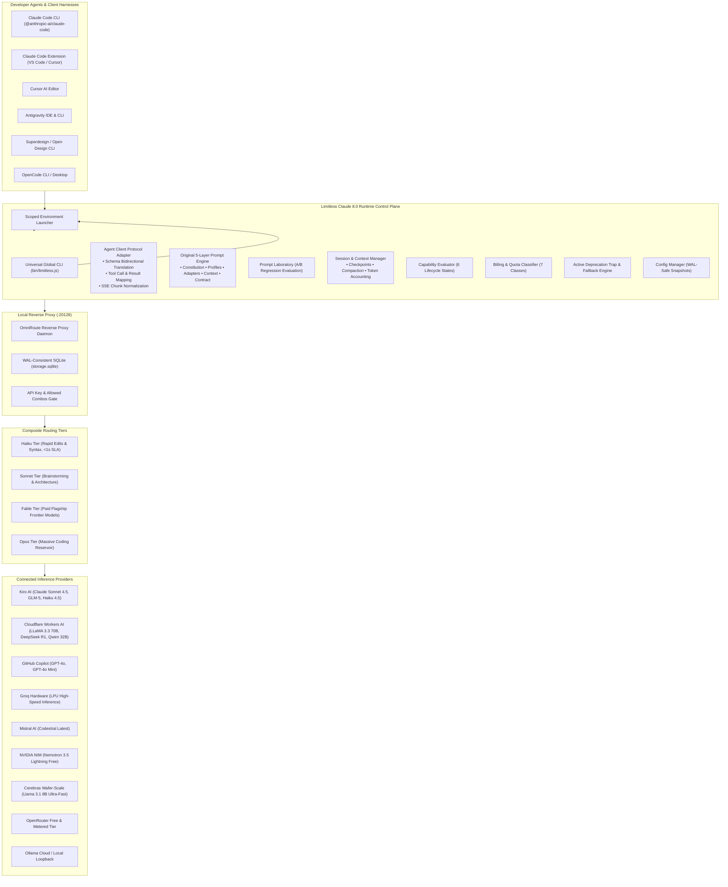
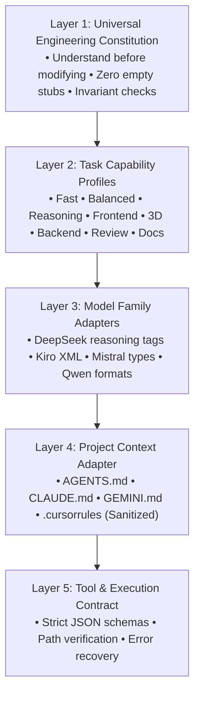
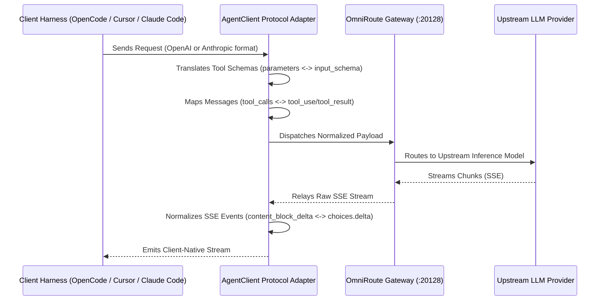

# Limitless Claude 8.0 — Autonomous Multi-Provider Coding Agent Runtime

[](package.json)
[](package.json)
[](https://github.com/mahik504/limitless-claude/actions/workflows/test.yml)
[](LICENSE)
[](test/)
[](scripts/e2e-acceptance.js)
[](scripts/doctor.js)

**Limitless Claude 8.0** is an open, provider-neutral, high-performance coding agent runtime designed to liberate developers from proprietary vendor lock-in. It delivers intelligent multi-model routing, bidirectional protocol adaptation (Anthropic Messages API <-> OpenAI Chat API), automated fallback chains, an original 5-layer prompt engine, session state persistence, fine-grained quota intelligence, and zero-registry configuration isolation for **Claude Code CLI**, **Cursor IDE**, **Antigravity IDE**, **Superdesign**, and **OpenCode**.

---

## Highlights & Core Capabilities

- **Standalone First Architecture (Mode A vs Mode B):**
  - **Mode A (Standalone):** Runs 100% autonomously out of the box. Zero imports or dependencies on external frameworks (Orchestra, private Brains, or host registries). Natively reads standard project rules (`AGENTS.md`, `CLAUDE.md`, `GEMINI.md`, `.cursorrules`).
  - **Mode B (Optional Orchestra Interoperability):** Clean, loose contract adapter in `src/integrations/orchestra/` that consumes public tasks and constraints without creating a second conductor.
- **Original 5-Layer Prompt Engine (`src/core/prompt-engine.js`):**
  - **Layer 1: Universal Engineering Constitution:** Understand before modifying, surgical minimal diffs, anti-slop zero stubs (`// TODO`), and verification before assertion.
  - **Layer 2: Task-Specific Capability Profiles:** Fast, Balanced, Reasoning, Frontend (React 19), 3D (Three.js/R3F), Backend (PostgreSQL RLS), Hostile Review, and Documentation.
  - **Layer 3: Upstream Model Adapters:** DeepSeek reasoning `<think>` blocks, Kiro XML structures, Mistral types, and Qwen schemas.
  - **Layer 4: Project Context Adapter:** Auto-discovers and sanitizes repository rule files with prompt injection defense.
  - **Layer 5: Tool & Execution Contract:** Strict JSON parameter compliance and filesystem safety.
- **Bidirectional Protocol & Tool Translation (`src/core/agent-client.js`):** Complete schema mapping between Anthropic Messages API (`input_schema`, `tool_use`, `tool_result`) and OpenAI Chat API (`parameters`, `tool_calls`, `role: 'tool'`), with streaming SSE chunk normalization.
- **Truth-in-Model Intelligence & Formal Lifecycles:**
  - 6 lifecycle states (`DISCOVERED`, `ESTIMATED`, `SMOKE_TESTED`, `TOOL_TESTED`, `BENCHMARKED`, `PRODUCTION_APPROVED`).
  - Zero fabricated benchmark scores from name regexes. Heuristic priors are strictly isolated from empirical evidence.
- **Fine-Grained Billing & Quota Safety:**
  - 7 billing classes (`provider_free_quota`, `subscription-entitled`, `promotional`, `paid-token`, `pay-as-you-go`, `local`, `unknown`).
  - Unknown costs return `unknown` (never `$0.00`). Free-only mode strictly excludes unmetered commercial endpoints.
  - Verified OpenRouter credit policy ($10 credit unlocks 1,000 req/day on `:free` models) with concrete token capacity calculators.
- **Context & Session Intelligence:** Multi-turn session tracking, atomic turn checkpoints, and sliding-window compaction preserving essential tool state while pruning verbose command output.
- **Universal Global CLI (`limitless`):** 18 specialized commands including `doctor`, `init`, `status`, `verify`, `discover`, `models`, `providers`, `budget`, `prompt`, `benchmark`, `acceptance`, `rollback`, and `launcher`.
- **Database Safety & WAL Rollback:** Atomic SQLite snapshot backups using clean WAL checkpoints (`VACUUM INTO`) via `src/omniroute/db.js`.

---

## Table of Contents

1. [Architecture & System Overview](#1-architecture--system-overview)
2. [Operating Modes: Standalone vs Orchestra](#2-operating-modes-standalone-vs-orchestra)
3. [Original 5-Layer Prompt Engine](#3-original-5-layer-prompt-engine)
4. [Composite Model Tiers & Quota Taxonomy](#4-composite-model-tiers--quota-taxonomy)
5. [Universal Global CLI Reference](#5-universal-global-cli-reference)
6. [Master Agent Prompts (New Setup & Update/Repair)](#6-master-agent-prompts-new-setup--updaterepair)
   - [Prompt 1: Clean Installation Master Prompt (New Setup)](#prompt-1-clean-installation-master-prompt-new-setup)
   - [Prompt 2: Repair, Update & Re-Sync Master Prompt (Broken or Existing Setup)](#prompt-2-repair-update--re-sync-master-prompt-broken-or-existing-setup)
7. [Agent Client Protocol & Tool Translation](#7-agent-client-protocol--tool-translation)
8. [Token Capacity & OpenRouter Quota Intelligence](#8-token-capacity--openrouter-quota-intelligence)
9. [Prompt Laboratory & A/B Benchmarking](#9-prompt-laboratory--ab-benchmarking)
10. [Session Continuity & Context Compaction](#10-session-continuity--context-compaction)
11. [Disaster Recovery, Snapshots & Rollback](#11-disaster-recovery-snapshots--rollback)
12. [Verification Suites & Production Readiness](#12-verification-suites--production-readiness)
13. [Contributing & License](#13-contributing--license)

---

## 1. Architecture & System Overview



---

## 2. Operating Modes: Standalone vs Orchestra

Limitless Claude is engineered from the ground up as a **Standalone-First** runtime:

### Mode A: Standalone Mode (Default & Primary)
- Functions completely out of the box without any external orchestrator.
- Automatically discovers standard project configuration files:
  - `AGENTS.md`
  - `CLAUDE.md`
  - `GEMINI.md`
  - `.cursorrules`
- Core runtime modules in `src/core/*` strictly contain **zero imports** from Orchestra.
- Full capability evaluation, billing safety, prompt engineering, session persistence, and CLI operations run independently.

### Mode B: Orchestra Interoperability (Optional Extension)
- Encapsulated cleanly within `src/integrations/orchestra/adapter.js`.
- Consumes public contracts (task capability requirements, model profile selections, project constraints) as a loose external consumer.
- If Orchestra is absent or disabled, the adapter gracefully falls back to Mode A without throwing errors or halting execution.
- Does **not** create a second conductor; Orchestra handles workflow coordination while Limitless manages model routing and protocol execution.

---

## 3. Original 5-Layer Prompt Engine

Limitless Claude avoids static monolithic prompts. It dynamically composes system prompts across five orthogonal layers (`src/core/prompt-engine.js`):



### Layer Details:
1. **Universal Constitution (`prompts/universal/constitution.md`):** Core anti-slop rules, minimal surgical edits, and empirical verification before completion.
2. **Capability Profiles (`prompts/capabilities/`):** Dedicated task profiles for `fast`, `balanced`, `reasoning`, `frontend` (React 19), `3d` (Three.js/R3F), `backend` (PostgreSQL RLS), `review` (hostile vulnerability triage), and `documentation`.
3. **Provider Adapters (`prompts/providers/`):** Tailored syntax handling (e.g. DeepSeek `<think>` reasoning tags, Kiro XML tags, Mistral typed signatures).
4. **Project Context (`prompts/context/`):** Auto-discovers workspace instructions with delimiter escaping and prompt injection defenses (`<<<PROJECT_CONTEXT_START>>>`).
5. **Tool Contract (`prompts/contracts/standard-contract.md`):** Enforces exact argument types, boundary checking, and actionable error reporting.

---

## 4. Composite Model Tiers & Quota Taxonomy

Limitless Claude organizes upstream models into 4 composite tiers inside OmniRoute:

| Composite Tier | Purpose & SLA | Primary Upstream Candidates | Billing Classes |
| :--- | :--- | :--- | :--- |
| **Haiku Tier** (`limitless-haiku-4.5`) | Sub-second rapid edits, AST checks, atomic fixes | Kiro Claude Haiku 4.5, Cloudflare LLaMA 3.3 70B, GitHub GPT-4o Mini, Groq LPU | `provider_free_quota`, `subscription-entitled` |
| **Sonnet Tier** (`limitless-sonnet-5.5`) | Brainstorming, system architecture, deep reasoning | Kiro Claude Sonnet 4.5, Cloudflare DeepSeek R1, GitHub GPT-4o, GLM-5 | `subscription-entitled`, `provider_free_quota` |
| **Fable Tier** (`limitless-fable-reasoning`) | Flagship frontier intelligence & multi-agent routing | GitHub GPT-4o, Kiro DeepSeek 3.2, Mistral Codestral | `subscription-entitled`, `paid-token` |
| **Opus Tier** (`limitless-opus-4.6`) | Heavy autonomous coding loops & fullstack development | 23-model massive reservoir across all connected providers | `provider_free_quota`, `subscription-entitled`, `paid-token` |

### Billing Taxonomy
- **`provider_free_quota`:** Vendor-provided free quota with rate limits (Groq, Cloudflare Workers AI, Cerebras, NVIDIA NIM).
- **`subscription-entitled`:** Flat monthly subscription covering inference without per-token charges (GitHub Copilot, Kiro AI).
- **`paid-token`:** Metered per-token commercial APIs (Mistral, OpenAI, Anthropic, OpenRouter paid).
- **`local`:** Self-hosted zero-cost inference (Ollama, vLLM).
- **`unknown`:** Unverified pricing. Returns `null` cost and is strictly excluded in free-only mode.

---

## 5. Universal Global CLI Reference

The `limitless` CLI is installed globally and accessible from any working directory:

```bash
# Core Operations
limitless init               # Run zero-config onboarding & pre-setup validation
limitless doctor             # Run 15-point system, gateway, and database diagnostics
limitless status             # Display active profile, gateway URL, and routing tiers
limitless verify             # Test live HTTP 200 connectivity across all 4 tiers
limitless setup              # Sync live OmniRoute models into composite tiers
limitless launcher           # Launch Claude Code under scoped profile (no registry pollution)

# Model & Provider Intelligence
limitless discover           # Scan and catalog live models and providers
limitless models list        # List catalogued models (--free-only, --profile <name>)
limitless models inspect <id># Inspect detailed capability profile of a specific model
limitless providers list     # List connected providers, states, and billing taxonomy
limitless providers test     # Test live gateway ping latency to inference endpoints

# Prompt Engineering & Budget
limitless prompt list        # List available 5-layer capability profiles & adapters
limitless prompt compose     # Compose full 5-layer prompt with hash & section preview
limitless prompt test        # Run Prompt Laboratory fixture regression suite
limitless budget             # View spend controls & OpenRouter token capacity calculator

# Benchmarks & Resilience
limitless benchmark          # Run 12-task standardized capability benchmark
limitless acceptance         # Run 6-test End-to-End production acceptance suite
limitless dashboard          # Open real-time terminal observability dashboard
limitless rollback --list    # List available atomic database snapshots
limitless rollback --latest  # Restore most recent database snapshot
```

---

## 6. Master Agent Prompts (New Setup & Update/Repair)

Use these production-grade master agent prompts to install or repair Limitless Claude in any AI agent (Google Antigravity, Cursor, or OpenCode).

### Prompt 1: Clean Installation Master Prompt (New Setup)

```text
You are the Lead Systems Infrastructure Engineer configuring a fresh, production-grade installation of Limitless Claude 8.0 on this machine.

Execute the following sequential installation workflow cleanly without skipping steps or fabricating output:

1. WORKSPACE & REPOSITORY CLONE:
   - Check if the repository exists at C:\projects\limitless-claude (or clone from https://github.com/mahik504/limitless-claude.git).
   - Verify Node.js version is >= 22 (node -v). Run `npm install` inside the project root.

2. RUN SYSTEM DIAGNOSTICS:
   - Execute `node bin/limitless.js doctor`.
   - Verify that all 15 diagnostic checkpoints pass: Node version, platform architecture, SQLite integrity, API key permissions, gateway reachability (:20128), model catalog, composite routing tiers, capability governance, and billing guards.
   - If OmniRoute gateway is not running, launch the background daemon via `omniroute-daemon.bat` or `npm run launcher`.

3. MODEL & PROVIDER DISCOVERY:
   - Run `node bin/limitless.js discover` to scan live providers (Groq, Cloudflare AI, Kiro, Mistral, NVIDIA NIM, Cerebras, OpenRouter, GitHub Copilot).
   - Confirm that `config/provider-inventory.json` and `config/model-inventory.json` are written with formal lifecycle states (DISCOVERED / PRODUCTION_APPROVED) and accurate billing classifications.

4. COMPOSITE ROUTING SETUP:
   - Execute `node bin/limitless.js setup` to synchronize intelligent multi-model composite tiers into OmniRoute SQLite:
     * Haiku Tier: 5-6 sub-second rapid models for AST syntax verification and atomic edits.
     * Sonnet Tier: 5-6 premier brainstorming, system design, and architectural reasoning models.
     * Opus Tier: 23-model massive reservoir across all connected providers for heavy autonomous coding loops.
     * Fable Tier: Paid flagship frontier reasoning models.
   - Inject the 5-layer Universal Engineering Constitution into combos.system_message.

5. VERIFICATION & ACCEPTANCE GATES:
   - Run `node bin/limitless.js verify` to confirm HTTP 200 connectivity across all 4 tiers.
   - Run `node bin/limitless.js acceptance` to execute the 6-test End-to-End production acceptance suite.
   - Run `npm test` to confirm all unit and contract tests pass.

6. FINAL STATUS & LAUNCHER:
   - Run `node bin/limitless.js status` to display the active configuration overview.
   - Provide the user with the command `limitless launcher` to begin their coding agent session.
```

---

### Prompt 2: Repair, Update & Re-Sync Master Prompt (Broken or Existing Setup)

```text
You are the Principal AI Infrastructure Recovery Engineer repairing, updating, or re-synchronizing an existing Limitless Claude installation.

Execute this surgical repair and migration protocol to resolve any flaws, broken models, or stale configurations:

1. ATOMIC BACKUP & SNAPSHOT:
   - Run `node bin/limitless.js rollback --create pre-repair` to capture a WAL-safe SQLite and configuration snapshot before making changes.
   - Preserve existing API keys, provider configurations, and user credentials.

2. GATEWAY & SCHEMA REPAIR:
   - Verify OmniRoute database at ~/.omniroute/storage.sqlite is accessible and healthy.
   - Check API key permissions using `node bin/limitless.js doctor`. If the active key is in restricted mode, ensure all 4 composite tiers are authorized in allowed_combos.
   - Eliminate any deprecated endpoints (such as obsolete Antigravity 2.29 version strings) from primary positions.

3. CATALOG RE-DISCOVERY & LIFECYCLE RE-CLASSIFICATION:
   - Run `node bin/limitless.js discover` to fetch live endpoints from the local gateway.
   - Re-classify uncatalogued models into formal lifecycle states (ESTIMATED, SMOKE_TESTED, PRODUCTION_APPROVED).
   - Ensure unknown model pricing returns null, never $0.00, preventing accidental chargeable invocations.

4. TIER RE-SYNCHRONIZATION:
   - Run `node bin/limitless.js setup` to re-populate Haiku, Sonnet, Opus, and Fable tiers with verified active endpoints.
   - Re-inject the updated 5-layer Universal Engineering Constitution into combos.system_message.

5. VERIFICATION & RECOVERY CONFIRMATION:
   - Execute `node bin/limitless.js verify` to prove live HTTP 200 connectivity on all 4 tiers.
   - Execute `node bin/limitless.js prompt test` to verify Prompt Laboratory fixtures pass.
   - Execute `npm test` to verify all test suites are green.
   - Print `limitless status` and confirm the repair is fully verified.
```

---

## 7. Agent Client Protocol & Tool Translation

Limitless Claude provides complete bidirectional protocol translation across client harnesses:



---

## 8. Token Capacity & OpenRouter Quota Intelligence

### OpenRouter Verified Credit Policy (November 2026)
- **Unfunded Accounts:** Capped at **50 requests per day** on `:free` models.
- **Funded Accounts (\$10.00 USD Credit Deposit):** Unlocks **1,000 requests per day** on `:free` models without consuming the \$10 deposit on free endpoints.
- **Disclaimers:** Calculations represent theoretical daily throughput bounds. Actual delivery depends on upstream model concurrency and rate limits.

### Daily Throughput Reference Table

| Workload Profile | Tokens / Req | 50 Req/Day (Unfunded) | 1,000 Req/Day (\$10 Deposit) |
| :--- | :---: | :---: | :---: |
| **Micro-Patch / Syntax** (1k in / 1k out) | 2,000 | **0.10M tokens/day** | **2.00M tokens/day** |
| **Standard Feature / Unit Test** (4k in / 1k out) | 5,000 | **0.25M tokens/day** | **5.00M tokens/day** |
| **Full Architecture / Backend RLS** (10k in / 2k out) | 12,000 | **0.60M tokens/day** | **12.00M tokens/day** |

*Access live in CLI:* `limitless budget` or inspect [`docs/TOKEN-CAPACITY.md`](docs/TOKEN-CAPACITY.md).

---

## 9. Prompt Laboratory & A/B Benchmarking

The Prompt Laboratory (`src/core/prompt-lab.js`) provides fixture-based regression testing for prompt engineering:
- Evaluates prompt variants against standard fixtures: syntax repair, PostgreSQL RLS, Three.js `.dispose()` cleanup, and hostile secret leak review.
- Tracks average score, pass rate, latency, and token efficiency.
- Automatically halts deployment if regressions are detected.

*Run in CLI:* `limitless prompt test` or inspect [`docs/PROMPT-LAB-REPORT.md`](docs/PROMPT-LAB-REPORT.md).

---

## 10. Session Continuity & Context Compaction

- **Session Checkpoints (`src/core/session-manager.js`):** Creates in-memory checkpoints at critical conversation turns. If an agent turn encounters an unrecoverable failure, the session state rolls back instantaneously.
- **Sliding-Window Compaction (`src/core/context-manager.js`):** Monitors token accumulation. When context approaches model limits (default 80%), it automatically compresses verbose command output and redundant logs while preserving active goals, edited file paths, and unresolved errors.

---

## 11. Disaster Recovery, Snapshots & Rollback

Limitless Claude enforces atomic configuration transitions:
- Pre-switch snapshots are created automatically before profile transitions or tier modifications.
- SQLite backups execute WAL-safe transactions (`VACUUM INTO` or atomic checkpoints via `src/omniroute/db.js`), preventing database corruption.
- Instant rollback:
  ```bash
  limitless rollback --list      # View snapshots
  limitless rollback --latest    # Restore previous snapshot
  ```

---

## 12. Verification Suites & Production Readiness

Every release of Limitless Claude is validated through rigorous automated gates:

```text
Unit & Contract Test Suite (`npm test`)        : 100% Pass (82/82 tests passed)
System Diagnostic Doctor (`limitless doctor`)   : 100% Pass (15/15 checks healthy)
Tier Connectivity Verification (`limitless verify`): 100% Pass (4/4 tiers HTTP 200 OK)
End-to-End Acceptance (`limitless acceptance`)  : 100% Pass (6/6 acceptance tests passed)
Prompt Laboratory Fixtures (`limitless prompt test`): 100% Pass (4/4 fixtures satisfied)
```

---

## 13. Contributing & License

Contributions are welcome! Please run `npm test` and `node bin/limitless.js doctor` before submitting pull requests.

Distributed under the **MIT License**. See [`LICENSE`](LICENSE) for details.
