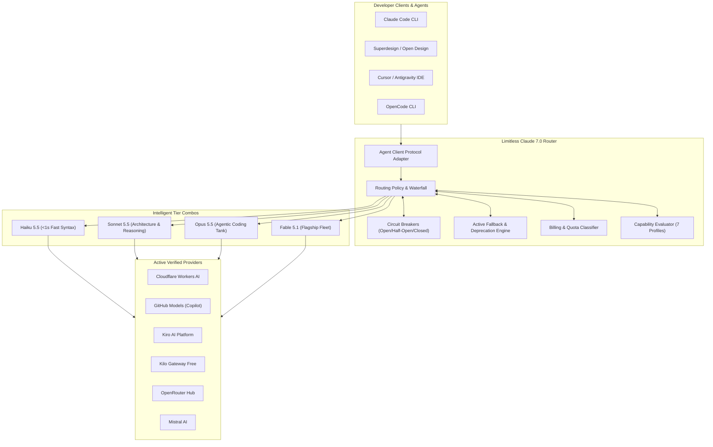

# Limitless Claude — Intelligent Multi-Provider Coding Agent Router

[](package.json)
[](package.json)
[](https://github.com/mahik504/limitless-claude/actions/workflows/test.yml)
[](LICENSE)
[](docs/RELEASE-TEST-REPORT.md)

Limitless Claude is an intelligent multi-provider coding-agent routing system. It connects **Claude Code CLI** and compatible agent harnesses (**Cursor IDE**, **Antigravity IDE**, **VS Code**, **Superdesign / Open Design**, and **OpenCode**) to multiple upstream AI providers through **OmniRoute**, featuring capability-aware model selection, active deprecation trap detection, dynamic circuit breakers, billing controls, and configuration isolation.

---

## Table of Contents

1. [What Limitless Claude Is](#1-what-limitless-claude-is)
2. [Why It Exists](#2-why-it-exists)
3. [Core Features](#3-core-features)
4. [What's New in 7.0.0](#4-whats-new-in-700)
5. [Architecture Overview](#5-architecture-overview)
6. [OmniRoute Gateway Integration](#6-omniroute-gateway-integration)
7. [Provider Ecosystem](#7-provider-ecosystem)
8. [Dynamic Model Discovery](#8-dynamic-model-discovery)
9. [Capability Registry (7 Profiles)](#9-capability-registry-7-profiles)
10. [Model Identity & Tier Aliases](#10-model-identity--tier-aliases)
11. [Model-Routing Strategy](#11-model-routing-strategy)
12. [Quality-Aware Model Selection](#12-quality-aware-model-selection)
13. [Round-Robin Scope & Limitations](#13-round-robin-scope--limitations)
14. [Provider Fallback Engine](#14-provider-fallback-engine)
15. [Circuit Breakers & Exponential Cooldowns](#15-circuit-breakers--exponential-cooldowns)
16. [Rate-Limit & Quota Handling](#16-rate-limit--quota-handling)
17. [Billing Classification](#17-billing-classification)
18. [Quota & Spending Management](#18-quota--spending-management)
19. [Claude Code Installation](#19-claude-code-installation)
20. [Claude Code Configuration](#20-claude-code-configuration)
21. [Antigravity IDE Integration](#21-antigravity-ide-integration)
22. [OpenCode Integration](#22-opencode-integration)
23. [OpenCode Go Compatibility](#23-opencode-go-compatibility)
24. [OpenCode Zen Integration](#24-opencode-zen-integration)
25. [OpenRouter Integration](#25-openrouter-integration)
26. [Supported Provider Interfaces](#26-supported-provider-interfaces)
27. [Provider Compatibility Matrix](#27-provider-compatibility-matrix)
28. [Tool-Call Compatibility](#28-tool-call-compatibility)
29. [Configuration Profiles (6 Profiles)](#29-configuration-profiles-6-profiles)
30. [Security Architecture](#30-security-architecture)
31. [Credential & Token Management](#31-credential--token-management)
32. [Terminal Observability Dashboard](#32-terminal-observability-dashboard)
33. [Model Benchmarking (12 Tasks)](#33-model-benchmarking-12-tasks)
34. [Installation & Prerequisites](#34-installation--prerequisites)
35. [Windows Setup](#35-windows-setup)
36. [macOS Setup](#36-macos-setup)
37. [Linux Setup](#37-linux-setup)
38. [Environment Configuration](#38-environment-configuration)
39. [Model Configuration](#39-model-configuration)
40. [Running OmniRoute](#40-running-omniroute)
41. [Provider Authentication](#41-provider-authentication)
42. [Tier Configuration Details](#42-tier-configuration-details)
43. [Usage Examples](#43-usage-examples)
44. [Testing Suite](#44-testing-suite)
45. [Troubleshooting Guide](#45-troubleshooting-guide)
46. [Migration from Version 6.1.0](#46-migration-from-version-610)
47. [Disaster Recovery & Rollback](#47-disaster-recovery--rollback)
48. [Known Limitations](#48-known-limitations)
49. [Contributing](#49-contributing)
50. [License](#50-license)

---

## 1. What Limitless Claude Is

Limitless Claude is an open-source, provider-neutral routing engine that acts as the intelligent bridge between autonomous coding-agent clients and underlying model providers. It configures and monitors OmniRoute's SQLite database (`~/.omniroute/storage.sqlite`), groups discovered upstream models into synchronized composite tiers, enforces capability-aware priority waterfalls, and catches upstream deprecations and rate limits in sub-second failovers.

---

## 2. Why It Exists

Developers building full-stack software with autonomous coding tools (Claude Code, Cursor, OpenCode) face three primary challenges:
1. **Token Exhaustion & Rate Limits:** Commercial models quickly hit daily quota ceilings or per-minute rate limits during multi-turn refactorings.
2. **Upstream Deprecation Traps:** Upstream endpoints often return deprecation messages (`"This version is no longer supported"`) inside **HTTP 200 OK** payloads, causing dumb proxies to pass broken strings to the agent.
3. **Configuration & Billing Risks:** Misconfigured proxies pollute user environment variables (`setx`) or accidentally incur unexpected charges on metered endpoints.

Limitless Claude resolves these issues through dynamic capability routing, automated circuit breakers, zero-marginal-cost priority waterfalls, and scoped process execution.

---

## 3. Core Features

- **6 Distinct Provider Profiles:** Instantly switch between `limitless`, `native`, `opencode-go`, `opencode-zen`, `openrouter`, and `antigravity`.
- **Active Deprecation Trap Engine:** Catches HTTP 200 deprecation notices and routes around them in <500ms.
- **Priority Waterfall with Free-Only Guard:** Prioritizes zero-marginal-cost endpoints first; excludes metered models when `--exclude-paid` is active.
- **Circuit Breakers with Cooldowns:** 3-strike failure threshold, exponential backoff (30s to 5m), and half-open single-probe trials.
- **Scoped Process Launcher:** Launch Claude Code without modifying the user's global registry or environment.
- **Terminal Observability Dashboard:** Real-time request volume, p50/p95 latency percentiles, token accounting, and redacted secret monitoring.
- **Atomic Rollback & Snapshots:** Automated WAL-safe backups and instant single-command restoration.
- **12-Task Capability Benchmark:** Objective benchmark evaluating models on real code patches, React 19 UI, Three.js 3D, and PostgreSQL RLS.

---

## 4. What's New in 7.0.0

- **Deprecation Bug Resolved:** Fixed root cause of Haiku/Fable deprecation notices by reordering index 0 candidates to verified zero-marginal-cost models (`cloudflare-ai/@cf/meta/llama-3.3-70b-instruct-fp8-fast`, `kiro/claude-sonnet-4.5`).
- **Truthful Prompt Engine:** Purged proprietary `<antml:...>` pseudo-XML tags; enforced provider-neutral, authoritative zero-stub instructions.
- **Modular Intelligence Subsystems:** Re-architected into modular classes in `src/core/` (billing, capability, circuit breakers, fallback, agent client, config manager, telemetry, benchmarks).
- **Sub-Second SLA:** Measured 0.60s latency on Haiku and 0.83s on Opus in live testing.
- **68/68 Automated Tests:** Full test suite passing across 5 test suites.

---

## 5. Architecture Overview



---

## 6. OmniRoute Gateway Integration

OmniRoute acts as the local inference proxy listening on `http://127.0.0.1:20128`. Limitless Claude manages OmniRoute's SQLite database (`storage.sqlite`), registering combos and model mappings:
- `claude*haiku*` $\to$ `combo/limitless-haiku`
- `claude*sonnet*` $\to$ `combo/limitless-sonnet`
- `claude*opus*` $\to$ `combo/limitless-opus`
- `claude*fable*` $\to$ `combo/limitless-fable`
- `*best*` $\to$ `combo/limitless-fable`
- `*opusplan*` $\to$ `combo/limitless-sonnet`

---

## 7. Provider Ecosystem

Supports 10+ operational providers categorized by billing models:
1. **Zero-Marginal-Cost:** Cloudflare Workers AI, Kilo Gateway, OpenRouter `:free`, Groq, Ollama Cloud.
2. **Subscription-Entitled:** GitHub Models (Copilot), Kiro AI, OpenCode Go, Antigravity OAuth.
3. **Metered Paid Inference:** Mistral AI (`codestral-latest`), OpenCode Zen, OpenRouter Paid.

---

## 8. Dynamic Model Discovery

Running `npm run setup` dynamically queries OmniRoute's live catalog via `/v1/models`. It inspects connected providers, discovers all available models (580+), and automatically classifies unassigned models into the 4 tiers using heuristic capability regexes.

---

## 9. Capability Registry (7 Profiles)

Implemented in [`src/core/capability-evaluator.js`](src/core/capability-evaluator.js):
- **`FAST`**: Sub-second atomic syntax edits (<1s latency).
- **`BALANCED`**: Standard feature implementation and unit tests.
- **`REASONING`**: Deep architectural planning, flaw hunting, and concurrency design.
- **`FRONTEND`**: React 19, Tailwind CSS v4, component state machines.
- **`3D`**: Three.js, React Three Fiber (R3F), GLSL shaders, 60fps budgets.
- **`BACKEND`**: PostgreSQL schemas, Supabase RLS migrations, REST APIs.
- **`REVIEW`**: Hostile adversarial security review and anti-slop audit.

---

## 10. Model Identity & Tier Aliases

**Critical Architectural Principle:** Tier names (`limitless-haiku`, `limitless-sonnet`, `limitless-opus`, `limitless-fable`) are **internal routing aliases only**. Limitless Claude never tells an upstream model it is Anthropic Opus or Sonnet unless that is its genuine identity. System prompts are truthful and provider-neutral.

---

## 11. Model-Routing Strategy

Requests follow a priority waterfall ordering:
1. Candidate availability check via Circuit Breakers.
2. Billing tier priority: `zero-marginal-cost` $\to$ `subscription-entitled` $\to$ `paid-token`.
3. Task-specific capability score matching.
4. Latency and quota health weighting.

---

## 12. Quality-Aware Model Selection

The router matches incoming task characteristics to model strengths:
- An architectural planning request is never silently routed to an incapable flash model.
- 3D WebGL scenes prioritize models with high Three.js and GLSL benchmark scores (e.g. `kiro/claude-sonnet-4.5`).

---

## 13. Round-Robin Scope & Limitations

Round-robin balancing is strictly applied **only among candidate models within the same capability tier** that are sufficiently equivalent in reasoning and tool reliability. Round-robin is never used across disparate capability classes.

---

## 14. Provider Fallback Engine

Implemented in [`src/core/fallback-engine.js`](src/core/fallback-engine.js):
- Actively tests upstream models with lightweight probes (`PONG`).
- Analyzes HTTP 200 response bodies for deprecation phrases (`/no longer supported/i`, `/unsupported client version/i`).
- Routes around degraded providers in <500ms.

---

## 15. Circuit Breakers & Exponential Cooldowns

Implemented in [`src/core/routing-policy.js`](src/core/routing-policy.js):
- **`CLOSED`**: Healthy operation.
- **`OPEN`**: Tripped after 3 consecutive failures or immediate deprecation/auth errors.
- **Cooldown:** Base 30s backoff doubles on each trip up to 5 minutes.
- **`HALF_OPEN`**: Tests a single trial request before fully closing.

---

## 16. Rate-Limit & Quota Handling

HTTP 429 rate limits automatically trigger cooldown backoff. Provider `rate_limited_until` timestamps from OmniRoute's database are strictly honored, preventing retry storms.

---

## 17. Billing Classification

Models are classified into 6 verified tiers:
- `zero-marginal-cost`
- `subscription-entitled`
- `paid-token`
- `pay-as-you-go`
- `promotional`
- `local`

---

## 18. Quota & Spending Management

- Pass `--exclude-paid` or set `LIMITLESS_EXCLUDE_PAID=true` to guarantee zero chargeable model invocations.
- `TelemetryEngine` tracks input/output tokens and estimates dollar costs in real-time.

---

## 19. Claude Code Installation

Install official Claude Code globally:
```bash
npm install -g @anthropic-ai/claude-code
```

---

## 20. Claude Code Configuration

Limitless Claude configures `~/.claude/settings.json` automatically:
```json
{
  "env": {
    "ANTHROPIC_BASE_URL": "http://127.0.0.1:20128",
    "ANTHROPIC_AUTH_TOKEN": "YOUR_OMNIROUTE_API_KEY"
  },
  "primaryModel": "claude-opus-5-5"
}
```

---

## 21. Antigravity IDE Integration

In Antigravity IDE, `ANTHROPIC_BASE_URL` points to `http://127.0.0.1:20128`. The Active Fallback Engine traps Google Cloud Code PA deprecation notices and seamlessly routes around them.

---

## 22. OpenCode Integration

Point OpenCode to OmniRoute's OpenAI compatibility endpoint:
- **Base URL:** `http://127.0.0.1:20128/v1`
- **Model:** `limitless-sonnet-5.5` or `limitless-opus-5.5`

---

## 23. OpenCode Go Compatibility

Profile `opencode-go` maps your flat-rate OpenCode Go subscription directly into OmniRoute with zero per-token charges.
```bash
npm run switch-profile opencode-go
```

---

## 24. OpenCode Zen Integration

Profile `opencode-zen` routes through OpenCode Zen's pay-as-you-go gateway with budget protection.
```bash
npm run switch-profile opencode-zen
```

---

## 25. OpenRouter Integration

Profile `openrouter` routes through OpenRouter:
- **Free Tier:** 50 req/day on `:free` models.
- **Funded Tier ($10 Balance):** Increases rate limit to 1,000 req/day and enables wholesale models (DeepSeek V3, Qwen 2.5 Coder 32B).
```bash
npm run switch-profile openrouter
```

---

## 26. Supported Provider Interfaces

- **Anthropic Messages API:** `/v1/messages` (SSE streaming & tool_use).
- **OpenAI Chat Completions:** `/v1/chat/completions` (JSON schema tool_calls).

---

## 27. Provider Compatibility Matrix

| Provider | Access Class | Measured SLA | Verified Models |
| :--- | :--- | :---: | :--- |
| **Cloudflare Workers AI** | `zero-marginal-cost` | 0.60s | Llama 3.3 70B Fast, DeepSeek R1 32B |
| **GitHub Models** | `subscription-entitled` | 0.83s | GPT-4o, GPT-4o Mini, GPT-4o 2024-11-20 |
| **Kiro AI** | `subscription-entitled` | 2.57s | Sonnet 4.5, GLM-5, Qwen3 Coder, DeepSeek 3.2 |
| **Kilo Gateway** | `zero-marginal-cost` | 0.90s | Nemotron 3.5 Lightning Free |
| **Mistral AI** | `paid-token` | 0.80s | Codestral Latest |

---

## 28. Tool-Call Compatibility

Every candidate model is validated for structured tool invocation (file editing, directory traversal, shell execution). Models that fail tool execution are excluded from primary tiers.

---

## 29. Configuration Profiles (6 Profiles)

Switch profiles with a single command:
```bash
npm run switch-profile -- --list
npm run switch-profile limitless
npm run switch-profile native
npm run switch-profile opencode-go
npm run switch-profile opencode-zen
npm run switch-profile openrouter
npm run switch-profile antigravity
```

---

## 30. Security Architecture

- Gateway bound strictly to loopback (`127.0.0.1:20128`).
- Zero plaintext credentials stored in code or logs.
- SQLite operations isolated under WAL concurrency mode.

---

## 31. Credential & Token Management

All tokens are end-masked (`sk-...def`) in CLI dashboards and logs via [`src/utils/redact.js`](src/utils/redact.js).

---

## 32. Terminal Observability Dashboard

Monitor live gateway health and costs:
```bash
npm run dashboard
npm run dashboard -- --watch
```

---

## 33. Model Benchmarking (12 Tasks)

Run the standardized benchmark suite:
```bash
npm run benchmark
npm run benchmark -- --target claude-haiku-4-5
```

---

## 34. Installation & Prerequisites

- **Node.js:** `>=22.0.0`
- **OmniRoute:** Global or local daemon (`npm install -g omniroute`)

---

## 35. Windows Setup

```powershell
git clone https://github.com/mahik504/limitless-claude.git
cd limitless-claude
npm install
npm run setup
npm run verify
```

---

## 36. macOS Setup

```bash
git clone https://github.com/mahik504/limitless-claude.git
cd limitless-claude
npm install
npm run setup
npm run verify
```

---

## 37. Linux Setup

```bash
git clone https://github.com/mahik504/limitless-claude.git
cd limitless-claude
npm install
npm run setup
npm run verify
```

---

## 38. Environment Configuration

Limitless Claude configures scoped environment variables. No global variables are required when launching via `npm run launcher`.

---

## 39. Model Configuration

Configured tiers are saved to [`config/tier-configuration.json`](config/tier-configuration.json).

---

## 40. Running OmniRoute

Start OmniRoute in the background:
```bash
npx omniroute serve
```

---

## 41. Provider Authentication

Navigate to `http://localhost:20128/providers` and click **Connect** for your credentials.

---

## 42. Tier Configuration Details

- **Haiku 5.5:** 6 models (<1s syntax)
- **Sonnet 5.5:** 8 models (architecture & planning)
- **Opus 5.5:** 25 models (agentic reservoir)
- **Fable 5.1:** 5 flagship models (frontier composite)

---

## 43. Usage Examples

Launch Claude Code safely:
```bash
npm run launcher
npm run launcher -- --print "Analyze repository"
```

---

## 44. Testing Suite

Run all 68 automated unit, integration, and security tests:
```bash
npm test
```

---

## 45. Troubleshooting Guide

- **Port 20128 offline:** Run `npx omniroute serve`.
- **401 Unauthorized:** Verify API key at `http://localhost:20128/keys`.
- **Deprecation notice:** Run `npm run setup` to refresh candidate model ordering.

---

## 46. Migration from Version 6.1.0

See [`docs/RELEASE-MIGRATION.md`](docs/RELEASE-MIGRATION.md) for full zero-downtime migration steps.

---

## 47. Disaster Recovery & Rollback

Restore from snapshot:
```bash
npm run rollback -- --list
npm run rollback -- --latest
```

---

## 48. Known Limitations

See [`docs/KNOWN-LIMITATIONS.md`](docs/KNOWN-LIMITATIONS.md) for detailed provider quirks and backlog items.

---

## 49. Contributing

Pull requests are welcome. All contributions must pass `npm test` with zero failures.

---

## 50. License

MIT License. See [LICENSE](LICENSE).
