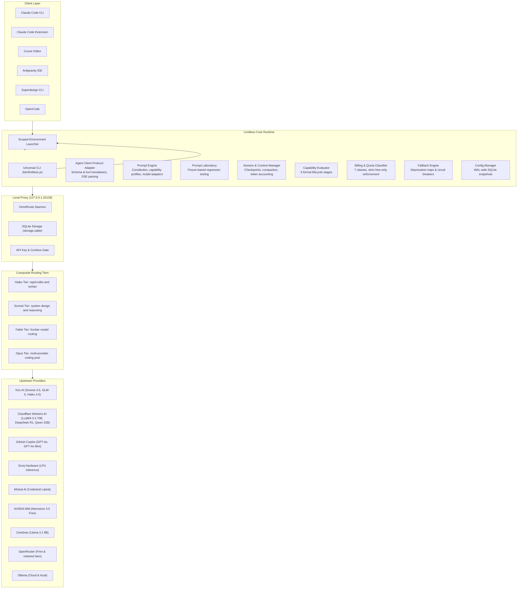
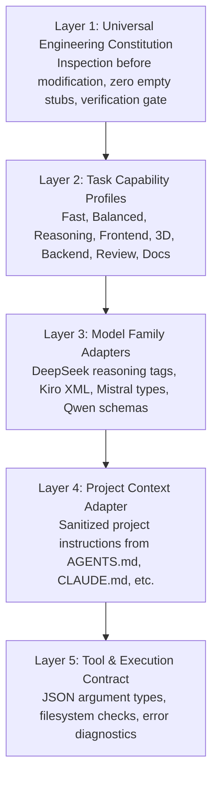
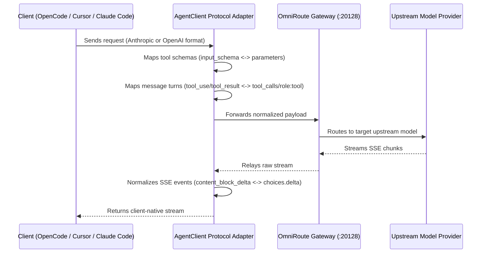

# Limitless Claude 8.0

[](package.json)
[](package.json)
[](https://github.com/mahik504/limitless-claude/actions/workflows/test.yml)
[](LICENSE)
[](test/)
[](scripts/e2e-acceptance.js)
[](scripts/doctor.js)

Limitless Claude routes coding-agent traffic across local and hosted model providers through an OmniRoute gateway. It connects Claude Code CLI, Cursor, Antigravity, OpenCode, and Superdesign to models from Kiro, Cloudflare, Groq, Mistral, GitHub Copilot, Cerebras, NVIDIA, and OpenRouter without modifying existing agent workflows.

---

## Architecture Overview



---

## Operating Modes

Limitless Claude supports two modes depending on your workspace setup:

### Mode A: Standalone Mode
Runs independently without external orchestrators. The engine inspects standard repository files (`AGENTS.md`, `CLAUDE.md`, `GEMINI.md`, `.cursorrules`) and composes them into task instructions. The core runtime under `src/core/` does not import any external framework code.

### Mode B: Orchestra Interoperability
When an Orchestra installation is detected (such as `C:\projects\orchestra-workflow`), the adapter at `src/integrations/orchestra/adapter.js` activates automatically. Orchestra coordinates high-level tasks and memory, while Limitless Claude handles upstream model routing, prompt composition, and protocol translation. If Orchestra is removed or disabled, Limitless Claude continues operating under Mode A.

---

## Five-Layer Prompt Engine

Rather than maintaining a static prompt string, `src/core/prompt-engine.js` composes instructions from five independent layers:



1. Universal Constitution (`prompts/universal/constitution.md`): Requires reading existing code before edits, forbids empty stubs (`// TODO`), and requires test output before claiming fixes.
2. Capability Profiles (`prompts/capabilities/`): Loads instructions for specific tasks: `fast` (atomic diffs), `balanced` (features with tests), `reasoning` (architectural analysis), `frontend` (React 19 and CSS), `3d` (Three.js and R3F disposal), `backend` (PostgreSQL RLS), `review` (vulnerability audits), and `documentation`.
3. Provider Adapters (`prompts/providers/`): Formats instructions for specific model behaviors, including DeepSeek `<think>` reasoning tags, Kiro XML tags, and Mistral type signatures.
4. Project Context: Reads repository instructions and wraps them in security delimiters (`<<<PROJECT_CONTEXT_START>>>`) to defend against prompt injection.
5. Tool Contract (`prompts/contracts/standard-contract.md`): Specifies exact JSON types, filesystem boundaries, and error recovery behavior.

---

## Composite Model Tiers

OmniRoute groups upstream models into four composite tiers:

| Tier | Primary Purpose | Primary Endpoints | Billing Classes |
| :--- | :--- | :--- | :--- |
| **Haiku** (`limitless-haiku-4.5`) | Syntax checks, atomic line diffs, quick tool calls | Kiro Claude Haiku 4.5, Cloudflare LLaMA 3.3 70B, GitHub GPT-4o Mini, Groq LPU | `provider_free_quota`, `subscription-entitled` |
| **Sonnet** (`limitless-sonnet-5.5`) | System architecture, code review, debugging | Kiro Claude Sonnet 4.5, Cloudflare DeepSeek R1, GitHub GPT-4o, GLM-5 | `subscription-entitled`, `provider_free_quota` |
| **Fable** (`limitless-fable-reasoning`) | Frontier context synthesis and multi-agent coordination | GitHub GPT-4o, Kiro DeepSeek 3.2, Mistral Codestral | `subscription-entitled`, `paid-token` |
| **Opus** (`limitless-opus-4.6`) | Long coding loops, fullstack features, 3D scenes | 23-model pool across all active providers | `provider_free_quota`, `subscription-entitled`, `paid-token` |

### Billing Taxonomy
- `provider_free_quota`: Vendor free tier with rate limits (Groq, Cloudflare Workers AI, Cerebras, NVIDIA NIM).
- `subscription-entitled`: Flat monthly subscription covering inference without per-token charges (GitHub Copilot, Kiro AI).
- `paid-token`: Metered per-token commercial APIs (Mistral, OpenAI, Anthropic, OpenRouter paid).
- `local`: Self-hosted local inference (Ollama, vLLM).
- `unknown`: Pricing is unverified. Returns `null` cost and is excluded in free-only mode.

---

## Universal CLI Commands

The `limitless` binary runs globally from any working directory:

```bash
# Core operations
limitless init               # Run zero-config environment setup
limitless doctor             # Run 15-point diagnostic sweep
limitless status             # Print active profile, gateway URL, and routing tiers
limitless verify             # Test HTTP 200 connectivity across all tiers
limitless setup              # Sync live OmniRoute models into composite tiers
limitless launcher           # Launch Claude Code under scoped profile

# Catalog and providers
limitless discover           # Scan and record live gateway models and providers
limitless models list        # List catalogued models (--free-only, --profile <name>)
limitless models inspect <id># View capability profile for a specific model
limitless providers list     # List connected providers and billing classes
limitless providers test     # Ping upstream provider endpoints through gateway

# Prompts and budget
limitless prompt list        # List capability profiles and provider adapters
limitless prompt compose     # Render 5-layer prompt with hash and section previews
limitless prompt test        # Run Prompt Laboratory regression fixtures
limitless budget             # View spend controls and daily token capacity estimates

# Benchmarking and recovery
limitless benchmark          # Run 12-task standardized benchmark
limitless acceptance         # Run 6-test end-to-end acceptance suite
limitless dashboard          # Open live terminal observability dashboard
limitless rollback --list    # List available database and config snapshots
limitless rollback --latest  # Restore most recent snapshot
```

---

## Master Installation & Repair Prompts

Use these prompts when setting up or repairing Limitless Claude in an AI coding assistant.

### Prompt 1: Clean Installation (New Environment)

```text
Set up a clean installation of Limitless Claude 8.0 on this machine following these steps:

1. Repository setup:
   - Check if the repository exists at C:\projects\limitless-claude (or clone from https://github.com/mahik504/limitless-claude.git).
   - Ensure Node.js is version 22 or higher. Run `npm install` inside the project root.

2. Diagnostic check:
   - Run `node bin/limitless.js doctor`.
   - Confirm all 15 checkpoints pass, including database integrity, API key permissions, gateway reachability, model catalog, and billing guards.
   - If the OmniRoute gateway is stopped, start it via `omniroute-daemon.bat` or `npm run launcher`.

3. Model discovery:
   - Run `node bin/limitless.js discover` to scan live providers (Groq, Cloudflare, Kiro, Mistral, NVIDIA, Cerebras, OpenRouter, GitHub Copilot).
   - Confirm `config/provider-inventory.json` and `config/model-inventory.json` are generated with formal lifecycle states and billing classifications.

4. Composite tier setup:
   - Run `node bin/limitless.js setup` to register the composite tiers in OmniRoute:
     * Haiku Tier: 6 sub-second models for syntax checks and atomic edits.
     * Sonnet Tier: 6 models for system architecture and reasoning.
     * Opus Tier: 23-model pool for autonomous coding loops.
     * Fable Tier: 5 models for high-context frontier tasks.
   - Inject the Universal Engineering Constitution into combos.system_message.

5. Verification:
   - Run `node bin/limitless.js verify` to confirm HTTP 200 connectivity on all 4 tiers.
   - Run `node bin/limitless.js acceptance` to execute the 6-test acceptance suite.
   - Run `npm test` to verify unit and contract tests pass.

6. Completion:
   - Run `node bin/limitless.js status` to display the active tier configuration.
   - Use `limitless launcher` to start a Claude Code session.
```

---

### Prompt 2: Repair, Update & Re-Sync (Existing Setup)

```text
Repair and re-synchronize an existing Limitless Claude installation using these steps:

1. Create snapshot:
   - Run `node bin/limitless.js rollback --create pre-repair` to capture a WAL-safe SQLite and configuration snapshot before making modifications.
   - Keep existing API keys, provider configurations, and user credentials intact.

2. Database and key checks:
   - Check that ~/.omniroute/storage.sqlite is accessible.
   - Run `node bin/limitless.js doctor`. If the API key is in restricted mode, ensure all composite tiers are included in allowed_combos.
   - Remove deprecated endpoints (such as obsolete Antigravity 2.29 version strings) from primary positions.

3. Discovery and classification:
   - Run `node bin/limitless.js discover` to read live gateway endpoints.
   - Update model records with formal lifecycle states (ESTIMATED, SMOKE_TESTED, PRODUCTION_APPROVED).
   - Verify unknown model pricing returns null, preventing unintended charges in free-only mode.

4. Re-sync tiers:
   - Run `node bin/limitless.js setup` to update Haiku, Sonnet, Opus, and Fable tiers with active models.
   - Update the 5-layer Universal Engineering Constitution in combos.system_message.

5. Verification:
   - Run `node bin/limitless.js verify` to confirm HTTP 200 connectivity across all tiers.
   - Run `node bin/limitless.js prompt test` to verify Prompt Laboratory fixtures pass.
   - Run `npm test` to confirm test suites pass.
   - Run `limitless status` to display the verified configuration.
```

---

## Protocol & Tool Translation

Limitless Claude provides bidirectional translation between Anthropic Messages API and OpenAI Chat format:



---

## Token Capacity & OpenRouter Quota Intelligence

### OpenRouter Policy (Verified November 2026)
- Unfunded accounts: Limited to **50 requests per day** across `:free` models.
- Funded accounts (\$10 credit deposit): Unlocks **1,000 requests per day** across `:free` models without deducting from the \$10 deposit on free endpoints.
- Upstream rate limits: Individual models may enforce separate concurrency and per-minute request caps.

### Daily Throughput Reference Table

| Workload Profile | Tokens / Req | 50 Req/Day (Unfunded) | 1,000 Req/Day (\$10 Deposit) |
| :--- | :---: | :---: | :---: |
| Micro-Patch / Syntax (1k in / 1k out) | 2,000 | 0.10M tokens/day | 2.00M tokens/day |
| Standard Feature / Tests (4k in / 1k out) | 5,000 | 0.25M tokens/day | 5.00M tokens/day |
| Full Architecture / Backend (10k in / 2k out) | 12,000 | 0.60M tokens/day | 12.00M tokens/day |

Run `limitless budget` in your terminal or read [`docs/TOKEN-CAPACITY.md`](docs/TOKEN-CAPACITY.md) for custom scenario calculations.

---

## Prompt Laboratory

The Prompt Laboratory (`src/core/prompt-lab.js`) runs regression fixtures against prompt variants:
- Tests syntax fixes, PostgreSQL RLS policies, Three.js `.dispose()` cleanup, and secret leak detection.
- Measures correctness score, pass rates, latency, and token efficiency.
- Halts deployment if a prompt modification causes a regression on standard fixtures.

Run `limitless prompt test` or inspect [`docs/PROMPT-LAB-REPORT.md`](docs/PROMPT-LAB-REPORT.md).

---

## Session Continuity & Context Compaction

- Turn Checkpoints (`src/core/session-manager.js`): Records in-memory checkpoints at conversation turns. If an upstream turn fails unrecoverably, the session can roll back to a known good turn.
- Context Compaction (`src/core/context-manager.js`): Tracks token counts against context limits. When context reaches 80% capacity, it truncates verbose terminal dumps while preserving active objectives, modified file paths, and unresolved errors.

---

## Snapshots and Rollback

Limitless Claude supports atomic configuration and database rollbacks:
- Pre-switch snapshots are taken automatically before profile changes or tier updates.
- SQLite backups use clean WAL checkpoints (`VACUUM INTO` via `src/omniroute/db.js`), preventing database corruption.
- Rollback commands:
  ```bash
  limitless rollback --list      # Show available snapshots
  limitless rollback --latest    # Restore the most recent snapshot
  ```

---

## Verification Results

The 8.0.0 release passed all local automated gates:

```text
Unit & Contract Tests (`npm test`)        : 87/87 passed
System Diagnostic Doctor (`limitless doctor`): 15/15 passed (Orchestra Mode B Active)
Tier Connectivity (`limitless verify`)     : 8/8 routes HTTP 200 OK
End-to-End Acceptance (`limitless acceptance`): 6/6 passed
Prompt Laboratory (`limitless prompt test`) : 4/4 fixtures passed (100% score)
```

---

## License

Distributed under the MIT License. See [`LICENSE`](LICENSE) for details.
