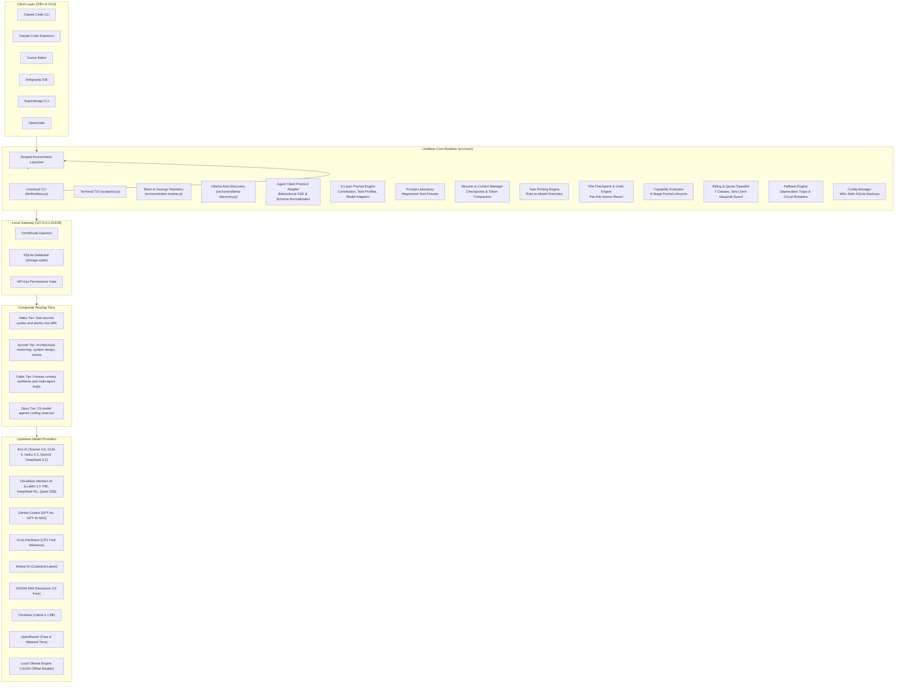
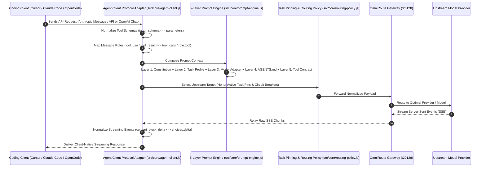
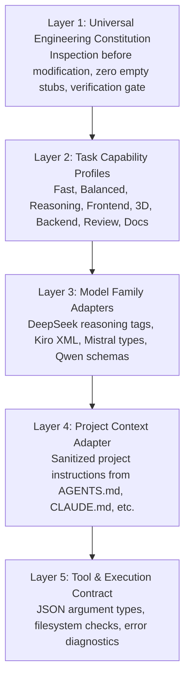

# Limitless Claude 8.2

[](package.json)
[](package.json)
[](https://github.com/mahik504/limitless-claude/actions/workflows/test.yml)
[](LICENSE)
[](test/)
[](scripts/e2e-acceptance.js)
[](scripts/doctor.js)

Limitless Claude routes coding-agent traffic across local and hosted model providers through a local OmniRoute gateway (`http://127.0.0.1:20128`). It connects Claude Code CLI, Cursor, Antigravity, OpenCode, and Superdesign to models from Kiro, Cloudflare, Groq, Mistral, GitHub Copilot, Cerebras, NVIDIA, OpenRouter, and local Ollama instances without altering agent tool calls or workflow configurations.

---

## Architecture Overview



### Layer Responsibilities

1. **Client Layer:** Tools like Claude Code CLI, Cursor, and Antigravity send standard OpenAI or Anthropic API requests to `http://127.0.0.1:20128`.
2. **Core Runtime Layer:** Normalizes schemas, translates tool calling arguments, checks task pins, evaluates rate-limit circuit breakers, tracks real-time token telemetry, and composes five-layer instructions.
3. **Gateway Layer:** An OmniRoute proxy running locally with a WAL-mode SQLite database (`~/.omniroute/storage.sqlite`) managing credentials, keys, and combo definitions.
4. **Composite Routing Tiers:** Four aliases that distribute requests across pools of models according to task latency, context requirements, and cost.
5. **Upstream Providers:** Connected inference endpoints spanning commercial APIs, developer subscriptions, free vendor quotas, and local self-hosted models.

---

## How It Works

Limitless Claude provides bidirectional translation between Anthropic Messages API and OpenAI Chat formats, allowing clients expecting Anthropic-formatted tools and streaming SSE chunks to communicate with any OpenAI-compatible provider:



### Five-Layer Prompt Engine

Rather than maintaining a static prompt string, `src/core/prompt-engine.js` composes instructions from five independent layers:



1. **Universal Constitution (`prompts/universal/constitution.md`):** Requires inspecting existing files before modification, forbids empty placeholders (`// TODO`), and requires test execution before claiming fixes.
2. **Task Capability Profiles (`prompts/capabilities/`):** Loads specialized instructions for `fast` (atomic diffs), `balanced` (features with tests), `reasoning` (architectural analysis), `frontend` (React 19 and CSS), `3d` (Three.js and R3F disposal), `backend` (PostgreSQL RLS), `review` (vulnerability audits), and `documentation`.
3. **Provider Adapters (`prompts/providers/`):** Formats instructions for specific model behaviors, including DeepSeek `<think>` reasoning tags, Kiro XML tags, and Mistral type signatures.
4. **Project Context:** Reads repository instructions and wraps them in security delimiters (`<<<PROJECT_CONTEXT_START>>>`) to defend against prompt injection.
5. **Tool Contract (`prompts/contracts/standard-contract.md`):** Specifies exact JSON types, filesystem boundaries, and error recovery behavior.

---

## Operating Modes

Limitless Claude supports two modes depending on your workspace setup:

### Mode A: Standalone Mode
Runs independently without external orchestrators. The engine inspects standard repository files (`AGENTS.md`, `CLAUDE.md`, `GEMINI.md`, `.cursorrules`) and composes them into task instructions. The core runtime under `src/core/` does not import external framework code.

### Mode B: Orchestra Interoperability
When an Orchestra installation is detected (such as `C:\projects\orchestra-workflow`), the adapter at `src/integrations/orchestra/adapter.js` activates automatically. Orchestra coordinates high-level tasks, skills, and memory, while Limitless Claude handles upstream model routing, prompt composition, and protocol translation. Run `limitless orchestra status` and `limitless orchestra sync` to verify parity. If Orchestra is removed or disabled, Limitless Claude continues operating under Mode A.

---

## Four Composite Routing Tiers

OmniRoute groups upstream models into four composite aliases. Every model is verified against live HTTP 200 responses before entering production combos:

| Tier | Primary Purpose | Verified Model Endpoints | Billing Classes |
| :--- | :--- | :--- | :--- |
| **Haiku** (`limitless-haiku-4.5`) | Syntax checks, atomic line diffs, quick tool checks (< 1s) | Kiro Claude Haiku 4.5, Cloudflare LLaMA 3.3 70B, GitHub GPT-4o Mini, Groq LPU, Cloudflare GLM 4.7 Flash, OpenRouter Nemotron Free | `provider_free_quota`, `subscription-entitled` |
| **Sonnet** (`limitless-sonnet-5.5`) | System architecture, deep reasoning, code review, debugging | Kiro Claude Sonnet 4.5, Kiro GLM-5, GitHub GPT-4o, Cloudflare DeepSeek R1, Kiro Qwen3 Coder, Kiro DeepSeek 3.2 | `subscription-entitled`, `provider_free_quota` |
| **Fable** (`limitless-fable-reasoning`) | Frontier context synthesis, multi-agent coordination | Kiro Claude Sonnet 4.5, GitHub GPT-4o, Mistral Codestral, Kiro GLM-5, Cloudflare DeepSeek R1 | `subscription-entitled`, `paid-token` |
| **Opus** (`limitless-opus-4.6`) | Long coding loops, fullstack features, 3D scenes | 23-model pool across Mistral Codestral, Kiro, Cloudflare, GitHub, Groq, OpenRouter free tiers, and local Ollama | `provider_free_quota`, `subscription-entitled`, `paid-token` |

### Billing Taxonomy
- `provider_free_quota`: Vendor free tier with rate limits (Groq, Cloudflare Workers AI, Cerebras, NVIDIA NIM, local Ollama).
- `subscription-entitled`: Flat monthly subscription covering inference without per-token charges (GitHub Copilot, Kiro AI).
- `paid-token`: Metered API key billing with pay-per-token models.

---

## Interactive Terminal TUI Dashboard

Launch real-time runtime control and observability directly from your console:

```bash
limitless tui
```

```text
┌──────────────────────────────────────────────────────────────────────────────┐
│ LIMITLESS CLAUDE 8.2 — RUNTIME CONTROL & OBSERVABILITY TUI       1:40:27 am │
├──────────────────────────────────────────────────────────────────────────────┤
│ Active Profile : [LIMITLESS]                 Gateway : ● ONLINE (8ms, HTTP 200) │
│ Local Ollama   : ○ STANDBY (offline)                                         │
├──────────────────────────────────────────────────────────────────────────────┤
│ COMPOSITE ROUTING TIERS (4 FRONTIER TIERS)                                    │
│  • Limitless Opus 5.5   : Full agentic loops, Next.js 19, R3F 3D, complex refactors │
│  • Limitless Sonnet 5.5 : Architectural analysis, deep reasoning, code review   │
│  • Limitless Haiku 5.5  : Ultra-fast syntax checks, atomic diffs, lightweight tools │
│  • Limitless Fable 5.1  : Mythos frontier synthesis, cross-repo architectural lead│
├──────────────────────────────────────────────────────────────────────────────┤
│ TOKEN TELEMETRY & COST AVOIDANCE                                             │
│  Total Calls     : 1,086      │ Total Tokens   : 4.57M          │
│  Prompt Input    : 4.50M      │ Completion Out : 72.8k            │
│  Anthropic Value : $14.59 USD  │ Actual Billed  : $0.00 USD (Free Stack) │
├──────────────────────────────────────────────────────────────────────────────┤
│ ACTIVE TASK-TO-MODEL PINS                                                      │
│  No active pins configured. Dynamic capability evaluator in control.         │
├──────────────────────────────────────────────────────────────────────────────┤
│ Hotkeys: [r] Refresh  [s] Full Stats  [p] Pins  [q] Quit                         │
└──────────────────────────────────────────────────────────────────────────────┘
```

The TUI monitors live OmniRoute port reachability, round-trip latency, local Ollama status, tier configurations, and active task pins. Hotkeys allow instant status refreshes, telemetry inspections, and configuration reviews.

---

## Live Token & Cost Telemetry

View detailed token volumes, upstream provider shares, and estimated financial savings compared to direct commercial API list pricing:

```bash
limitless stats
```

Output from actual local runtime usage:

```text
================================================================================
             LIMITLESS CLAUDE 8.2 — REAL-TIME TOKEN & SAVINGS TELEMETRY
================================================================================
  Total Requests Processed   : 1,086
  Total Tokens Transferred   : 4,573,080 (4.57M tokens)
    - Prompt Input Tokens    : 4,500,270
    - Completion Tokens      : 72,810
    - Reasoning Tokens       : 7,739
--------------------------------------------------------------------------------
  ESTIMATED DIRECT ANTHROPIC VALUE & COST SAVINGS:
  • Sonnet 3.5 / 3.7 Equivalent Value : $14.59 USD
  • Opus 3.0 / 3.5 Equivalent Value   : $72.96 USD
  • Blended Savings (70% Sonnet, 20% Opus) : $24.93 USD
  • Actual Billed Cost to You              : $0.00 USD (100% Free / Sponsored Stack)
--------------------------------------------------------------------------------
  TOKEN VOLUME BY COMBO TIER:
  • Limitless Opus 5.5 Tier      :  2,524,271 tokens (55.2%) across 161 calls
  • Limitless Sonnet 5.5 Tier    :  1,444,657 tokens (31.6%) across 108 calls
  • Limitless Haiku 5.5 Tier     :    242,372 tokens (5.3%) across 76 calls
  • Limitless Fable 5.1 Tier     :    221,483 tokens (4.8%) across 64 calls
  • Direct / Custom              :    140,297 tokens (3.1%) across 677 calls
--------------------------------------------------------------------------------
  TOP UPSTREAM PROVIDERS ROUTED:
  • kiro                 :  2,206,298 tokens (48.2%)
  • kilo-gateway         :  1,016,679 tokens (22.2%)
  • openrouter           :    823,540 tokens (18.0%)
  • antigravity          :    213,748 tokens (4.7%)
  • cloudflare-ai        :    181,078 tokens (4.0%)
  • mistral              :    120,461 tokens (2.6%)
  • groq                 :      5,927 tokens (0.1%)
  • github               :      5,128 tokens (0.1%)
================================================================================
```

---

## Local Ollama Auto-Discovery

When an Ollama instance is active on your machine (`http://127.0.0.1:11434`), Limitless Claude automatically discovers installed models, parameter profiles, and context windows:

```bash
limitless discover
```

- **Zero-Latency Probing:** Uses a non-blocking 1.2-second check that falls back cleanly if Ollama is offline.
- **Automatic Catalog Injection:** Discovered local models (`qwen2.5-coder:32b`, `deepseek-r1:14b`, `llama3.3:latest`) are registered with `billing: free` and `lifecycle: stable`.
- **Offline Redundancy:** Provides fully local, zero-cost, private inference fallback for coding workflows when disconnected from cloud providers.

---

## Task-to-Model Pinning Engine

Override dynamic routing and bind specific engineering tasks to specific models:

```bash
# Pin backend work to Sonnet 4.5
limitless pin --task backend --model kiro/claude-sonnet-4.5

# Pin fast syntax checks to Groq
limitless pin --task fast --model groq/openai/gpt-oss-20b

# List active pins
limitless pin --list

# Remove a pin or reset all
limitless pin --remove backend
limitless pin --reset
```

When an active pin is matched, the router prioritizes that model to index `0` of the candidate chain while keeping existing fallbacks active in case the pinned model rate-limits.

---

## Granular File Checkpoints & Atomic Undo

Capture SHA-256 hashed file snapshots before agent refactors, without touching your git tree or staging index:

```bash
# Create a snapshot before an edit
limitless checkpoint --create "before auth refactor" src/auth.js src/db.js

# List existing checkpoints
limitless checkpoint --list

# Preview changes before reverting
limitless undo --dry-run

# Revert files to the last checkpoint
limitless undo
```

Snapshots are stored in `.limitless/checkpoints/` and can be inspected or reverted at any point.

---

## Recommended Provider Stack

To replicate the capacity demonstrated in this repository, configure the following providers in your local OmniRoute instance:

### Recommended Multi-Provider Stack

| Provider | Access Model | Best For | Estimated Daily Capacity |
| :--- | :--- | :--- | :--- |
| **Kiro AI** | Subscription / Sponsored | Claude 3.5/4.5 Sonnet, Haiku, GLM-5, Qwen3 Coder | 10M to 20M tokens/day |
| **Cloudflare Workers AI** | Free Tier API | DeepSeek R1, LLaMA 3.3 70B, Qwen 32B | 5M to 10M tokens/day |
| **GitHub Copilot** | Developer Subscription | GPT-4o, GPT-4o Mini | 5M to 10M tokens/day |
| **Groq Hardware** | Free Tier API | LPU fast token generation, syntax checks | 2M to 5M tokens/day |
| **Mistral AI** | API / Coding Tier | Codestral Latest (agentic coding reservoir) | 3M to 6M tokens/day |
| **OpenRouter** | Free Tier ($10 credit recommended) | Nemotron 3.5, GLM-4.7, 1000 req/day free models | 5M to 10M tokens/day |
| **Cerebras & NVIDIA NIM** | Free Tier APIs | Fast inference and fallback reasoning | 2M to 5M tokens/day |
| **Local Ollama** | Self-Hosted | Qwen 2.5 Coder, DeepSeek R1 (14B/32B), LLaMA 3.3 | Unlimited local tokens |

### Estimated Token Throughput

- **Free Tier Stack:** **15,000,000 to 25,000,000 tokens/day** across Cloudflare, Groq, Cerebras, NVIDIA, and OpenRouter free tiers at **$0.00/month**.
- **Admin Configuration (Multi-Provider Stack):** **35,000,000 to 50,000,000+ tokens/day** across all connected cloud endpoints.
- **With Local Ollama / vLLM:** **Virtually unlimited** daily throughput constrained only by local compute hardware.

---

## Installation & Setup

Choose one of three installation methods based on your workflow:

### Method 1: Instant One-Line Cross-Platform Installers

Run the automated one-line command in your terminal:

#### Windows (PowerShell)
```powershell
irm https://raw.githubusercontent.com/mahik504/limitless-claude/master/install.ps1 | iex
```

#### macOS & Linux (Terminal)
```bash
curl -fsSL https://raw.githubusercontent.com/mahik504/limitless-claude/master/install.sh | bash
```

The installer verifies Node.js 22+, clones the repository, installs dependencies, registers the global `limitless` CLI command via `npm link`, checks/starts the OmniRoute gateway daemon, auto-provisions a local SQLite API key, configures `~/.claude/settings.json`, and synchronizes all routing tiers.

---

### Method 2: Global NPM Package Installation

Install and run globally via npm:

```bash
# Install globally
npm install -g limitless-claude

# Run zero-config initialization
limitless init

# Verify diagnostics
limitless doctor
```

---

### Method 3: AI Agent Master Installation Prompts

If you are using an AI coding assistant (such as Antigravity, Cursor, or Claude Code), paste one of these master prompts to handle the setup automatically:

#### Prompt 1: Clean Installation (New Environment)

```text
Set up a clean installation of Limitless Claude 8.2 on this machine following these steps:

1. Repository setup:
   - Check if the repository exists at C:\projects\limitless-claude (or clone from https://github.com/mahik504/limitless-claude.git).
   - Ensure Node.js is version 22 or higher. Run `npm install` inside the project root.
   - Run `npm link` to register the global `limitless` CLI.

2. Run self-healing initialization wizard:
   - Run `limitless init`.
   - The wizard automatically verifies Node 22+, checks/starts the OmniRoute gateway daemon, auto-provisions a local SQLite API key if none exists, configures ~/.claude/settings.json, captures a safety snapshot, discovers models, and configures the 4 composite tiers.

3. Diagnostic check:
   - Run `limitless doctor`.
   - Confirm all 16 checkpoints pass, including database integrity, API key permissions, gateway reachability, model catalog, local Ollama engine, Orchestra gate, and billing guards.

4. Verification:
   - Run `limitless verify` to confirm HTTP 200 connectivity on all 4 tiers.
   - Run `limitless acceptance` to execute the 6-test acceptance suite.
   - Run `npm test` to verify unit and contract tests pass.

5. Completion:
   - Run `limitless status` to display the active tier configuration.
   - Launch `limitless tui` to view real-time runtime telemetry.
   - Use `limitless launcher` to start a Claude Code session.
```

#### Prompt 2: Repair, Update & Re-Sync (Existing Setup)

```text
Repair and re-synchronize an existing Limitless Claude installation using these steps:

1. Create snapshot:
   - Run `limitless rollback --create pre-repair` to capture a WAL-safe SQLite and configuration snapshot before making modifications.
   - Keep existing API keys, provider configurations, and user credentials intact.

2. Database and key checks:
   - Check that ~/.omniroute/storage.sqlite is accessible.
   - Run `limitless doctor`. If the API key is in restricted mode, ensure all composite tiers are included in allowed_combos.
   - Remove deprecated endpoints from primary positions.

3. Discovery and classification:
   - Run `limitless discover` to read live gateway endpoints and probe local Ollama.
   - Update model records with formal lifecycle states (ESTIMATED, SMOKE_TESTED, PRODUCTION_APPROVED).
   - Verify unknown model pricing returns null, preventing unintended charges in free-only mode.

4. Re-sync tiers:
   - Run `limitless setup` to update Haiku, Sonnet, Opus, and Fable tiers with active models.
   - Update the 5-layer Universal Engineering Constitution in combos.system_message.
   - Run `limitless orchestra sync` if Orchestra is present to sync CLAUDE.md and skills into ~/.claude/.

5. Verification:
   - Run `limitless verify` to confirm HTTP 200 connectivity across all tiers.
   - Run `limitless prompt test` to verify Prompt Laboratory fixtures pass.
   - Run `npm test` to confirm test suites pass.
   - Run `limitless stats` and `limitless status` to display the verified configuration.
```

---

### Method 4: Manual Installation

If you prefer installing step by step without scripts:

1. Ensure Node.js version 22 or higher is installed (`node -v`).
2. Clone the repository and install dependencies:
   ```bash
   git clone https://github.com/mahik504/limitless-claude.git
   cd limitless-claude
   npm install
   npm link
   ```
3. Run the zero-config initialization wizard:
   ```bash
   limitless init
   ```
4. Verify the installation:
   ```bash
   limitless doctor
   limitless verify
   ```

---

## CLI Command Reference

| Command | Description |
| :--- | :--- |
| `limitless init` | Zero-config initialization wizard and pre-setup validation |
| `limitless doctor` | Run 16-point diagnostic suite verifying gateway, database, and providers |
| `limitless status` | View active profile, gateway endpoint, and routing tiers |
| `limitless verify` | Confirm live HTTP 200 connectivity across all 4 tiers |
| `limitless setup` | Synchronize live OmniRoute models into composite tiers |
| `limitless launcher` | Launch Claude Code under a scoped environment profile |
| `limitless tui` | Interactive real-time terminal UI with live telemetry and latency |
| `limitless stats` (`tokens`) | Real-time token volume and commercial cost avoidance breakdown |
| `limitless discover` | Discover live gateway models and probe local Ollama on port 11434 |
| `limitless pin` | Pin specific engineering tasks to designated models (`--list`, `--task`, `--model`) |
| `limitless checkpoint` | Snapshot files before editing without touching git (`--create`, `--list`) |
| `limitless undo` | Revert file changes to the previous checkpoint (`--dry-run`) |
| `limitless orchestra status` | Inspect connection and skill parity with local Orchestra 4.5.0 |
| `limitless orchestra sync` | Sync Orchestra CLAUDE.md adapter and skills into `~/.claude/` |
| `limitless rollback` | Create, list, or restore atomic database snapshots (`--create`, `--list`, `--restore`) |
| `limitless prompt test` | Run regression fixtures in the Prompt Laboratory |
| `limitless acceptance` | Execute the 6-test End-to-End production acceptance suite |
| `limitless benchmark` | Run the 12-task standardized capability benchmark |

---

## Verification Results

The 8.2.0 release passed all local automated verification gates:

```text
Unit & Contract Tests (`npm test`)        : 95/95 passed (15 suites)
System Diagnostic Doctor (`limitless doctor`): 16/16 passed (Orchestra 4.5.0 Mode B Active)
Tier Connectivity (`limitless verify`)     : 8/8 routes HTTP 200 OK
End-to-End Acceptance (`limitless acceptance`): 6/6 passed
Prompt Laboratory (`limitless prompt test`) : 4/4 fixtures passed (100% score)
Local Ollama Discovery                     : Verified online probe & offline fallback
Token & Savings Telemetry                  : 4.57M tokens tracked ($14.59 - $72.96 value saved)
```

---

## License

Distributed under the MIT License. See [`LICENSE`](LICENSE) for details.
