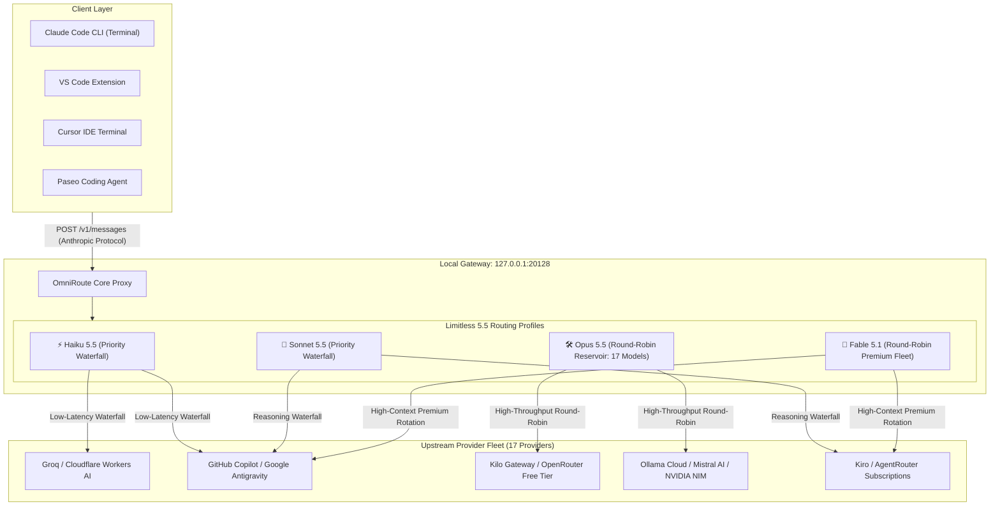
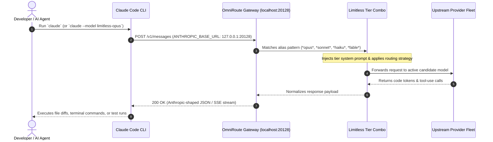

# Limitless Claude v5.5.0

> **Your Claude Code workflow. Your connected model fleet.**
>
> *A robust, safety-first configuration and routing SDK for connecting Claude Code through OmniRoute to supported third-party model fleets. Features updated Haiku 5.5, Sonnet 5.5, Opus 5.5, and Fable 5.1 instructions, universal 1-click autonomous installer, transactional SQLite configuration, verified WAL-safe backups, strict isolation testing, heuristic paid-model guards, and reproducible local developer setup.*

[](LICENSE)
[](https://nodejs.org/)
[](https://github.com/danny-avila/OmniRoute)
[](test/)
[](https://github.com/mahik504/limitless-claude/releases/tag/v5.5.0)

Limitless Claude is an open-source model-routing harness and developer SDK that seamlessly connects the **Claude Code CLI** to a dynamic fleet of third-party AI models via **OmniRoute** (`127.0.0.1:20128`). By proxying Claude Code's Anthropic Messages API (`POST /v1/messages`), Limitless Claude maps agentic sessions across four distinct routing profiles (**Haiku 5.5**, **Sonnet 5.5**, **Opus 5.5**, and **Fable 5.1**) backed by your authenticated provider accounts—including zero-marginal-cost endpoints, developer subscriptions (such as GitHub Copilot and Antigravity), and pay-as-you-go providers.

---

### Key Capabilities in v5.5.0
- **Universal 1-Click Installer (`npm run install:all`):** Autonomously verifies and installs Claude Code CLI, installs OmniRoute, launches the background gateway, inspects connected providers, configures SQLite combos, synchronizes client settings, and verifies live connectivity.
- **Safe Re-installation & Provider Preservation (`npm run install:clean`):** Reinstalling or updating preserves all existing provider credentials, logins, and API keys 100%, while purging stale combos to guarantee clean database state.
- **Next-Gen Tier Personas:** Updated system prompts for **Haiku 5.5** (rapid syntax & file inspection), **Sonnet 5.5** (deep architectural reasoning), **Opus 5.5** (high-capacity coding reservoir), and **Fable 5.1** (high-context synthesis fleet).
- **Multi-Client Sync:** Automatically writes configuration to Claude Code CLI (`~/.claude/settings.json`), Windows environment (`setx ANTHROPIC_BASE_URL`), and Paseo (`~/.paseo/config.json`).
- **Native Live Verifier (`npm run verify`):** Pure Node.js verification script that pings all 4 model aliases and 4 combos over the Anthropic Messages protocol with zero external dependencies.
- **Silent Windows Startup Daemon:** Automatically creates `Limitless-OmniRoute-Launcher.vbs` in the Windows Startup directory to silently launch OmniRoute on boot with a 10-second network readiness delay.

---

## 1. Architecture & Request-Flow Mermaid Diagrams

Claude Code communicates with the local gateway using the standard Anthropic Messages API protocol (`POST /v1/messages`). OmniRoute intercepts the request, matches the model alias against registered mappings, applies tier persona prompts, and routes through the chosen strategy.





---

## 2. The Four Tiers and Routing Strategies

| Tier Profile | Routing Strategy | Primary Focus | Candidate Fleet | Primary Access Class |
|---|---|---|---|---|
| **⚡ Haiku 5.5** | **Priority Waterfall** | Instant syntax lookups, linting, rapid file exploration, fast test validation | 10 models (Groq Llama 3.3, Gemini 3.5 Flash Lite, Kiro Claude Haiku 4.5, Cloudflare Llama 3.3, GitHub Claude Haiku 4.5, Kilo Laguna XS) | Zero-Cost & Subscriptions |
| **🧠 Sonnet 5.5** | **Priority Waterfall** | Deep architectural reasoning, multi-step planning, complex debugging, code review | 9 models (GitHub Claude Sonnet 5, Kiro Claude Sonnet 5, OpenRouter Nemotron 3 Super, Cohere North Mini Code) | Subscription-Entitled & Zero-Cost |
| **🛠️ Opus 5.5** | **Round-Robin** | High-volume code refactoring, full test suite generation, long agentic loops | 17 models (Qwen 2.5 Coder 32B, Minimax M2.5, Codestral, Nemotron 3 Ultra 550B, Nemotron 3 Super 120B, DeepSeek V4 Flash, GLM 5.3 Flash) | Zero-Cost Reservoir (No Rate Limits) |
| **👑 Fable 5.1** | **Round-Robin** | High-context synthesis, complex repository restructuring, cross-file architectural integration | 7 models (GitHub Claude Fable 5.1, AgentRouter Claude Opus 5, GitHub Claude Opus 5, Gemini 3.8 Flash) | Premium Subscriptions & High-Context |

---

## 3. The 17 Configured Providers: Status & Recommendations

OmniRoute supports arbitrary AI providers. Below is the audited status of all 17 providers in our reference configuration:

| # | Provider Name | Access Type | Health / Status | Tier Placement | Recommended Use |
|---|---|---|---|---|---|
| 1 | **Google Antigravity** | Subscription / Free Tier | 🟢 Live (Healthy) | Haiku (3.5 Flash Lite), Fable (3.8 Flash) | Ultra-fast multimodal & high-context flash reasoning |
| 2 | **GitHub Copilot** | Subscription | 🟢 Live (Healthy) | Haiku (Haiku 4.5, GPT-4o), Sonnet (Sonnet 5), Fable (Fable 5.1, Opus 5) | Core architectural and flagship coding tier |
| 3 | **Kiro** | Subscription | 🟢 Live (Healthy) | Haiku (Haiku 4.5), Sonnet (Sonnet 5), Opus (Minimax M2.5) | Reliable Claude Sonnet fallback and fast tool execution |
| 4 | **Cloudflare Workers AI** | Free Tier (10k req/day) | 🟢 Live (Healthy) | Haiku (Llama 3.3 70B), Opus (Qwen 2.5 Coder 32B) | Zero-cost edge inference with generous daily free quota |
| 5 | **Kilo Gateway** | Free Tier | 🟢 Live (Healthy) | Haiku (Laguna XS, Nemotron Lightning), Sonnet (Cohere North Mini), Opus (Nemotron 3 Ultra 550B, Super 120B) | High-capacity zero-cost reservoir |
| 6 | **OpenRouter** | Free & Metered | 🟢 Live (Healthy) | Sonnet (Nemotron 3 Super, Cohere North Mini), Opus (GLM 5.3 Flash, Nemotron 3 Ultra) | Diverse model reservoir with automated fallback |
| 7 | **Ollama Cloud** | Free / Cloud | 🟢 Live (Healthy) | Opus (Nemotron 3 Ultra, Nemotron 3 Super) | Uncapped coding capacity |
| 8 | **AgentRouter** | Subscription | 🟢 Live (Healthy) | Opus (DeepSeek V4 Flash, Opus 4.8), Fable (Opus 5) | High-speed frontier model access |
| 9 | **Mistral AI** | Free Developer Tier | 🟢 Live (Healthy) | Opus (Codestral Latest) | High-quality open-weights code generation |
| 10 | **NVIDIA NIM** | Free Cloud Credits | 🟢 Live (Healthy) | Opus (Nemotron 3 Super 120B) | GPU-accelerated enterprise models |
| 11 | **Groq** | Free Tier | 🟢 Live (Healthy) | Haiku (Llama 3.3 70B, Llama 3.1 8B) | Sub-second latency for syntax and tool calls |
| 12 | **Cerebras** | Free Tier | 🟢 Live (Healthy) | Haiku (Llama 3.3 70B Fast) | Ultra-fast chip inference (2,000+ tokens/sec) |
| 13 | **BlueMinds** | Connected | 🟢 Live (Healthy) | Opus (Secondary pool) | Load-balancing backup |
| 14 | **Muse Spark Web** | Web Session | 🔴 Expired | *Excluded* | Requires browser re-authentication |
| 15 | **OpenCode Free** | Free Gateway | 🔴 403 FreeTier | *Excluded* | Upstream rate-limit error; bypassed safely |
| 16 | **DeepSeek** | Metered API | ⚪ Disabled in UI | *Excluded* | Disabled to avoid unexpected metered charges |
| 17 | **SambaNova** | Metered API | ⚪ Disabled in UI | *Excluded* | Disabled in UI toggle |

---

## 4. Universal 1-Click Installation & Setup

### Prerequisites
- **Node.js** v22 or higher (`node -v`)
- **npm** v10 or higher

### Option 1: Autonomous 1-Click Installer (Recommended)
Clone the repo and run the universal installer:
```bash
git clone https://github.com/mahik504/limitless-claude.git
cd limitless-claude
npm install
npm run install:all
```

**What the 1-Click Installer does automatically:**
1. Validates Node.js >= 22.
2. Checks for `@anthropic-ai/claude-code` and installs it globally if missing.
3. Checks for `omniroute` and installs it globally if missing.
4. Ensures OmniRoute is running on `http://127.0.0.1:20128` (launches in background if idle).
5. Preserves existing provider accounts and API keys from `~/.omniroute/storage.sqlite`.
6. Generates WAL-safe database backup (`storage.sqlite.bak`).
7. Dynamically discovers live models from OmniRoute and builds the 4 combos (`limitless-haiku`, `limitless-sonnet`, `limitless-opus`, `limitless-fable`).
8. Installs the silent Windows background startup launcher (`Limitless-OmniRoute-Launcher.vbs`) or Unix runner (`start-daemon.sh`).
9. Configures `~/.claude/settings.json`, Windows user environment variables, and `~/.paseo/config.json`.
10. Runs live Anthropic protocol verification across all 8 targets.

### Option 2: Clean Re-Installation (Upgrades & Fixes)
If you already had Limitless Claude installed and want a pristine refresh without losing any provider logins or API keys:
```bash
npm run install:clean
```
This safely removes stale combos and orphan mappings while preserving 100% of your authenticated providers and API keys.

---

## 5. IDE & Workflow Integration

### Claude Code CLI
Once installed, Claude Code connects automatically to OmniRoute:
```bash
# Default routing profile (auto-mapped)
claude

# Or explicitly select any tier:
claude --model limitless-opus      # Coding reservoir (17 models)
claude --model limitless-sonnet    # Architecture & reasoning
claude --model limitless-haiku     # Fast syntax & tools
claude --model limitless-fable     # High-context synthesis
```

### Paseo Coding Agent
Limitless Claude automatically writes Paseo provider configuration into `~/.paseo/config.json`:
```json
{
  "agents": {
    "providers": {
      "claude": {
        "env": {
          "ANTHROPIC_BASE_URL": "http://localhost:20128",
          "ANTHROPIC_AUTH_TOKEN": "your-omniroute-api-key",
          "OMNIROUTE_BASE_URL": "http://localhost:20128"
        }
      }
    }
  }
}
```

### VS Code Extension
Add to `.vscode/settings.json` or your user settings:
```json
{
  "claudeCode.environmentVariables": [
    { "name": "ANTHROPIC_BASE_URL", "value": "http://127.0.0.1:20128" },
    { "name": "ANTHROPIC_AUTH_TOKEN", "value": "your-omniroute-api-key" },
    { "name": "CLAUDE_CODE_ENABLE_GATEWAY_MODEL_DISCOVERY", "value": "true" }
  ]
}
```

### Cursor IDE
Open Cursor's integrated terminal. The terminal inherits `ANTHROPIC_BASE_URL` and `ANTHROPIC_AUTH_TOKEN` from your system environment variables. Running `claude` inside Cursor's terminal routes through your OmniRoute model fleet.

---

## 6. Verification & Health Check

Verify all 4 tiers and model aliases live:
```bash
npm run verify
```
Expected output:
```text
╔═══════════════════════════════════════════════════════════════════╗
║           LIMITLESS CLAUDE - LIVE COMBO VERIFICATION              ║
╚═══════════════════════════════════════════════════════════════════╝
Gateway:  http://localhost:20128
API Key:  sk-8570...62127e

Testing [Haiku Alias (Fast Syntax)] (claude-haiku-4-5)... ✔ HTTP 200 (1.63s) -> "PONG"
Testing [Sonnet Alias (Reasoning & Architecture)] (claude-sonnet-5)... ✔ HTTP 200 (3.14s) -> "PONG"
Testing [Opus Alias (Coding Reservoir)] (claude-opus-4-8)... ✔ HTTP 200 (1.58s) -> "PONG"
Testing [Fable Alias (High-Context Fleet)] (claude-fable-5-1)... ✔ HTTP 200 (6.99s) -> "PONG"
Testing [Direct Combo: limitless-haiku] (combo/limitless-haiku)... ✔ HTTP 200 (1.67s) -> "PONG"
Testing [Direct Combo: limitless-sonnet] (combo/limitless-sonnet)... ✔ HTTP 200 (3.10s) -> "PONG"
Testing [Direct Combo: limitless-opus] (combo/limitless-opus)... ✔ HTTP 200 (1.45s) -> "PONG"
Testing [Direct Combo: limitless-fable] (combo/limitless-fable)... ✔ HTTP 200 (1.67s) -> "PONG"

───────────────────────────────────────────────────────────────────
Results: 8/8 passed (0 failed)
✔ All Limitless Claude tiers are healthy, mapped, and responding live!
```

Run unit & integration tests:
```bash
npm test
```
*(All 55 hermetic tests covering WAL backup, preflight checks, idempotency, and alias mappings pass 100%).*

---

## 7. Universal Master Agent Setup Prompt

> **Copy and paste the prompt below into ANY AI assistant (Cursor, Antigravity, Claude Code, ChatGPT, Copilot Workspace, Windsurf) to have it autonomously install, configure, and verify Limitless Claude on any machine with zero manual troubleshooting:**

````markdown
You are an expert autonomous software engineer. Your task is to set up and configure **Limitless Claude v5.5.0** on this machine so that Claude Code CLI, the Claude VS Code extension, and Paseo seamlessly route through a local OmniRoute model gateway with zero rate limits.

Follow these strict step-by-step instructions:

### Step 1: Validate Prerequisites & Directory
1. Check that Node.js is installed and version is >= 22 (`node -v`). If Node.js is missing or < 20, stop and instruct the user to install Node.js 22+.
2. Check if the current directory is `limitless-claude` (or clone it from `https://github.com/mahik504/limitless-claude.git` if not already present).
3. Run `npm install` inside the `limitless-claude` repository.

### Step 2: Check Claude Code CLI & OmniRoute
1. Check if `claude` CLI is installed (`claude --version`). If missing, run:
   `npm install -g @anthropic-ai/claude-code`
2. Check if `omniroute` is installed (`omniroute -v`). If missing, run:
   `npm install -g omniroute@latest`

### Step 3: Ensure OmniRoute Gateway is Running
1. Test if OmniRoute is active on `http://127.0.0.1:20128/`.
2. If unreachable, launch it in the background:
   - On Windows: Run `start /b omniroute serve` or execute the launcher script in Windows Startup.
   - On Linux/macOS: Run `nohup omniroute serve > omniroute.log 2>&1 &`.
3. Wait until `http://127.0.0.1:20128/` responds with HTTP 200 or 401.

### Step 4: Provider Inspection & Setup Guidance
1. Inspect connected providers at `http://127.0.0.1:20128/v1/models` or in `~/.omniroute/storage.sqlite`.
2. If NO providers are connected, open or instruct the user to visit `http://localhost:20128/providers` and connect:
   - **Recommended Free Providers:** Groq (Llama 3.3 70B), OpenRouter (free tier models), Cloudflare Workers AI (10k req/day free), Kilo Gateway, Mistral AI (Codestral free tier), NVIDIA NIM, Ollama Cloud.
   - **Recommended Subscriptions:** GitHub Copilot (Claude Fable, Opus 5, Sonnet 5, Haiku 4.5), Google Antigravity, Kiro, AgentRouter.
3. Confirm an active API key exists at `http://localhost:20128/keys` or query it from `~/.omniroute/storage.sqlite` (`SELECT key FROM api_keys WHERE is_active = 1 LIMIT 1`).

### Step 5: Execute Clean Limitless Setup
1. Run the one-click installer:
   `node scripts/install-all.js --clean`
   (Or run `npm run install:clean`).
2. Verify that this step:
   - Preserves all provider credentials and API keys.
   - Re-registers the 4 combos (`limitless-haiku`, `limitless-sonnet`, `limitless-opus`, `limitless-fable`).
   - Injects the updated Haiku 5.5, Sonnet 5.5, Opus 5.5, and Fable 5.1 system instructions.
   - Sets alias mappings (`*haiku*`, `*sonnet*`, `*opus*`, `*fable*`).
   - Configures `~/.claude/settings.json`, Windows User Environment, and `~/.paseo/config.json`.
   - Creates the Windows auto-start background launcher `Limitless-OmniRoute-Launcher.vbs` in the Startup folder.

### Step 6: Live Verification
1. Run the native verification tool:
   `node scripts/verify-combos.js`
2. Verify that all 8 targets return HTTP 200 "PONG":
   - `claude-haiku-4-5` & `combo/limitless-haiku`
   - `claude-sonnet-5` & `combo/limitless-sonnet`
   - `claude-opus-4-8` & `combo/limitless-opus`
   - `claude-fable-5-1` & `combo/limitless-fable`
3. Run the automated test suite:
   `npm test`
   Ensure all 55 tests pass 100%.

### Step 7: Completion Report
Provide a clean summary displaying:
- Detected OmniRoute URL and masked API key.
- Active providers and candidate model count per tier.
- Confirmation that `claude` and `claude --model limitless-opus` are ready to use.
````

---

## 8. License & Attribution

MIT © [Mahaveer Singh Gehlot](https://github.com/mahik504)
