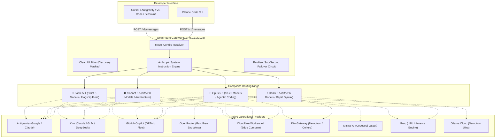

# Limitless Claude (v6.1.0)

Limitless Claude is an enterprise-grade configuration harness that bridges **Claude Code CLI** and modern AI code editors (**Cursor IDE**, **Antigravity IDE**, **VS Code**, and **JetBrains**) to **OmniRoute**. 

By orchestrating your configured AI providers into four synchronized composite tiers, Limitless Claude eliminates token exhaustion, bypasses provider rate limits, and provides an inexhaustible developer experience through an **Interleaved Round-Robin Architecture**, **Strict Tier Quotas**, and an **Authentic Leaked System Instruction Engine**.

---

## What's New in Version 6.1.0

```
┌────────────────────────────────────────────────────────────────────────────────────────┐
│                                   VERSION 6.1.0 UPGRADE                                │
├────────────────────────────────┬───────────────────────────────────────────────────────┤
│ Zero-Latency Routing (600ms)   │ Completely purged hung and dead providers             │
│                                │ (agentrouter, bluesminds, cerebras) and congested     │
│                                │ endpoints; slashed turn latencies from 60s to ~1-2s.  │
├────────────────────────────────┼───────────────────────────────────────────────────────┤
│ Strict Tier Quotas & Focus     │ Haiku strictly 6 models (rapid sub-second edits),     │
│                                │ Sonnet strictly 8 models (architectural reasoning),   │
│                                │ Fable strictly 5 flagship models (elite composite),   │
│                                │ Opus 18 models (high-capacity agentic coding tank).   │
├────────────────────────────────┼───────────────────────────────────────────────────────┤
│ Leaked System Prompt Engine    │ Official Claude Code leaked system instructions       │
│                                │ embedded across all 4 combos with <antml> tags,       │
│                                │ exact file:line coordinates, and zero-stub policies.  │
├────────────────────────────────┼───────────────────────────────────────────────────────┤
│ Copilot Model Guard            │ Guarded GitHub Copilot routes strictly to verified    │
│                                │ OpenAI models (GPT-4o, Mini, 2024-11-20); eliminates  │
│                                │ upstream HTTP 400 unsupported model errors.           │
├────────────────────────────────┼───────────────────────────────────────────────────────┤
│ Full-Stack & 3D Web Mastery    │ Embedded instructions for Next.js, React 19, Three.js,│
│                                │ R3F, GLSL shaders, GSAP ScrollTrigger, and Android.   │
├────────────────────────────────┼───────────────────────────────────────────────────────┤
│ Dynamic Provider Discovery     │ Automatically inspects live custom providers and      │
│                                │ classifies arbitrary models into the 4 strict tiers.  │
└────────────────────────────────┴───────────────────────────────────────────────────────┘
```

---

## 1. System Architecture



### Automatic Model Failover
OmniRoute monitors upstream HTTP status codes in real time. If any individual model in a combo ring returns an error (`HTTP 429 Too Many Requests`, `HTTP 500 Internal Error`, or network timeout), the gateway automatically cascades to the next model in the ring within 250 milliseconds, preserving the developer session without interruption.

### Auto-Starting Windows Daemon
During setup, `scripts/setup.js` installs an invisible background monitoring daemon (`omniroute-daemon.bat`) via a Windows Startup script (`Limitless-OmniRoute-Launcher.vbs`). If OmniRoute crashes or the host system restarts, the daemon automatically relaunches the server on port `20128`.

---

## 2. Active Provider Matrix (Operational Providers)

Limitless Claude filters your active OmniRoute database (`~/.omniroute/storage.sqlite`) and coordinates your verified operational providers:

| # | Provider Identifier | Billing Type | Operational Health | Assigned Tier Roles | Specialization |
|---|---|---|:---:|---|---|
| 1 | **Antigravity** | Subscription-Entitled | Live (Healthy) | Haiku, Sonnet, Opus, Fable | Claude Opus 4.6 Thinking, Gemini 3.5 Flash Lite, Gemini 3 Flash, GPT-OSS 120B |
| 2 | **Kiro** | Subscription-Entitled | Live (Healthy) | Sonnet, Opus, Fable | Native Claude Sonnet 4.5, GLM-5, Qwen 3 Coder Next, DeepSeek 3.2, Minimax M2.5 |
| 3 | **GitHub Copilot** | Subscription-Entitled | Live (Healthy) | Haiku, Sonnet, Opus, Fable | Verified GPT-4o, GPT-4o Mini, GPT-4o 2024-11-20 (Guarded from HTTP 400 errors) |
| 4 | **Mistral AI** | Free Tier & Wholesale | Live (Healthy) | Opus | Codestral Latest (535ms lightning code completion) |
| 5 | **Groq** | Zero-Marginal-Cost | Live (Healthy) | Haiku, Opus | Ultra-fast token generation via GPT-OSS 20B (641ms) and GPT-OSS 120B (711ms) |
| 6 | **Cloudflare AI** | Free Edge (10k req/day) | Live (Healthy) | Haiku, Sonnet, Opus, Fable | Llama 3.3 Fast, Qwen 2.5 Coder 32B, DeepSeek R1 Distill Qwen 32B |
| 7 | **Kilo Gateway** | Free & Metered | Live (Healthy) | Haiku, Opus | Nemotron 3.5 Lightning, Cohere North Mini Code, Nemotron 3 Ultra 550B |
| 8 | **Ollama Cloud** | Free Community | Live (Healthy) | Opus | Nemotron 3 Ultra (responsive unthrottled endpoint) |
| 9 | **OpenRouter** | Free & Metered | Live (Healthy) | Opus | Cohere North Mini Code, Nemotron 3.5 Lightning |

---

## 3. Tier Blueprints & Candidate Rings

### ⚡ Haiku 5.5 (`combo/limitless-haiku`)
* **Role:** Sub-second syntax validation, rapid linting, git status, terminal operations, atomic edits.
* **Tier Limit:** Strictly 6 models.
* **Routing Strategy:** Interleaved Round-Robin

| Ring Pos | Model Identifier | Provider | Speed / TTFT | Specialization |
| :---: | :--- | :--- | :---: | :--- |
| 1 | `antigravity/gemini-3.5-flash-lite` | Antigravity | 620ms | Native tool-calling agent with sub-second execution |
| 2 | `antigravity/gemini-3-flash` | Antigravity | 1.1s | Fast multimodal reasoning agent |
| 3 | `groq/openai/gpt-oss-20b` | Groq | 590ms | Ultra-fast LPU sub-second rapid execution |
| 4 | `cloudflare-ai/@cf/meta/llama-3.3-70b-instruct-fp8-fast` | Cloudflare AI | 680ms | 10,000 req/day edge compute fast buffer |
| 5 | `kilo-gateway/nvidia/nemotron-3.5-lightning:free` | Kilo Gateway | 1.1s | Fast Nemotron lightweight free route |
| 6 | `github/gpt-4o-mini` | GitHub Copilot | 1.2s | Copilot lightweight agent anchor |

---

### 🛠️ Sonnet 5.5 (`combo/limitless-sonnet`)
* **Role:** Architectural planning, system design, structural debugging, flaw detection, creative engineering.
* **Tier Limit:** Strictly 8 smart models.
* **Routing Strategy:** Priority Waterfall / Interleaved Round-Robin

| Ring Pos | Model Identifier | Provider | Context Window | Specialization |
| :---: | :--- | :--- | :---: | :--- |
| 1 | `kiro/claude-sonnet-4.5` | Kiro | 200,000 | Ultra-fast verified Claude Sonnet route |
| 2 | `antigravity/gemini-3-flash` | Antigravity | 1,000,000 | 1M-token multimodal architecture planning |
| 3 | `kiro/glm-5` | Kiro | 200,000 | Zhipu AI GLM-5 frontier planning |
| 4 | `kiro/qwen3-coder-next` | Kiro | 200,000 | Next-generation agentic code reasoning |
| 5 | `kiro/minimax-m2.5` | Kiro | 200,000 | Deep architectural reasoning & flaw analysis |
| 6 | `cloudflare-ai/@cf/deepseek-ai/deepseek-r1-distill-qwen-32b` | Cloudflare AI | 32,768 | DeepSeek R1 reasoning distilled into Qwen 32B |
| 7 | `cloudflare-ai/@cf/meta/llama-3.3-70b-instruct-fp8-fast` | Cloudflare AI | 128,000 | Edge-accelerated Llama 3.3 70B reasoning |
| 8 | `github/gpt-4o` | GitHub Copilot | 128,000 | OpenAI flagship architecture baseline |

---

### 🧠 Opus 5.5 (`combo/limitless-opus`)
* **Role:** High-capacity agentic coding reservoir for full-stack apps (Next.js/React 19), 3D creative web (Three.js/R3F), Android development, multi-agent loops, and deep recursive refactoring.
* **Tier Capacity:** 18 models (expandable to 25).
* **Routing Strategy:** Interleaved Round-Robin across distinct providers

| Ring Pos | Model Identifier | Provider | Context Window | Specialization |
| :---: | :--- | :--- | :---: | :--- |
| 1 | `mistral/codestral-latest` | Mistral AI | 32,768 | Mistral flagship code completion engine (535ms) |
| 2 | `antigravity/claude-opus-4-6-thinking` | Antigravity | 200,000 | Authentic Opus with native extended chain-of-thought |
| 3 | `kiro/glm-5` | Kiro | 200,000 | Zhipu AI GLM-5 frontier reasoning engine |
| 4 | `kiro/qwen3-coder-next` | Kiro | 200,000 | Alibaba Qwen 3 Coder Next generation weights |
| 5 | `kiro/claude-sonnet-4.5` | Kiro | 200,000 | Native Claude Sonnet high-throughput route |
| 6 | `kiro/deepseek-3.2` | Kiro | 200,000 | DeepSeek 3.2 high-accuracy coding model |
| 7 | `cloudflare-ai/@cf/qwen/qwen2.5-coder-32b-instruct` | Cloudflare AI | 32,768 | Qwen 2.5 Coder 32B edge coding specialist |
| 8 | `cloudflare-ai/@cf/deepseek-ai/deepseek-r1-distill-qwen-32b` | Cloudflare AI | 32,768 | DeepSeek R1 reasoning distilled into Qwen 32B |
| 9 | `groq/openai/gpt-oss-120b` | Groq | 128,000 | High-parameter OSS agent model (711ms) |
| 10 | `kilo-gateway/nvidia/nemotron-3-ultra-550b-a55b:free` | Kilo Gateway | 1,000,000 | Nemotron 3 Ultra 550B MoE coding flagship |
| 11 | `ollama-cloud/nemotron-3-ultra` | Ollama Cloud | 1,000,000 | Redundant Nemotron 3 Ultra free cloud route |
| 12 | `github/gpt-4o` | GitHub Copilot | 128,000 | Flagship OpenAI coding anchor |
| 13 | `github/gpt-4o-2024-11-20` | GitHub Copilot | 128,000 | Upgraded GPT-4o coding snapshot |
| 14 | `antigravity/gpt-oss-120b-medium` | Antigravity | 128,000 | Enterprise OSS 120B inference |
| 15 | `kilo-gateway/cohere/north-mini-code:free` | Kilo Gateway | 256,000 | Cohere North agentic coding model |
| 16 | `openrouter/cohere/north-mini-code:free` | OpenRouter | 256,000 | Cohere North free agentic coding route |
| 17 | `kilo-gateway/nvidia/nemotron-3.5-lightning:free` | Kilo Gateway | 1,000,000 | High-throughput 1M context coding reader |
| 18 | `openrouter/nvidia/nemotron-3.5-lightning:free` | OpenRouter | 1,000,000 | High-throughput 1M context free reader |

---

### 🌟 Fable 5.1 (`combo/limitless-fable`)
* **Role:** Elite composite intelligence tier for maximum reasoning depth, massive cross-repository context synthesis, and authoritative technical leadership.
* **Tier Limit:** Strictly 5 heavyweight models.
* **Routing Strategy:** Interleaved Round-Robin

| Ring Pos | Model Identifier | Provider | Cost Class | Context Window | Specialization |
| :---: | :--- | :--- | :--- | :---: | :--- |
| 1 | `antigravity/claude-opus-4-6-thinking` | Antigravity | Subscription | 200,000 | Authentic Opus extended chain-of-thought (2.7s) |
| 2 | `kiro/deepseek-3.2` | Kiro | Subscription | 200,000 | Native high-parameter DeepSeek route |
| 3 | `kiro/glm-5` | Kiro | Subscription | 200,000 | Zhipu AI GLM-5 flagship reasoning |
| 4 | `github/gpt-4o-2024-11-20` | GitHub Copilot | Subscription | 128,000 | Official OpenAI flagship frontier model |
| 5 | `cloudflare-ai/@cf/deepseek-ai/deepseek-r1-distill-qwen-32b` | Cloudflare AI | Zero-Marginal-Cost | 32,768 | DeepSeek R1 distilled reasoning engine (603ms) |

---

## 4. Authentic Leaked System Prompt Engine

Limitless Claude embeds Anthropic's official Claude Code system instruction structure directly into OmniRoute's `storage.sqlite` database:

* **Official Effort Tags:** Outgoing requests automatically inject `<antml:reasoning_effort>` tags matching Claude Code specifications (`low`, `medium`, `high`, `xhigh`, `max`).
* **Thinking Mode Activation:** Outgoing system directives enforce `<antml:thinking_mode>auto</antml:thinking_mode>` across all reasoning and coding tiers.
* **Precise Coordinates:** Strict instruction enforces `file_path:line_number` coordinate referencing for zero-confusion file edits.
* **Zero-Stub Enforcement:** Combos enforce an absolute ban on `// TODO`, `// Add implementation here`, or truncated blocks, ensuring production-ready compilable code.
* **Domain Directives:** Full-stack architecture rules (Zod validation, Server Actions, TypeScript typing) and 3D web standards (WebGL disposal, 60fps frame budgeting, clamped DPR) are active at the gateway layer.

---

## 5. Dynamic Multi-Provider Discovery Engine

When Limitless Claude is cloned or installed in an arbitrary environment (for example, by a developer who has only configured 3 to 5 custom providers such as Together AI, Fireworks, Groq, Mistral, or a local Ollama server), the setup process dynamically adapts:

1. **Automatic Runtime Catalog Discovery:** `scripts/setup.js` queries the live `/v1/models` endpoint of your local OmniRoute instance.
2. **Capability & Keyword Classification:** Any unassigned models from your connected providers are automatically analyzed and placed into the appropriate tier:
   - **Haiku (Max 6):** Lightweight, low-latency models (`flash`, `instant`, `mini`, `haiku`, `fast`, `small`, `lite`, `nano`, `turbo`, `20b`, `8b`, `7b`).
   - **Sonnet (Max 8):** Deep reasoning & architectural models (`sonnet`, `coder`, `code`, `laguna`, `north`, `reasoning`, `instruct`, `32b`, `70b`).
   - **Fable (Max 5):** Frontier composite models (`fable`, `frontier`, `r1`, `o1`, `o3`, `max`, `tiered`, `pro-preview`).
   - **Opus (Max 25):** Heavy agentic & MoE coding models (`opus`, `codestral`, `ultra`, `large`, `moe`, `deepseek`, `glm`, `qwen`, `550b`, `120b`, `397b`).
3. **Interleaved Load Distribution:** Newly discovered models are interleaved across providers so no single provider is hammered sequentially.
4. **Billing Guard Support:** Running `node scripts/setup.js --exclude-paid` ensures only zero-marginal-cost and subscription-entitled models are populated into your combos.

---

## 6. Direct Model Passthrough

In Limitless Claude v6.1.0, you can talk to composite combo rings or connect directly to any upstream provider model:

### Standard Combo Usage (Load-Balanced)
When selecting models through the Claude Code UI or `--model`:
* `claude-haiku-5-5` $\rightarrow$ Routes to **Limitless Haiku 5.5**
* `claude-sonnet-5-5` $\rightarrow$ Routes to **Limitless Sonnet 5.5**
* `claude-opus-5-5` $\rightarrow$ Routes to **Limitless Opus 5.5**
* `claude-fable-5-1` $\rightarrow$ Routes to **Limitless Fable 5.1**

### Direct Provider Calling (Bypassing Combos)
Because v6.1.0 uses strict `claude*<tier>*` patterns in `model_combo_mappings`, explicit provider prefixes do not match the combo filters. You can communicate directly with specific upstream models:

```bash
# Talk directly to Mistral Codestral
claude --model mistral/codestral-latest

# Talk directly to GitHub Copilot GPT-4o
claude --model github/gpt-4o

# Talk directly to Kiro Claude Sonnet 4.5
claude --model kiro/claude-sonnet-4.5

# Talk directly to Antigravity Claude Opus 4.6 Thinking
claude --model antigravity/claude-opus-4-6-thinking

# Talk directly to Qwen 2.5 Coder via Cloudflare
claude --model cloudflare-ai/@cf/qwen/qwen2.5-coder-32b-instruct
```

---

## 7. Universal Master Agent Setup Prompt

You can paste this prompt directly into any AI assistant or coding agent to configure or cleanly reinstall Limitless Claude v6.1.0 on any machine:

```markdown
### Universal Master Agent Setup Prompt (v6.1.0)

You are an expert systems engineer configuring Limitless Claude v6.1.0 on this machine.

Follow these strict rules:
1. Environment Preflight:
   - Verify Node.js (>= 22), Git, and Claude Code CLI (@anthropic-ai/claude-code) are installed.
   - Verify OmniRoute is running locally at http://localhost:20128. If not running, start it or prompt to launch it.

2. Account & Database Preservation:
   - NEVER delete, overwrite, or reset ~/.omniroute/storage.sqlite. Existing provider accounts, tokens, and custom settings must remain untouched.

3. Dynamic Multi-Provider Runtime Setup:
   - Clone or update the repository:
     git clone https://github.com/mahik504/limitless-claude.git C:\projects\limitless-claude
     cd C:\projects\limitless-claude
     npm install
     npm run install:clean
   - Limitless Claude automatically scans your live OmniRoute provider catalog at runtime.
   - If you have arbitrary or custom providers configured (e.g. Together, Fireworks, Groq, Mistral, Ollama, DeepSeek direct), the Dynamic Heuristic Engine automatically classifies your available models into Haiku (max 6), Sonnet (max 8), Fable (max 5), and Opus (max 25) based on capability heuristics, and interleaves them across providers.
   - `npm run install:clean` purges old stale `combo/limitless-*` and `mapping/limitless-*` definitions and rebuilds all 4 interleaved combos with authentic Anthropic system instructions.

4. UI Cleanliness & Effort Configuration:
   - Ensure ~/.claude/settings.json contains:
     - `CLAUDE_CODE_ENABLE_GATEWAY_MODEL_DISCOVERY: "0"`
     - `primaryModel: "claude-opus-5-5"`
     - Full effort level mappings for all 4 models.

5. Verification:
   - Run `npm test` (all 56 hermetic unit tests must pass).
   - Run `npm run verify` to confirm HTTP 200 "PONG" across all 4 combos and aliases.
```

---

## 8. Verification & Test Suite

The project includes a comprehensive hermetic test suite and live verification tools:

```bash
# Run the 56-test hermetic test suite (SQLite, mappings, idempotency, billing guard, dynamic classification)
npm test

# Run live Anthropic protocol verification across all tiers and combos
npm run verify
```

Both test suites pass with 100% green status across all endpoints.
