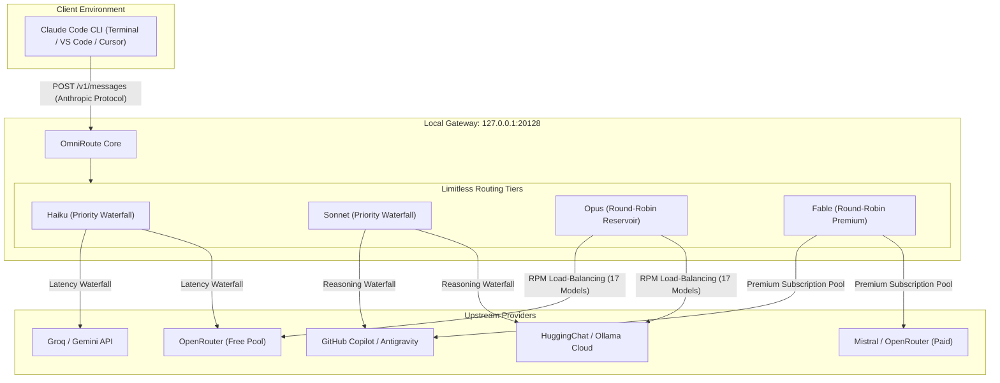
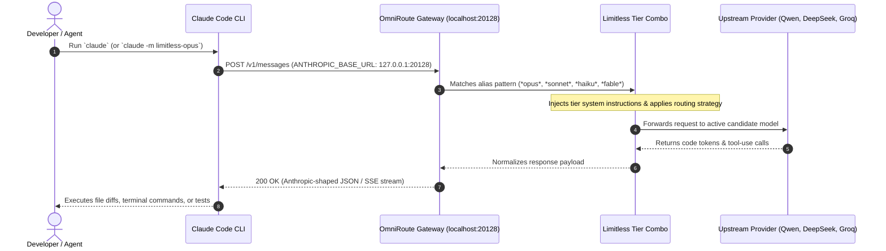

# Limitless Claude v4.5

> **Your Claude Code workflow. Your connected model fleet.**
>
> *The most stable and robust Limitless Claude setup yet. Built for safety, predictable routing, clean configuration, and zero-headache developer onboarding.*

Limitless Claude is an open-source configuration and model-routing harness that connects **Claude Code** to a dynamic fleet of third-party AI models through **OmniRoute**. Instead of binding your agentic coding sessions to a single provider meter, Limitless Claude aggregates your existing developer accounts—including free community endpoints, subscription-entitled access (like GitHub Copilot and Antigravity), and pay-as-you-go providers—into four specialized coding tiers.

---

## 1. What Limitless Claude Does (and Why It Exists)

Deep agentic coding loops run high token volumes through terminal actions, test suites, and file modifications. When using Claude Code, configuring diverse upstream models can be challenging.

Limitless Claude solves this by providing:
- **Four Purpose-Built Tiers:** Four pre-configured combo profiles (`Haiku`, `Sonnet`, `Opus`, `Fable`) with tuned system prompts and routing policies.
- **Dynamic Provider Filtering:** Scans your active OmniRoute providers and automatically configures only the models you actually have access to.
- **Safe Database Management:** Manages OmniRoute's SQLite database atomically with automatic, WAL-consistent backups and minimal API key permissions.
- **Silent Background Recovery:** Windows VBScript/Batch launchers and Unix background scripts that restart OmniRoute automatically after system boot or unexpected process termination.
- **Transparent Capacity Modeling:** Clear, reproducible calculations of your aggregate daily theoretical token capacity.

---

## 2. What Limitless Claude Does NOT Do

To keep expectations clear and honest:
- **Not an Inference Provider:** Limitless Claude does not supply free compute or host models. You connect your own provider accounts through OmniRoute.
- **Not Official Anthropic Models:** The tier names `Haiku`, `Sonnet`, `Opus`, and `Fable` are internal routing profiles. They route to models such as Qwen, DeepSeek, Llama, and GPT-4o. In particular, **Fable is an internal composite profile, not an Anthropic model**.
- **No Stolen System Prompts:** This repository does not contain Anthropic's proprietary system instructions. It uses Limitless Claude's own functional coding instructions designed to minimize conversational filler and maximize tool use accuracy.
- **No Parity Guarantees:** Third-party open-weight models have distinct strengths and limits. Model quality, speed, context window, and tool reliability depend directly on upstream provider capabilities.

---

## 3. Architecture & Data Flow

Claude Code communicates with the local gateway using the standard Anthropic Messages API protocol (`POST /v1/messages`). OmniRoute intercepts the request, matches the model alias against registered mappings, applies tier persona prompts, and routes through the chosen strategy.





*For in-depth architectural details, see [docs/ARCHITECTURE.md](docs/ARCHITECTURE.md).*

---

## 4. The Four Tiers and Routing Strategies

| Tier | Routing Strategy | Primary Focus | Models Configured | Primary Access Class |
|---|---|---|---|---|
| **⚡ Haiku** | **Priority Waterfall** | Instant syntax lookups, file tree exploration, fast tool verification | 7 candidates (Groq Llama, Gemini Flash Lite, GLM) | Zero-Marginal-Cost & Subscriptions |
| **🧠 Sonnet** | **Priority Waterfall** | Architectural planning, multi-step debugging, deep code review | 6 candidates (Claude Thinking, DeepSeek Reasoner, Command R+) | Subscription-Entitled |
| **🛠️ Opus** | **Round-Robin** | High-volume code generation and multi-agent refactoring loops | 17 candidates (Qwen 2.5 Coder, Codestral, DeepSeek, GLM) | Zero-Marginal-Cost Reservoir |
| **👑 Fable** | **Round-Robin** | High-context synthesis leveraging premium developer subscriptions | 6 candidates (GPT-4o, Claude Opus, Gemini Pro) | Subscription-Entitled & Paid |

*For exact model IDs and cascade orders, review [docs/MODEL-CATALOG.md](docs/MODEL-CATALOG.md).*

---

## 5. Token-Capacity Modeling

By load-balancing requests across diverse providers, Limitless Claude mitigates single-provider rate-limit bottlenecks. Under stated assumptions (2,500 average tokens per round-trip request), the **theoretical modeled capacity reaches ~28,000,000 tokens per day**.

```
┌──────────────────────────────────────────────────────────┐
│ ESTIMATED THEORETICAL CAPACITY: ~28M TOKENS / DAY        │
├──────────────────────────┬───────────────────────────────┤
│ Zero-Marginal-Cost (ZMC) │ ~16.5M tokens (59%)           │
│ Subscription-Entitled    │ ~8.5M tokens (30%)            │
│ Metered Paid Inference   │ ~3.0M tokens (11%)            │
└──────────────────────────┴───────────────────────────────┘
```

### Critical Modeling Caveats
1. **Modeled vs. Practical Throughput:** A human developer writing code generates far fewer tokens than an automated multi-agent loop running round-the-clock.
2. **Concurrent Availability:** Assumes all configured providers and free endpoints are concurrently accessible.
3. **Shared Quotas:** If your GitHub Copilot subscription is utilized by both Sonnet and Fable, requests issued by Sonnet directly decrement available volume for Fable.
4. **No SLA:** Free model rate limits and availability can change without notice.

*Read the transparent methodology in [docs/TOKEN-CAPACITY.md](docs/TOKEN-CAPACITY.md).*

---

## 6. Installation & Quickstart

### Prerequisites
- **Node.js** v22 or later (`node -v`)
- **npm** v10 or later
- **Claude Code CLI** (`npm install -g @anthropic-ai/claude-code`)
- **OmniRoute** (`npm install -g omniroute@latest`)

---

### Step 1: Start OmniRoute & Authenticate Providers
1. In a terminal, launch OmniRoute:
   ```bash
   omniroute serve
   ```
2. Open `http://localhost:20128` in your browser.
3. Navigate to **Providers** and connect whichever free, open-source, or subscription accounts you have (e.g., GitHub Copilot, OpenRouter, Groq).

### Step 2: Clone & Configure Limitless Claude
```bash
git clone https://github.com/mahik504/limitless-claude.git
cd limitless-claude
npm install
npm run setup
```

**What `npm run setup` performs safely:**
1. Connects to `~/.omniroute/storage.sqlite` and creates a WAL-consistent backup (`storage.sqlite.bak`).
2. Validates schema compatibility.
3. Filters tier candidates against your authenticated providers.
4. Atomically registers combos, system instructions, and routing mappings.
5. Preserves restricted API key modes without silently granting global access.
6. Writes active configuration snapshot to `config/tier-configuration.json`.
7. On Windows, registers an invisible auto-restart daemon in your Windows Startup directory.

### Step 3: Connect Claude Code to OmniRoute
Configure Claude Code to route requests through OmniRoute:

**Option A: Global Configuration via `~/.claude/settings.json` (Recommended)**
Add or update the following fields in your `~/.claude/settings.json`:
```json
{
  "env": {
    "ANTHROPIC_BASE_URL": "http://127.0.0.1:20128",
    "ANTHROPIC_AUTH_TOKEN": "your-omniroute-api-key",
    "CLAUDE_CODE_ENABLE_GATEWAY_MODEL_DISCOVERY": "true"
  }
}
```

**Option B: Terminal Environment Variables**
On Windows (PowerShell):
```powershell
$env:ANTHROPIC_BASE_URL = "http://127.0.0.1:20128"
$env:ANTHROPIC_AUTH_TOKEN = "your-omniroute-api-key"
```
On Linux / macOS:
```bash
export ANTHROPIC_BASE_URL="http://127.0.0.1:20128"
export ANTHROPIC_AUTH_TOKEN="your-omniroute-api-key"
```

### Step 4: Run Claude Code!
```bash
claude
```
Or target a specific routing profile:
```bash
claude -m limitless-opus
claude -m limitless-sonnet
claude -m limitless-haiku
claude -m limitless-fable
```

---

## 7. IDE Integration Guidance

### Claude Code Terminal
Works out of the box once `ANTHROPIC_BASE_URL` and `ANTHROPIC_AUTH_TOKEN` are set in your environment or `~/.claude/settings.json`.

### VS Code Extension
The Claude Code VS Code extension reads settings from `~/.claude/settings.json` and supports explicit configuration in VS Code `settings.json`:
```json
{
  "claudeCode.environmentVariables": [
    { "name": "ANTHROPIC_BASE_URL", "value": "http://127.0.0.1:20128" },
    { "name": "ANTHROPIC_AUTH_TOKEN", "value": "your-omniroute-api-key" }
  ]
}
```

### Cursor IDE
When running Claude Code inside Cursor's integrated terminal, it automatically inherits your user environment variables (`ANTHROPIC_BASE_URL`). To use OmniRoute combos directly within Cursor's custom model settings, configure custom models pointing to `http://localhost:20128/v1`.

---

## 8. Diagnostic & Troubleshooting Guide

| Issue | Potential Cause | Tested Resolution |
|---|---|---|
| **OmniRoute Not Reachable** | Process not running or port 20128 blocked | Run `omniroute serve` or check `curl http://127.0.0.1:20128`. |
| **Authentication Error (401)** | Missing or mismatched OmniRoute API key | Copy your active API key from the OmniRoute dashboard (`http://localhost:20128/keys`) into `ANTHROPIC_AUTH_TOKEN`. |
| **Model Alias Not Recognized** | Setup has not registered mappings | Run `npm run setup` to ensure mappings (`*opus*`, `*sonnet*`, etc.) are written to `model_combo_mappings`. |
| **No Models Found in Tier** | No matching providers authenticated | Visit `http://localhost:20128/providers`, connect at least one provider (e.g. GitHub Copilot, Groq, OpenRouter), and re-run `npm run setup`. |
| **SQLite Schema Incompatible** | Corrupted or outdated OmniRoute DB | Verify OmniRoute version is updated (`npm install -g omniroute@latest`). Setup verifies column presence before executing transactions. |
| **Daemon Repeatedly Restarting** | Invalid executable path in launcher | Re-run `npm run setup` to regenerate `omniroute-daemon.bat` with verified binary paths. |

---

## 9. Rollback & Uninstallation

- **Database Rollback:** If you ever need to restore your pre-setup OmniRoute database:
  ```bash
  cp ~/.omniroute/storage.sqlite.bak ~/.omniroute/storage.sqlite
  ```
- **Remove Windows Startup Daemon:** Delete `Limitless-OmniRoute-Launcher.vbs` from:
  `%APPDATA%\Microsoft\Windows\Start Menu\Programs\Startup`
- **Remove Linux / macOS Background Script:** Kill the background process:
  ```bash
  pkill -f "omniroute serve"
  ```

---

## 10. Automated Testing

Run the isolated test suite:
```bash
npm test
```
The test suite covers:
- WAL-consistent backup and restore verification.
- Transaction rollback on simulated failures.
- Idempotency across repeated setup executions.
- Safe API key permission preservation without broadening to `'all'`.
- Mapping priority and route integrity.
- Launcher file generation with path quoting and retry loops.
- Strict isolation from live user databases and startup folders.

*Read the testing methodology in [docs/TESTING.md](docs/TESTING.md).*

---

## 11. License

MIT © [Mahaveer Singh Gehlot](https://github.com/mahik504)
