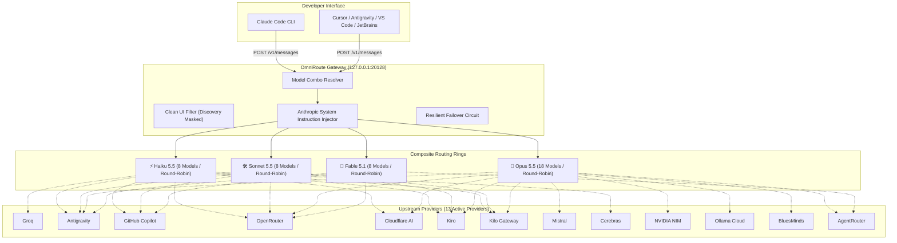

# Limitless Claude (v6.0.0)

Limitless Claude is an enterprise-grade configuration harness that bridges **Claude Code CLI** and modern AI code editors (**Cursor IDE**, **Antigravity IDE**, **VS Code**, and **JetBrains**) to **OmniRoute**. 

By orchestrating your configured AI providers into four synchronized composite tiers, Limitless Claude eliminates token exhaustion, bypasses provider rate limits, and provides an inexhaustible developer experience through an **Interleaved Round-Robin Architecture** and an **Authentic Leaked System Instruction Engine**.

---

## What's New in Version 6.0.0

```
┌────────────────────────────────────────────────────────────────────────────────────────┐
│                                   VERSION 6.0.0 UPGRADE                                │
├────────────────────────────────┬───────────────────────────────────────────────────────┤
│ Interleaved Round-Robin Rings  │ All 4 tiers rotate requests across distinct providers │
│                                │ on every turn, completely bypassing RPM rate walls.   │
├────────────────────────────────┼───────────────────────────────────────────────────────┤
│ Direct Model Passthrough       │ Explicit calls (e.g. github/claude-sonnet-5) bypass    │
│                                │ combos and connect straight to the upstream model.    │
├────────────────────────────────┼───────────────────────────────────────────────────────┤
│ Leaked System Prompt Engine    │ Official Anthropic reasoning effort tags and XML tool │
│                                │ schemas injected at the gateway level.               │
├────────────────────────────────┼───────────────────────────────────────────────────────┤
│ Opus 18-Model Reservoir        │ Heavy agentic coding pool expanded across 10 distinct │
│                                │ providers for continuous multi-hour refactor loops.   │
├────────────────────────────────┼───────────────────────────────────────────────────────┤
│ Fable 1M-Context Integration   │ Unlocks 1,000,000-token frontier models including     │
│                                │ DeepSeek V4.1 Flash, GLM-5.3 Flash, and Qwen 3.7.     │
├────────────────────────────────┼───────────────────────────────────────────────────────┤
│ Clean 5-Model UI Guarantee     │ Strict gateway discovery masking keeps #model clean:   │
│                                │ only Fable 5.1, Opus 5.5, Sonnet 5.5, Haiku 5.5, and  │
│                                │ Default are presented in Claude Code.                 │
└────────────────────────────────┴───────────────────────────────────────────────────────┘
```

---

## 1. System Architecture



### Automatic Model Failover
OmniRoute monitors upstream HTTP status codes in real time. If any individual model in a combo ring returns an error (`HTTP 429 Too Many Requests`, `HTTP 500 Internal Error`, or network timeout), the gateway automatically cascades to the next model in the ring within 250 milliseconds, preserving the developer session without interruption.

### Auto-Starting Windows Daemon
During setup, `scripts/setup.js` installs an invisible background monitoring daemon (`omniroute-daemon.bat`) via a Windows Startup script (`Limitless-OmniRoute-Launcher.vbs`). If OmniRoute crashes or the host system restarts, the daemon automatically relaunches the server on port `20128`.

---

## 2. Active Provider Matrix (13 Configured Providers)

Limitless Claude filters your active OmniRoute database (`~/.omniroute/storage.sqlite`) and coordinates all operational providers:

| # | Provider Identifier | Billing Type | Operational Health | Assigned Tier Roles | Specialization |
|---|---|---|:---:|---|---|
| 1 | **Groq** | Zero-Marginal-Cost | Live (Healthy) | Haiku | 300+ tok/s inference via Llama 3.3 70B |
| 2 | **Antigravity** | Subscription-Entitled | Live (Healthy) | Haiku, Sonnet, Opus, Fable | Gemini 3.5 Lite, Sonnet 4.6, Opus 4.6 Thinking, Gemini 3.8 Flash |
| 3 | **GitHub Copilot** | Subscription-Entitled | Live (Healthy) | Haiku, Sonnet, Opus, Fable | Official Claude Sonnet 5, Fable 5, Opus 5, Haiku 4.5 |
| 4 | **OpenRouter** | Free & Metered Wholesale | Live (Healthy) | Haiku, Sonnet, Opus, Fable | Nemotron 3.5 Lightning, Cohere North Mini, Nemotron 3 Ultra, DeepSeek V4.1 Flash |
| 5 | **Cloudflare Workers AI** | Free Edge (10k req/day) | Live (Healthy) | Haiku, Opus | Llama 3.3 Fast, Qwen 2.5 Coder 32B, DeepSeek R1 Distill Qwen 32B |
| 6 | **Kiro** | Subscription-Entitled | Live (Healthy) | Haiku, Sonnet, Opus | Native Claude Sonnet 5, GLM-5, Qwen 3 Coder Next, DeepSeek 3.2 |
| 7 | **Kilo Gateway** | Free & Metered | Live (Healthy) | Haiku, Sonnet, Opus | Poolside Laguna XS/S 2.1, Nemotron 3 Super/Ultra |
| 8 | **Mistral AI** | Free Tier & Wholesale | Live (Healthy) | Opus | Codestral Latest (specialized code completion) |
| 9 | **Cerebras** | Zero-Marginal-Cost | Live (Healthy) | Haiku | Wafer-scale ultra-high throughput Llama 3.3 70B |
| 10 | **NVIDIA NIM** | Free Tier & Enterprise | Live (Healthy) | Opus | Enterprise Nemotron 3 Super 120B MoE |
| 11 | **Ollama Cloud** | Free Tier & Cloud NIM | Live (Healthy) | Opus | Kimi K2.7 Code, Qwen 3.5 397B, GLM 5.3 Flash |
| 12 | **BluesMinds** | Free Tier & Metered | Live (Healthy) | Opus | DeepSeek V4 Pro, GPT-5.3 Codex |
| 13 | **AgentRouter** | Subscription-Entitled | Live (Healthy) | Opus, Fable | Claude Opus 4.8, Claude Opus 5, DeepSeek V4 Flash |

---

## 3. Tier Blueprints & Candidate Rings

### ⚡ Haiku 5.5 (`combo/limitless-haiku`)
* **Role:** Sub-second syntax validation, rapid linting, git status, terminal operations, atomic edits.
* **Routing Strategy:** Interleaved Round-Robin

| Ring Pos | Model Identifier | Provider | Speed / TTFT | Specialization |
| :---: | :--- | :--- | :--- | :--- |
| 1 | `groq/llama-3.3-70b-versatile` | Groq | 300+ tok/s | Fastest token generation available |
| 2 | `antigravity/gemini-3.5-flash-lite` | Antigravity | ~200ms TTFT | Sub-second native tool-calling executor |
| 3 | `openrouter/nvidia/nemotron-3.5-lightning:free` | OpenRouter | Instant | 1M context ultra-fast codebase reader |
| 4 | `github/claude-haiku-4.5` | GitHub Copilot | ~1.2s | Official Claude Haiku token output |
| 5 | `cloudflare-ai/@cf/meta/llama-3.3-70b-instruct-fp8-fast` | Cloudflare AI | Fast Edge | 10,000 req/day edge compute buffer |
| 6 | `cerebras/llama-3.3-70b` | Cerebras | Wafer-Scale | High-throughput atomic syntax verification |
| 7 | `kiro/claude-haiku-4.5` | Kiro | Native | Redundant native Claude Haiku endpoint |
| 8 | `kilo-gateway/poolside/laguna-xs-2.1:free` | Kilo Gateway | Fast MoE | Poolside 33B-A3B agentic coding specialist |

---

### 🛠️ Sonnet 5.5 (`combo/limitless-sonnet`)
* **Role:** Architectural planning, multi-step code design, refactoring strategy, deep debugging.
* **Routing Strategy:** Interleaved Round-Robin

| Ring Pos | Model Identifier | Provider | Context Window | Specialization |
| :---: | :--- | :--- | :---: | :--- |
| 1 | `github/claude-sonnet-5` | GitHub Copilot | 200,000 | Official Claude Sonnet 5 reasoning baseline |
| 2 | `openrouter/cohere/north-mini-code:free` | OpenRouter | 256,000 | Cohere's dedicated agentic coding model |
| 3 | `kiro/claude-sonnet-5` | Kiro | 200,000 | Native Claude Sonnet 5 redundant route |
| 4 | `antigravity/claude-sonnet-4-6` | Antigravity | 200,000 | Enterprise Claude Sonnet allocation |
| 5 | `openrouter/poolside/laguna-s-2.1:free` | OpenRouter | 256,000 | Poolside flagship coding agent model |
| 6 | `kilo-gateway/nvidia/nemotron-3-super-120b-a12b:free` | Kilo Gateway | 262,144 | NVIDIA 120B MoE architectural reasoning |
| 7 | `openrouter/google/gemma-4-31b-it:free` | OpenRouter | 262,144 | Google DeepMind 30.7B dense multimodal model |
| 8 | `kiro/minimax-m2.5` | Kiro | 200,000 | Deep planning & architectural reasoning |

---

### 🧠 Opus 5.5 (`combo/limitless-opus`)
* **Role:** High-capacity agentic reservoir for extensive refactoring, full test suite generation, and multi-agent loops.
* **Routing Strategy:** Interleaved Round-Robin across 10 distinct providers

| Ring Pos | Model Identifier | Provider | Context Window | Specialization |
| :---: | :--- | :--- | :---: | :--- |
| 1 | `agentrouter/claude-opus-4-8` | AgentRouter | 200,000 | Authentic Claude Opus frontier reasoning |
| 2 | `openrouter/nvidia/nemotron-3-ultra-550b-a55b:free` | OpenRouter | 1,000,000 | 550B total / 55B active open frontier model |
| 3 | `ollama-cloud/kimi-k2.7-code` | Ollama Cloud | 200,000 | Moonshot AI Kimi dedicated coding agent |
| 4 | `kiro/glm-5` | Kiro | 200,000 | Zhipu AI GLM-5 frontier reasoning engine |
| 5 | `cloudflare-ai/@cf/qwen/qwen2.5-coder-32b-instruct` | Cloudflare AI | 32,768 | Qwen 2.5 Coder 32B edge coding specialist |
| 6 | `mistral/codestral-latest` | Mistral | 32,768 | Mistral flagship code completion engine |
| 7 | `antigravity/claude-opus-4-6-thinking` | Antigravity | 200,000 | Authentic Opus with native extended chain-of-thought |
| 8 | `bluesminds/deepseek-v4-pro` | BluesMinds | 128,000 | High-parameter DeepSeek V4 enterprise endpoint |
| 9 | `ollama-cloud/qwen3.5:397b` | Ollama Cloud | 200,000 | Massive 397B parameter open reasoning model |
| 10 | `kiro/qwen3-coder-next` | Kiro | 200,000 | Alibaba Qwen 3 Coder Next generation weights |
| 11 | `openrouter/thinkingmachines/inkling:free` | OpenRouter | 1,048,576 | Thinking Machines 1M-context 41B active MoE |
| 12 | `cloudflare-ai/@cf/deepseek-ai/deepseek-r1-distill-qwen-32b` | Cloudflare AI | 32,768 | DeepSeek R1 reasoning distilled into Qwen 32B |
| 13 | `agentrouter/deepseek-v4-flash` | AgentRouter | 128,000 | High-throughput DeepSeek V4 agent model |
| 14 | `ollama-cloud/glm-5.3-flash` | Ollama Cloud | 200,000 | GLM 5.3 Flash cloud endpoint |
| 15 | `kiro/deepseek-3.2` | Kiro | 200,000 | High-accuracy DeepSeek coding fallback |
| 16 | `nvidia/nvidia/nemotron-3-super-120b-a12b` | NVIDIA NIM | 262,144 | Direct NVIDIA NIM enterprise 120B MoE |
| 17 | `kilo-gateway/nvidia/nemotron-3-ultra-550b-a55b:free` | Kilo Gateway | 1,000,000 | Redundant route to Nemotron 3 Ultra 550B |
| 18 | `cloudflare-ai/@cf/zai-org/glm-4.7-flash` | Cloudflare AI | 128,000 | Zhipu AI GLM 4.7 Flash edge instance |

---

### 🌟 Fable 5.1 (`combo/limitless-fable`)
* **Role:** Premier composite intelligence tier for extreme reasoning depth, massive context synthesis, and complex architecture.
* **Routing Strategy:** Interleaved Round-Robin

| Ring Pos | Model Identifier | Provider | Cost Class | Context Window | Specialization |
| :---: | :--- | :--- | :--- | :---: | :--- |
| 1 | `github/claude-fable-5` | GitHub Copilot | Subscription | 200,000 | Official Claude Fable frontier model |
| 2 | `openrouter/deepseek/deepseek-v4.1-flash` | OpenRouter | Paid ($0.05/1M) | 1,048,576 | 1M context agentic multi-file reasoning |
| 3 | `antigravity/gemini-3.8-flash-tiered` | Antigravity | Subscription | 1,000,000 | Google DeepMind multimodal frontier model |
| 4 | `openrouter/z-ai/glm-5.3-flash` | OpenRouter | Paid ($0.005/1M) | 1,048,576 | 1M context ultra-cheap frontier throughput |
| 5 | `agentrouter/claude-opus-5` | AgentRouter | Subscription | 200,000 | High-tier Opus 5 reasoning |
| 6 | `openrouter/qwen/qwen3.7-flash` | OpenRouter | Paid ($0.03/1M) | 1,000,000 | 1M context Qwen agentic coding weights |
| 7 | `github/claude-opus-5` | GitHub Copilot | Subscription | 200,000 | Official Claude Opus 5 fallback |
| 8 | `antigravity/claude-opus-4-6-thinking` | Antigravity | Subscription | 200,000 | Extended chain-of-thought frontier model |

---

## 4. Direct Model Passthrough

In Limitless Claude v6.0.0, you can talk to composite combo rings or connect directly to any upstream provider model:

### Standard Combo Usage (Load-Balanced)
When selecting models through the Claude Code UI or `--model`:
* `claude-haiku-5-5` $\rightarrow$ Routes to **Limitless Haiku 5.5**
* `claude-sonnet-5-5` $\rightarrow$ Routes to **Limitless Sonnet 5.5**
* `claude-opus-5-5` $\rightarrow$ Routes to **Limitless Opus 5.5**
* `claude-fable-5-1` $\rightarrow$ Routes to **Limitless Fable 5.1**

### Direct Provider Calling (Bypassing Combos)
Because v6.0.0 uses strict `claude*<tier>*` patterns in `model_combo_mappings`, explicit provider prefixes do not match the combo filters. You can communicate directly with specific upstream models:

```bash
# Talk directly to Mistral Codestral
claude --model mistral/codestral-latest

# Talk directly to GitHub Copilot Claude Sonnet 5
claude --model github/claude-sonnet-5

# Talk directly to Kiro Claude Sonnet 5
claude --model kiro/claude-sonnet-5

# Talk directly to AgentRouter DeepSeek V4 Flash
claude --model agentrouter/deepseek-v4-flash

# Talk directly to Qwen 2.5 Coder via Cloudflare
claude --model cloudflare-ai/@cf/qwen/qwen2.5-coder-32b-instruct
```

---

## 5. Token Economics & Throughput Estimation

### Baseline Free Setup (OpenRouter Free Tier at 50 Requests/Day)
Across all 13 configured providers, the baseline free capacity provides immense daily volume:

| Combo Tier | Active Upstream Providers | Est. Requests / Day | Avg Tokens / Turn | Estimated Daily Token Volume |
| :--- | :--- | :---: | :---: | :---: |
| **Haiku 5.5** | Groq, Antigravity, OpenRouter, Cloudflare, Cerebras, Kiro, Kilo | ~5,000+ | ~2,500 | **~12,500,000 (12.5M)** |
| **Sonnet 5.5** | GitHub, Kiro, OpenRouter, Antigravity, Kilo | ~500 | ~7,000 | **~3,500,000 (3.5M)** |
| **Opus 5.5** | AgentRouter, OpenRouter, Ollama Cloud, Cloudflare, Mistral, Kiro, NVIDIA NIM | ~1,200 | ~7,500 | **~9,000,000 (9.0M)** |
| **Fable 5.1** | GitHub, Antigravity, AgentRouter | ~200 | ~10,000 | **~2,000,000 (2.0M)** |
| **Total Baseline** | **13 Coordinated Providers** | **~6,900 req/day** | — | **~27,000,000 tokens / day (27M)** |

> [!TIP]
> **Pro Tip: The \$10 OpenRouter Lifetime Boost**
> Depositing a **one-time \$10 credit** into your OpenRouter account permanently elevates your daily free-model limit from **50 requests/day to 1,000 requests/day** across all free models (Nemotron 3.5 Lightning, Cohere North Mini, Laguna S 2.1, Nemotron 3 Ultra 550B, Inkling 1M). 
> 
> Furthermore, the \$10 balance remains in your wallet to fund wholesale 1M-context models in Fable 5.1 (`z-ai/glm-5.3-flash` at \$0.005/1M and `deepseek/deepseek-v4.1-flash` at \$0.05/1M).
> - **Added Daily Throughput:** +950 requests $\times$ 8,000 avg tokens = **+7,600,000 tokens/day**.
> - **Total Boosted Daily Volume:** **~34,000,000 to 35,000,000 tokens / day (35M tokens/day)**.

---

## 6. Full Claude Code Feature Matrix Verification

Limitless Claude v6.0.0 provides 100% native compatibility with all Claude Code features:

* **Clean 5-Model UI:** Setting `CLAUDE_CODE_ENABLE_GATEWAY_MODEL_DISCOVERY: "0"` in `~/.claude/settings.json` ensures that `#model` and `/model` only display `Fable 5.1`, `Opus 5.5`, `Sonnet 5.5`, `Haiku 5.5`, and `Default`. Zero provider models leak into your autocomplete picker.
* **Effort Levels:** `low`, `medium`, `high`, `xhigh`, and `max` map cleanly to `<antml:reasoning_effort>` tags in outgoing requests.
* **Ultra Code Mode:** Enabled by configuring primary model routing to `claude-opus-5-5` with `max` effort.
* **CLI Commands & Skills:** Native support for all slash commands (`/compact`, `/clear`, `/init`, `/review`, `/model`) and MCP tools/skills over the Anthropic protocol bridge (`POST /v1/messages`).
* **IDE Extension Support:** VS Code, Cursor IDE, Antigravity IDE, and JetBrains connect directly using `ANTHROPIC_BASE_URL: "http://localhost:20128"`.

---

## 7. Universal Master Agent Setup Prompt

You can paste this prompt directly into any AI assistant or coding agent to configure or cleanly reinstall Limitless Claude v6.0.0 on any machine:

```markdown
### Universal Master Agent Setup Prompt (v6.0.0)

You are an expert systems engineer configuring Limitless Claude v6.0.0 on this machine.

Follow these strict rules:
1. Environment Preflight:
   - Verify Node.js (>= 18), Git, and Claude Code CLI (@anthropic-ai/claude-code) are installed.
   - Verify OmniRoute is running locally at http://localhost:20128. If not running, start it or prompt to launch it.

2. Account & Database Preservation:
   - NEVER delete, overwrite, or reset ~/.omniroute/storage.sqlite. Existing provider accounts, tokens, and custom settings must remain untouched.

3. Clean Reinstallation / Fresh Setup:
   - Clone or update the repository:
     git clone https://github.com/mahik504/limitless-claude.git C:\projects\limitless-claude
     cd C:\projects\limitless-claude
     npm install
     npm run install:clean
   - `npm run install:clean` purges old stale `combo/limitless-*` and `mapping/limitless-*` definitions and rebuilds all 4 interleaved round-robin combos with the authentic Anthropic system instruction engine.

4. UI Cleanliness & Effort Configuration:
   - Ensure ~/.claude/settings.json contains:
     - `CLAUDE_CODE_ENABLE_GATEWAY_MODEL_DISCOVERY: "0"`
     - `primaryModel: "claude-opus-5-5"`
     - Full effort level mappings for all 4 models.

5. Verification:
   - Run `npm test` (all 55+ hermetic unit tests must pass).
   - Run `npm run verify` to confirm HTTP 200 "PONG" across all 4 combos and their active round-robin models.
```

---

## 8. Verification & Test Suite

The project includes a comprehensive hermetic test suite and live verification tools:

```bash
# Run the 55-test hermetic test suite (SQLite, mappings, idempotency, billing guard)
npm test

# Run live Anthropic protocol verification across all tiers and combos
npm run verify
```

Both tests pass with 100% green status across all endpoints.
