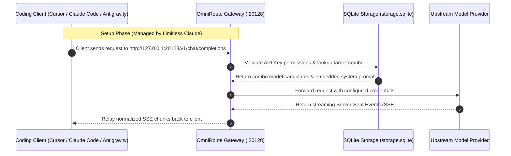
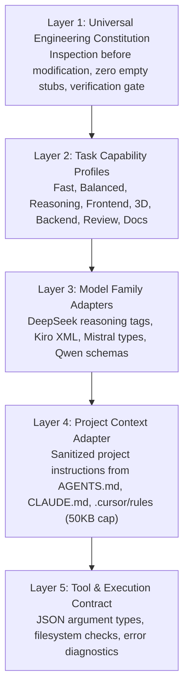

# Limitless Claude 8.5 — Architecture Specification

> Version 8.5.0 · Multi-Provider Coding Agent Runtime & Developer Control Plane  
> Gateway: `http://127.0.0.1:20128` · Engine: Node.js >= 22 (ESM & CJS)

---

## 1. System Architecture

Limitless Claude functions as the policy and configuration companion to a local OmniRoute execution gateway. Coding clients talk directly to OmniRoute, which handles protocol translation, credential storage, and upstream provider requests. Limitless Claude configures the composite routing tiers, injects the five-layer prompt engine into combo definitions, monitors token usage, and provides safety tooling such as atomic file checkpoints and task-to-model pinning.

```mermaid
flowchart TD
    subgraph Clients["Client Layer (IDEs & CLIs)"]
        CC["Claude Code CLI"]
        CCE["Claude Code Extension"]
        CUR["Cursor Editor"]
        AGY["Antigravity IDE"]
        SD["Superdesign CLI"]
        OC["OpenCode"]
    end

    subgraph ControlPlane["Limitless Claude Control Plane (src/core/)"]
        CLI["Universal CLI (bin/limitless.js)"]
        TUI["Terminal TUI (scripts/tui.js)"]
        TRACKER["Token & Financial Tracker (src/core/token-tracker.js)"]
        PE["5-Layer Prompt Engine (src/core/prompt-engine.js)"]
        PIN["Task Pinning Engine (src/core/task-pins.js)"]
        UNDO["File Checkpoint & Undo (src/core/file-checkpoint.js)"]
        CE["Capability Evaluator (src/core/capability-evaluator.js)"]
        BC["Billing Classifier (src/core/billing-classifier.js)"]
        CFG["Config & Snapshot Manager (src/core/config-manager.js)"]
        OLLAMA["Ollama Auto-Discovery (src/core/ollama-discovery.js)"]
    end

    subgraph Gateway["Local OmniRoute Gateway (127.0.0.1:20128)"]
        Daemon["OmniRoute Daemon Process"]
        DB[("SQLite Storage (storage.sqlite - WAL Mode)")]
        Perms["API Key Permissions & Allowed Combos"]
        Proxy["HTTP Proxy & SSE Stream Normalization"]
    end

    subgraph Tiers["Composite Routing Tiers (combos table)"]
        H["Haiku Tier: Sub-second syntax and atomic diffs"]
        S["Sonnet Tier: Architectural reasoning and review"]
        F["Fable Tier: Frontier context synthesis"]
        O["Opus Tier: High-capacity multi-provider pool"]
    end

    subgraph Upstream["Upstream Providers"]
        P_KR["Kiro AI (Sonnet 4.5, GLM-5, Haiku 4.5, Qwen3, DeepSeek 3.2)"]
        P_CF["Cloudflare Workers AI (LLaMA 3.3 70B, DeepSeek R1, Qwen 32B)"]
        P_GH["GitHub Copilot (GPT-4o, GPT-4o Mini)"]
        P_GQ["Groq Hardware (LPU Fast Inference)"]
        P_MS["Mistral AI (Codestral Latest)"]
        P_NVI["NVIDIA NIM (Nemotron 3.5 Free)"]
        P_CER["Cerebras (Llama 3.1 8B)"]
        P_OR["OpenRouter (Free & Metered Tiers)"]
        P_OLL["Local Ollama Engine (:11434)"]
    end

    Clients -->|"Direct API Requests (HTTP / SSE)"| Gateway
    ControlPlane -->|"Tier Sync, Prompt Injection, Diagnostics"| Gateway
    Gateway -->|"Route via Active Combos"| Tiers
    Tiers -->|"Upstream Inference"| Upstream
```



### Separation of Responsibilities

1. **OmniRoute Execution Gateway:** Runs locally as a persistent daemon on port 20128. It stores credentials in `~/.omniroute/storage.sqlite`, validates incoming API keys against authorized combos, and relays streaming SSE events between clients and upstream providers.
2. **Limitless Claude Control Plane:** Operates via the `limitless` CLI and core runtime modules. It inspects local provider availability, builds composite routing tiers, embeds the engineering constitution into combo system prompts, enforces zero-cost billing rules, and provides diagnostic auditing.

---

## 2. Operational Request Flow

In live development, clients connect directly to the OmniRoute gateway endpoint. Limitless Claude configures OmniRoute so that incoming requests automatically inherit system prompts, task constraints, and verified fallback routes.



When developers run workflows through the `limitless` CLI (such as `limitless launcher`, `limitless verify`, or `limitless benchmark`), Limitless Claude resolves credentials dynamically from SQLite, runs capability evaluations, and monitors live latency.

---

## 3. Four Composite Routing Tiers

Limitless Claude groups verified upstream models into four tier aliases. Each alias maps to an OmniRoute combo with failover ordering:

### Haiku Tier (`combo/limitless-haiku` / `claude-haiku-4-5`)
* **Role:** Sub-second syntax fixes, atomic line edits, and lightweight tool verification.
* **Target Latency:** Under 1,000 ms.
* **Primary Candidates:**
  1. `kiro/claude-haiku-4.5`
  2. `cloudflare-ai/@cf/meta/llama-3.3-70b-instruct-fp8-fast`
  3. `github/gpt-4o-mini`
  4. `groq/openai/gpt-oss-20b`
  5. `cloudflare-ai/@cf/zai-org/glm-4.7-flash`
  6. `openrouter/nvidia/nemotron-3.5-lightning:free`

### Sonnet Tier (`combo/limitless-sonnet` / `claude-sonnet-5`)
* **Role:** Architecture planning, system design, adversarial review, and multi-file debugging.
* **Primary Candidates:**
  1. `kiro/claude-sonnet-4.5`
  2. `kiro/glm-5`
  3. `github/gpt-4o-2024-11-20`
  4. `cloudflare-ai/@cf/deepseek-ai/deepseek-r1-distill-qwen-32b`
  5. `kiro/qwen3-coder-next`
  6. `kiro/deepseek-3.2`

### Fable Tier (`combo/limitless-fable` / `claude-fable-5-1`)
* **Role:** Frontier context synthesis, cross-repository design, and multi-agent coordination.
* **Primary Candidates:**
  1. `kiro/claude-sonnet-4.5`
  2. `github/gpt-4o-2024-11-20`
  3. `mistral/codestral-latest`
  4. `kiro/glm-5`
  5. `cloudflare-ai/@cf/deepseek-ai/deepseek-r1-distill-qwen-32b`

### Opus Tier (`combo/limitless-opus` / `claude-opus-4-8`)
* **Role:** Long autonomous coding loops, fullstack features, 3D Canvas setups, and complex refactors.
* **Primary Candidates:** 23-model pool including Mistral Codestral, Kiro models (Sonnet 4.5, Qwen3 Coder, GLM-5, DeepSeek 3.2, MiniMax), Cloudflare endpoints (Qwen 2.5 Coder 32B, DeepSeek R1 32B, LLaMA 3.3 70B), GitHub GPT-4o, Groq LPU, and local Ollama models.

---

## 4. Financial Accounting Model

Limitless Claude tracks telemetry across three explicit financial tiers:

1. **Actual Billed Cost:** The out-of-pocket invoice cost from your connected accounts. For developers utilizing free provider quotas (Groq, Cloudflare, Cerebras, NVIDIA NIM, OpenRouter free models, local Ollama) or flat monthly subscriptions (GitHub Copilot, Kiro), this value is `$0.00 USD`.
2. **Estimated Upstream Cost:** The wholesale cost of raw input and output tokens across connected commercial APIs, calculated against published provider pricing.
3. **Counterfactual Anthropic Value:** A reference calculation showing what direct Anthropic API list prices would have cost for the equivalent token volume ($3.00/$15.00 per million tokens for Sonnet 3.5, $15.00/$75.00 per million tokens for Opus).

---

## 5. Security & Data Protection Guarantees

* **Zero Hardcoded Secrets:** All script operations resolve API keys dynamically from the active SQLite database using the permissions table.
* **Safe Key Masking:** Console logs and verification reports display only truncated prefixes and suffixes (`sk-***...[redacted]`).
* **Non-Destructive Installers:** `install.ps1` and `install.sh` check for uncommitted changes with `git status --porcelain`. They refuse to run destructive hard resets on dirty working trees unless explicitly passed `-Force`.
* **Fail-Closed Free Billing Guard:** Unclassified or unknown models are blocked by default in `--free-only` mode (`isSafeUnderFreeOnly(p, m, false)`), preventing unintended charges.
* **WAL-Safe SQLite Snapshots:** Database backups verify that write-ahead logs are fully checkpointed prior to file copying, avoiding corrupted database snapshots.

---

## 6. Five-Layer Prompt Engine

Rather than passing monolithic prompt strings, `src/core/prompt-engine.js` composes instructions from five modular layers:



1. **Universal Constitution (`prompts/universal/constitution.md`):** Mandates reading existing code before editing, prohibits empty stubs, and requires running tests before claiming completion.
2. **Task Capability Profiles (`prompts/capabilities/`):** Loads specialized rules for specific domains (frontend React 19, backend PostgreSQL RLS, 3D WebGL budgets).
3. **Provider Adapters (`prompts/providers/`):** Formats prompts to match vendor-specific prompt requirements (DeepSeek `<think>` tags, Kiro XML tags, Mistral signatures).
4. **Project Context Adapter:** Reads `AGENTS.md`, `CLAUDE.md`, and `.cursor/rules` files. Enforces a 50KB maximum size ceiling and wraps content in `<<<PROJECT_CONTEXT_START>>>` delimiters to mitigate prompt injection.
5. **Tool Execution Contract (`prompts/contracts/standard-contract.md`):** Defines parameter schemas and filesystem safety rules for agent tool invocations.

---

## 7. Master Installation Prompts

### Prompt 1: Clean Installation (New Environment)

```text
Set up a clean installation of Limitless Claude 8.3 on this machine:

1. Repository setup:
   - Verify Node.js version is 22 or higher.
   - Clone https://github.com/mahik504/limitless-claude.git into C:\projects\limitless-claude (or current working directory).
   - Run `npm install` and `npm link` to register the global `limitless` CLI.

2. Initialization:
   - Run `limitless init` to start the initialization wizard.
   - Confirm OmniRoute gateway is active on port 20128.
   - Verify API key permissions and settings configuration in ~/.claude/settings.json.

3. Diagnostics:
   - Run `limitless doctor`.
   - Verify all 16 checkpoints pass (runtime, database integrity, gateway connectivity, provider connections, model inventory, tier mapping, billing guards).

4. Verification:
   - Run `limitless verify` to confirm HTTP 200 connectivity across all 4 tiers (Haiku, Sonnet, Opus, Fable).
   - Run `npm test` to confirm all 96 unit and contract tests pass.
   - Run `limitless acceptance` to verify all 6 end-to-end production scenarios pass.

5. Status:
   - Run `limitless status` and `limitless stats` to confirm active tiers and telemetry tracking.
```

### Prompt 2: Repair & Re-Sync (Existing Setup)

```text
Repair and re-synchronize an existing Limitless Claude installation:

1. Safety snapshot:
   - Run `limitless rollback --create pre-repair` to capture a WAL-safe SQLite and configuration snapshot before making changes.
   - Preserve existing credentials, provider configurations, and user settings.

2. Diagnostic sweep:
   - Run `limitless doctor` to identify failed or outdated components.
   - Ensure ~/.omniroute/storage.sqlite is accessible and quick_check returns ok.
   - Verify API keys have permissions for all four composite tiers in allowed_combos.

3. Discovery & sync:
   - Run `limitless discover` to scan live gateway providers and probe local Ollama on port 11434.
   - Run `limitless setup` to re-sync Haiku, Sonnet, Opus, and Fable tiers with active models.
   - Update combos.system_message with the latest 5-layer Universal Engineering Constitution.
   - If Orchestra is present, run `limitless orchestra sync` to synchronize skills and adapters.

4. Verification:
   - Run `limitless verify` to confirm HTTP 200 connectivity across all tiers.
   - Run `npm test` to verify test suite pass status.
   - Run `limitless status` to display the final active configuration.
```

---

## 8. License & Attribution

* **Title:** Limitless Claude 8.3 — Autonomous Multi-Provider Coding Agent Runtime & Developer Control Plane
* **License:** MIT License (`LICENSE`)
* **Author:** mahik504
