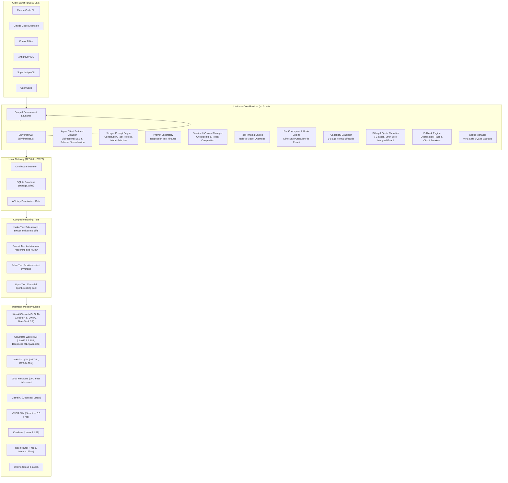
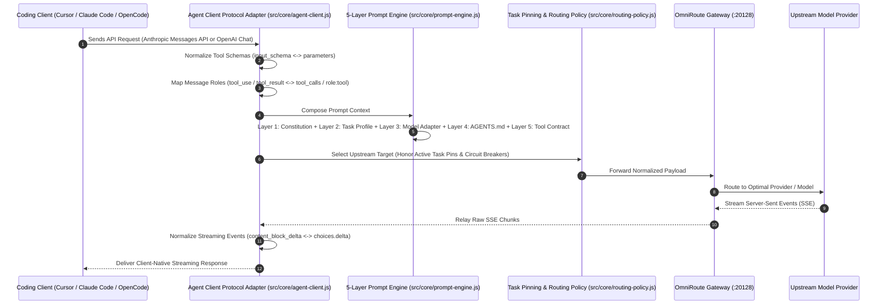
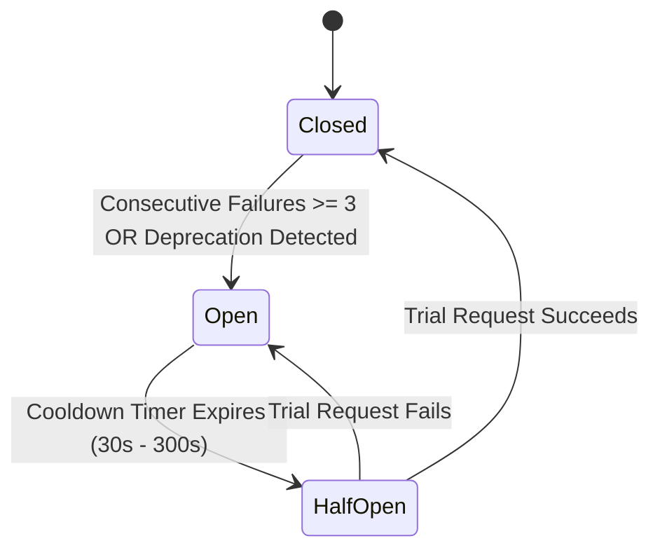

# Limitless Claude 8.1 — Complete Architecture Specification

> Version 8.1.0 · Multi-Provider Coding Agent Runtime  
> Gateway: `http://127.0.0.1:20128` · Engine: Node.js >= 22 (ESM & CJS)

---

## 1. System Architecture



---

## 2. Request Lifecycle & Tool Translation Sequence



---

## 3. Four Composite Routing Tiers

OmniRoute groups verified models into four composite aliases. Every endpoint is smoke-tested against live gateway responses before promotion:

### Haiku Tier (`combo/limitless-haiku` / `claude-haiku-4-5`)
* **Purpose:** Sub-second syntax verification, atomic line diffs, quick tool checks.
* **Target Latency:** < 1,000 ms.
* **Active Models (6):**
  1. `kiro/claude-haiku-4.5`
  2. `cloudflare-ai/@cf/meta/llama-3.3-70b-instruct-fp8-fast`
  3. `github/gpt-4o-mini`
  4. `groq/openai/gpt-oss-20b`
  5. `cloudflare-ai/@cf/zai-org/glm-4.7-flash`
  6. `openrouter/nvidia/nemotron-3.5-lightning:free`

### Sonnet Tier (`combo/limitless-sonnet` / `claude-sonnet-5`)
* **Purpose:** Architectural planning, system design, code review, multi-turn debugging.
* **Active Models (6):**
  1. `kiro/claude-sonnet-4.5`
  2. `kiro/glm-5`
  3. `github/gpt-4o-2024-11-20`
  4. `cloudflare-ai/@cf/deepseek-ai/deepseek-r1-distill-qwen-32b`
  5. `kiro/qwen3-coder-next`
  6. `kiro/deepseek-3.2`

### Fable Tier (`combo/limitless-fable` / `claude-fable-5-1`)
* **Purpose:** Frontier context synthesis, multi-agent coordination, god-mode coding.
* **Active Models (5):**
  1. `kiro/claude-sonnet-4.5`
  2. `github/gpt-4o-2024-11-20`
  3. `mistral/codestral-latest`
  4. `kiro/glm-5`
  5. `cloudflare-ai/@cf/deepseek-ai/deepseek-r1-distill-qwen-32b`

### Opus Tier (`combo/limitless-opus` / `claude-opus-4-8`)
* **Purpose:** High-capacity agentic coding reservoir across 23 models for long autonomous loops.
* **Primary Models:** `mistral/codestral-latest`, `kiro/claude-sonnet-4.5`, `kiro/qwen3-coder-next`, `kiro/glm-5`, `kiro/deepseek-3.2`, `kiro/minimax-m2.1`, Cloudflare Qwen 2.5 Coder 32B, DeepSeek R1 32B, LLaMA 3.3 70B, GitHub GPT-4o, Groq LPU, and NVIDIA Nemotron free endpoints.

---

## 4. Key Architectural Subsystems

### Task-to-Model Pinning Engine (`src/core/task-pins.js`)
Users can assign dedicated model endpoints to specific engineering tasks, matching the flexibility of Roo Code custom modes:
```bash
limitless pin --task backend --model kiro/claude-sonnet-4.5
limitless pin --task fast --model groq/openai/gpt-oss-20b
limitless pin --list
limitless pin --remove backend
```
Pinned models take immediate priority (index 0) in the candidate pool for matching tasks.

### File Checkpoint & Undo Engine (`src/core/file-checkpoint.js`)
Provides Cline-style granular file snapshots and atomic undo before autonomous loops:
```bash
limitless checkpoint --create "pre-refactor auth" src/auth.js src/db.js
limitless undo --dry-run
limitless undo
```
Files are stored with SHA-256 integrity hashes in `.limitless/checkpoints/` and can be restored individually.

### Five-Layer Prompt Engine (`src/core/prompt-engine.js`)
Instead of a single prompt string, instructions are composed from five layers:
1. **Layer 1: Universal Engineering Constitution** (`prompts/universal/constitution.md`) — Enforces reading code before edits, forbids empty stubs, and demands test evidence.
2. **Layer 2: Task Capability Profiles** (`prompts/capabilities/`) — Loads specialized instructions for `fast`, `balanced`, `reasoning`, `frontend`, `backend`, `3d`, `review`, and `docs`.
3. **Layer 3: Model Family Adapters** (`prompts/providers/`) — Formats prompts for model-specific syntax (DeepSeek `<think>` tags, Kiro XML, Mistral types).
4. **Layer 4: Project Context Adapter** — Discovers and sanitizes `AGENTS.md`, `CLAUDE.md`, and `.cursorrules` with injection delimiters (`<<<PROJECT_CONTEXT_START>>>`).
5. **Layer 5: Tool & Execution Contract** (`prompts/contracts/standard-contract.md`) — Defines exact JSON schemas, filesystem safety checks, and error boundaries.

### Circuit Breakers & Fallback Engine (`src/core/routing-policy.js`)

- **Deprecation traps** instantly trip the circuit breaker when an upstream vendor returns an outdated client notice.
- **Billing safety guards** classify every model across 7 formal classes. Models with unverified pricing return `null` and are excluded in free-only mode.

---

## 5. Master Installation Prompts

### Clean Installation (New Environment)
Copy and paste this prompt into an AI coding assistant (Antigravity, Cursor, or Claude Code):

```text
Set up a clean installation of Limitless Claude 8.1 on this machine:

1. Repository setup:
   - Check if the repository exists at C:\projects\limitless-claude (or clone from https://github.com/mahik504/limitless-claude.git).
   - Ensure Node.js version is 22 or higher. Run `npm install` inside the project root.

2. Diagnostic sweep:
   - Run `node bin/limitless.js doctor`.
   - Confirm all 15 checkpoints pass, including database integrity, API key permissions, gateway reachability, model catalog, and billing guards.
   - If the OmniRoute gateway is not running, open it from the Windows system tray or run `omniroute-daemon.bat` directly. Note that `npm run launcher` starts Claude Code with the scoped profile — it does not start the OmniRoute background daemon.

3. Model discovery:
   - Run `node bin/limitless.js discover` to scan live providers (Groq, Cloudflare, Kiro, Mistral, NVIDIA, Cerebras, OpenRouter, GitHub Copilot).
   - Verify `config/provider-inventory.json` and `config/model-inventory.json` are generated.

4. Composite tier setup:
   - Run `node bin/limitless.js setup` to register the composite tiers in OmniRoute:
     * Haiku: 6 sub-second models for syntax checks and atomic line diffs.
     * Sonnet: 6 models for system architecture, reasoning, and review.
     * Opus: 23-model pool for autonomous coding loops.
     * Fable: 5 models for frontier context synthesis.
   - Inject the Universal Engineering Constitution into combos.system_message.

5. Verification:
   - Run `node bin/limitless.js verify` to confirm HTTP 200 connectivity across all 4 tiers.
   - Run `node bin/limitless.js acceptance` to execute the end-to-end acceptance suite.
   - Run `npm test` to verify all unit and contract tests pass.

6. Completion:
   - Run `node bin/limitless.js status` to display the active tier configuration.
   - Use `limitless launcher` to start a Claude Code session.
```

---

### Repair & Re-Sync (Existing Setup)
Copy and paste this prompt when updating or repairing an existing Limitless Claude installation:

```text
Repair and re-synchronize an existing Limitless Claude installation:

1. Create backup snapshot:
   - Run `node bin/limitless.js rollback --create pre-repair` to capture a WAL-safe SQLite and configuration snapshot before making modifications.
   - Keep existing API keys, provider configurations, and user credentials intact.

2. Database and key checks:
   - Check that ~/.omniroute/storage.sqlite is accessible.
   - Run `node bin/limitless.js doctor`. If the API key is in restricted mode, ensure all composite tiers are included in allowed_combos.
   - Remove deprecated endpoints from primary positions.

3. Discovery and classification:
   - Run `node bin/limitless.js discover` to read live gateway endpoints.
   - Update model records with formal lifecycle states (ESTIMATED, SMOKE_TESTED, PRODUCTION_APPROVED).
   - Verify unknown model pricing returns null, preventing unintended charges in free-only mode.

4. Re-sync tiers:
   - Run `node bin/limitless.js setup` to update Haiku, Sonnet, Opus, and Fable tiers with active models.
   - Update the 5-layer Universal Engineering Constitution in combos.system_message.

5. Verification:
   - Run `node bin/limitless.js verify` to confirm HTTP 200 connectivity across all tiers.
   - Run `node bin/limitless.js prompt test` to verify Prompt Laboratory fixtures pass.
   - Run `npm test` to confirm test suites pass.
   - Run `limitless status` to display the verified configuration.
```

---

## 6. License & Release Information

* **Title:** Limitless Claude 8.1 — Autonomous Multi-Provider Coding Agent Runtime
* **License:** MIT License (`LICENSE`)
* **About / Description:** Provider-neutral coding-agent runtime with intelligent 4-tier routing, task-to-model pinning, Cline-style granular file undo, 5-layer prompt engine, and strict billing safety.
