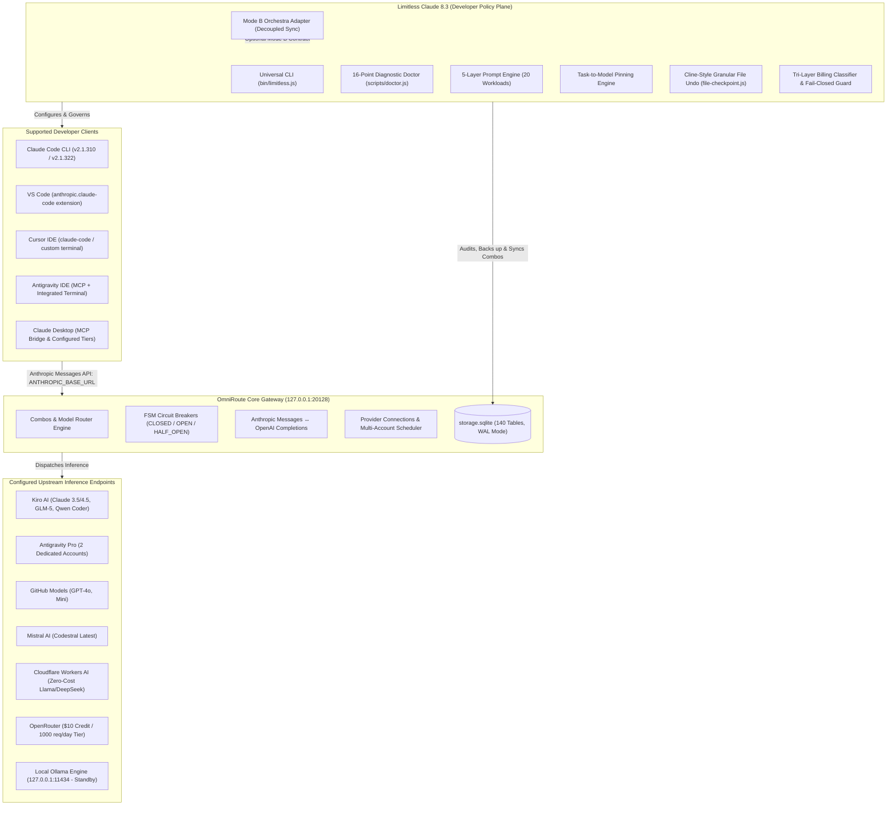

# Limitless Claude 8.3 — Complete Architecture Specification
**Architecture Pin**: Limitless Claude 8.3.0  
**Target Infrastructure**: OmniRouter (127.0.0.1:20128)  
**Classification**: Production Architecture & System Contract  
**Document Revision**: November 2026  

---

## 1. System Vision & The Policy Plane Delineation

Limitless Claude is the **Intelligent Developer Control Plane and Policy Companion** built around the Claude development experience. Rather than building a redundant model proxy from scratch, Limitless Claude establishes a clean architectural division of labor between the **transport/gateway plane** (OmniRoute) and the **developer policy/workflow plane** (Limitless Claude).



---

## 2. Delineation of Responsibilities

To avoid competing control planes or circular dependencies, system responsibilities are strictly bounded:

| Component | Strict Ownership & Responsibilities | Prohibited Responsibilities |
| :--- | :--- | :--- |
| **Limitless Claude** | • Model capability classification & tier strategy<br>• 5-Layer Prompt Engine (20 workloads)<br>• Granular pre-edit file checkpoints & instant undo<br>• Task-to-model overrides (`limitless pin`)<br>• Automated 16-point diagnostics (`limitless doctor`)<br>• IDE extension environment configuration<br>• Scoped launcher & profile management | • Never acts as an in-line HTTP proxy server<br>• Never modifies upstream provider accounts<br>• Never stores unencrypted secrets<br>• Never replaces working client harnesses |
| **OmniRoute** | • High-performance HTTP server listening on port 20128<br>• Bidirectional streaming translation (Anthropic ↔ OpenAI)<br>• Upstream connection pools & rate limit tracking<br>• Combo model waterfall resolution & fallback execution<br>• SQLite storage, encryption, and semantic caching | • Does not generate client IDE settings files<br>• Does not manage developer filesystem undo snapshots<br>• Does not synthesize multi-layer system prompts |
| **Client Harnesses** | • Local terminal / GUI pair programming interactions<br>• Tool call requests (Bash, Edit, Glob, View)<br>• Rendering real-time markdown streaming tokens<br>• Enforcing workspace file system security boundaries | • Must not bypass local gateway configuration<br>• Must not alter system prompts without policy review |
| **Upstream Providers**| • Token generation, reasoning blocks, and raw inference | • No visibility into local developer workstation state |

---

## 3. End-to-End Request Lifecycle & Streaming Flow

```mermaid
sequenceDiagram
    autonumber
    actor Dev as Developer
    participant Client as Claude Code CLI / IDE Extension
    participant Gateway as OmniRoute Gateway (:20128)
    participant Policy as Limitless Combo Engine
    participant CB as Circuit Breaker FSM
    participant Upstream1 as Primary Upstream (e.g. Kiro/Mistral)
    participant Upstream2 as Fallback Upstream (e.g. Cloudflare/GitHub)

    Dev->>Client: Enters coding prompt (e.g. "Implement user authentication")
    Note over Client: Client reads ANTHROPIC_BASE_URL & ANTHROPIC_AUTH_TOKEN
    Client->>Gateway: POST /v1/messages (model: "claude-sonnet-5", stream: true)
    Gateway->>Policy: Resolves model alias via model_combo_mappings
    Policy-->>Gateway: Maps to combo/limitless-sonnet (Ordered candidate list)
    Gateway->>CB: Inspects circuit health for Candidate #1
    alt Circuit Breaker is CLOSED (Healthy)
        Gateway->>Upstream1: Forwards streaming inference request
        alt Upstream1 Responds with HTTP 200 SSE
            Upstream1-->>Gateway: Real-time SSE chunks (content_block_delta)
            Gateway-->>Client: Normalized Anthropic SSE streaming chunks
            Client-->>Dev: Displays real-time streaming code in terminal
        else Upstream1 Returns HTTP 429 Rate Limit / 5xx Outage
            Upstream1-->>Gateway: HTTP 429 Too Many Requests
            Gateway->>CB: Records failure; trips breaker toward OPEN
            Note over Gateway: Sub-second seamless failover triggered
            Gateway->>Upstream2: Dispatches request to Candidate #2
            Upstream2-->>Gateway: HTTP 200 OK with streaming tokens
            Gateway-->>Client: Normalized Anthropic SSE stream continues
            Client-->>Dev: Request completes seamlessly without user intervention
        end
    else Circuit Breaker is OPEN (Unhealthy)
        Note over Gateway: Candidate #1 bypassed immediately; dispatches to Candidate #2
        Gateway->>Upstream2: Forwards streaming inference request
        Upstream2-->>Gateway: HTTP 200 OK
        Gateway-->>Client: Returns streaming tokens
    end
```

---

## 4. The 6 Core Model Tiers & Workload Specialization

Limitless Claude configures **6 production-approved routing tiers**, each engineered for empirical workload requirements:

```
┌──────────────────────────────────────────────────────────────────────────────────┐
│                         LIMITLESS CLAUDE 6-TIER ROUTING MATRIX                   │
├─────────────────────┬───────────────────────────┬────────────────────────────────┤
│ Tier Name           │ Target Workload Profile   │ Primary Model & Fallback Order │
├─────────────────────┼───────────────────────────┼────────────────────────────────┤
│ 1. Limitless Haiku  │ Fast syntax edits, micro- │ 1. kiro/claude-haiku-4.5       │
│    (Fast Syntax)    │ patches, AST linting,     │ 2. cloudflare-ai/llama-3.3-70b │
│                     │ classification, sub-1s    │ 3. github/gpt-4o-mini          │
│                     │ response time requirement │ 4. groq/openai/gpt-oss-20b     │
├─────────────────────┼───────────────────────────┼────────────────────────────────┤
│ 2. Limitless Sonnet │ Deep reasoning, system    │ 1. kiro/claude-sonnet-4.5      │
│    (Planning &      │ design, architecture,     │ 2. github/gpt-4o-2024-11-20    │
│     Reasoning)      │ technical problem solving,│ 3. kiro/glm-5                  │
│                     │ code analysis before edit │ 4. cloudflare-ai/deepseek-r1   │
├─────────────────────┼───────────────────────────┼────────────────────────────────┤
│ 3. Limitless Opus   │ End-to-end coding agent,  │ 1. mistral/codestral-latest    │
│    (Agentic Coding) │ multi-file modifications, │ 2. kiro/claude-sonnet-4.5      │
│                     │ complex refactoring, test │ 3. xkiro/codestral-2508        │
│                     │ generation & execution    │ 4. kiro/qwen3-coder-next       │
├─────────────────────┼───────────────────────────┼────────────────────────────────┤
│ 4. Limitless Fable  │ Premium intelligence, high│ 1. kiro/claude-sonnet-4.5      │
│    (Frontier Fleet) │ context analysis, formal  │ 2. github/gpt-4o-2024-11-20    │
│                     │ verification, synthesis   │ 3. xkiro/mistral-large-2512    │
│                     │ of complex technical docs │ 4. openrouter/nemotron-3:free  │
├─────────────────────┼───────────────────────────┼────────────────────────────────┤
│ 5. Desktop Chat     │ General conversational    │ 1. kiro/claude-sonnet-4.5      │
│    (Desktop General)│ chat in Claude Desktop,   │ 2. github/gpt-4o-2024-11-20    │
│                     │ knowledge work, summaries │ 3. openrouter/nemotron-3:free  │
├─────────────────────┼───────────────────────────┼────────────────────────────────┤
│ 6. Desktop Cowork   │ Agentic tool execution,   │ 1. kiro/claude-sonnet-4.5      │
│    (Desktop Agent)  │ automation, file actions  │ 2. github/gpt-4o-2024-11-20    │
│                     │ in desktop workflows      │ 3. kiro/glm-5                  │
└─────────────────────┴───────────────────────────┴────────────────────────────────┘
```

---

## 5. Granular File Undo & State Protection Engine

To counteract the **Error-Compound Effect** documented in academic research (where an agent takes a wrong turn and progressively corrupts repository context), Limitless Claude embeds a local file checkpoint manager (`src/core/file-checkpoint.js`):

- **Automatic Checkpointing**: Before applying edits, snapshots of affected files are hashed (SHA-256) and copied to `.checkpoints/`.
- **Instant Atomic Reversion**: Running `limitless undo` reverts modified files immediately to the exact pre-edit state.
- **Dry-Run Inspection**: Running `limitless undo --dry-run` displays file diffs and modification timestamps without altering disk state.

---

## 6. Orchestra Workflow Interoperability (Mode A vs. Mode B)

Limitless Claude is engineered to be **100% standalone** (Mode A), requiring zero external orchestration tools. However, when the user's optional **Orchestra Workflow** repository is present on disk, Limitless Claude activates **Mode B Interoperability**:

- **Mode A (Standalone)**: Operates independently with 20 modular prompt capabilities, built-in task pinning, and local SQLite governance.
- **Mode B (Orchestra Connected)**: Detects `C:\projects\orchestra-workflow`, synchronizes contract skills (`ow-sync.mjs`), forwards task capability recommendations, and bridges local MCP tools (`orchestra-brain`) without circular runtime imports.
