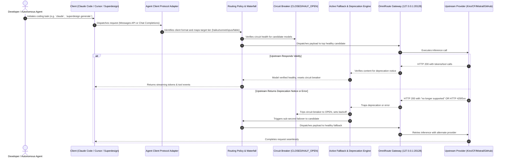

# Limitless Claude 7.0 - Intelligent Multi-Provider Routing Architecture

Limitless Claude 7.0 is an intelligent multi-provider coding router that bridges **Claude Code CLI**, modern AI code editors (**Cursor IDE**, **Antigravity IDE**, **VS Code**, **JetBrains**), and autonomous design agents (**Superdesign / Open Design**, **Google Stitch MCP**) to **OmniRoute**.

This document describes the request lifecycle, component boundaries, failure recovery state machines, billing intelligence, and multi-client protocol adapters.

---

## 1. Request Lifecycle & Routing Pipeline

---

## 2. Core Subsystems

### A. Billing & Quota Classifier (`src/core/billing-classifier.js`)
Classifies every upstream model into verifiable billing classes:
1. `zero-marginal-cost`: Verified free endpoints (`cloudflare-ai`, `kilo-gateway`, openrouter `:free` models, Groq).
2. `subscription-entitled`: Paid seat covers inference with zero per-token billing (`github`, `kiro`, `opencode-go`, `antigravity`).
3. `paid-token`: Commercial pay-per-token models (`mistral/codestral-latest`, paid OpenRouter models).
4. `pay-as-you-go`: Metered router tiers (`opencode-zen`).
5. `local`: Self-hosted loopback endpoints (`ollama`, `vllm`, `llama-cpp`).

**Safety Guard:** Enforcing `--exclude-paid` or `LIMITLESS_EXCLUDE_PAID=true` guarantees that chargeable models are omitted from all combos.

---

### B. Capability Evaluator (`src/core/capability-evaluator.js`)
Evaluates candidate models across 7 granular capability profiles:
- **`FAST`**: Atomic diffs, syntax validation, sub-second execution (<1s SLA).
- **`BALANCED`**: Standard feature implementation, unit tests, refactoring.
- **`REASONING`**: Complex architectural planning, flaw hunting, dependency mapping.
- **`FRONTEND`**: React 19, Tailwind CSS v4, component state machines, visual polish.
- **`3D`**: Three.js, React Three Fiber, WebGL shaders, 60fps frame budgets.
- **`BACKEND`**: PostgreSQL schemas, Supabase RLS migrations, REST/GraphQL APIs.
- **`REVIEW`**: Independent hostile adversarial review, security analysis, anti-slop audit.

---

### C. Circuit Breakers & Dynamic Routing (`src/core/routing-policy.js`)
Maintains a finite state machine per provider and model:
- **`CLOSED`**: Healthy. All requests are routed normally.
- **`OPEN`**: Tripped after 3 consecutive failures, HTTP 401/403 auth errors, or deprecation notice. Blocks traffic for an exponential cooldown period (base: 30s, max: 5m).
- **`HALF_OPEN`**: Cooldown elapsed. Allows a single probe request. If successful, resets to `CLOSED`; if failed, re-trips to `OPEN` with doubled backoff.

---

### D. Active Fallback & Deprecation Engine (`src/core/fallback-engine.js`)
Solves upstream protocol traps such as Google Cloud Code PA deprecation messages where upstream returns HTTP 200 with:
`"This version of Antigravity is no longer supported. Please upgrade Antigravity to the latest version..."`
The Fallback Engine inspects response text, detects deprecation signatures, marks the model `DEGRADED`, trips its circuit breaker immediately, and reroutes to the next provider.

---

### E. Agent Client Compatibility Layer (`src/core/agent-client.js`)
Maps header conventions, authentication mechanisms, and system prompt positions across:
- **Claude Code CLI** (`@anthropic-ai/claude-code`)
- **Claude Code VS Code / Cursor Extension**
- **Superdesign / Open Design CLI** (`@superdesign/cli`)
- **OpenCode CLI / Extension**
- **Antigravity IDE & CLI**
- **Cursor AI Editor**

---

### F. Configuration & Snapshot Manager (`src/core/config-manager.js`)
Provides:
- 6 active provider profiles: `limitless`, `native`, `opencode-go`, `opencode-zen`, `openrouter`, `antigravity`.
- Conflict detection across environment variables (`ANTHROPIC_BASE_URL`) and port 20128 bindings.
- Scoped process launchers (`npm run launcher`).
- Atomic snapshots and disaster-recovery rollbacks (`npm run rollback`).

---

### G. Telemetry & Observability (`src/core/telemetry.js`)
Aggregates live call logs, p50/p95 latency percentiles, token usage, estimated costs, and provider connection health with strict end-masking and secret redaction.
