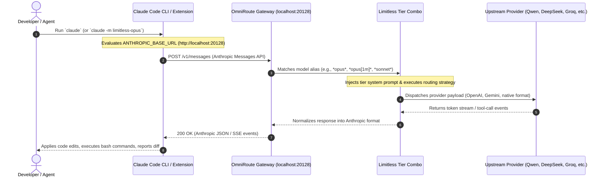

# Limitless Claude Architecture

Limitless Claude connects the agentic coding environment of **Claude Code** to a dynamic fleet of third-party AI models via **OmniRoute**.

This document outlines the request lifecycle, component boundaries, client configuration paths, and routing tiers.

---

## 1. Request Lifecycle & Protocol Flow

Claude Code communicates with its configured gateway using the standard Anthropic Messages API (`/v1/messages`). OmniRoute intercepts the request, maps the target model alias to one of four configured Limitless combos, injects specialized tier instructions, executes the routing strategy, and returns an Anthropic-compliant response back to Claude Code.

---

## 2. Component Boundaries & Responsibilities

| Component | Nature | Primary Role |
|---|---|---|
| **Claude Code CLI** | Client Application (Anthropic) | Local file system inspection, Git integration, tool execution (Bash, FileEdit, Grep), Terminal UI. |
| **OmniRoute** | Local AI Gateway & Proxy | Port `20128`. Protocol normalization (Anthropic $\leftrightarrow$ OpenAI / Gemini), rate-limit fallback, credential handling. |
| **Limitless Claude** | Configuration & Routing Harness | Configures OmniRoute's SQLite database (`storage.sqlite`), registers four tier combos, establishes model aliases, and installs background auto-recovery daemons. |

---

## 3. Client Integration Mechanics

### A. Claude Code Terminal CLI
- **Endpoint Discovery:** Claude Code reads the `ANTHROPIC_BASE_URL` environment variable (e.g., `http://localhost:20128` or `http://127.0.0.1:20128`) and authenticates with `ANTHROPIC_AUTH_TOKEN` or `ANTHROPIC_API_KEY`.
- **Model Resolution:** When starting `claude` or passing flags like `-m limitless-opus` or `-m opus[1m]`, OmniRoute's `model_combo_mappings` intercept the pattern and route to the corresponding combo.

### B. Claude Code VS Code Extension
- **Configuration Mechanism:** The extension executes Claude Code worker processes. It reads settings from `~/.claude/settings.json` and respects VS Code `claudeCode.environmentVariables` settings (specifically `ANTHROPIC_BASE_URL` and `ANTHROPIC_AUTH_TOKEN`).
- **Seamless Operation:** Because both the terminal CLI and the extension share the local OmniRoute gateway, combo routing operates identically across both interfaces.

### C. Cursor IDE
- **Terminal Integration:** When running Claude Code within Cursor's integrated terminal, it inherits the system or user environment variables (`ANTHROPIC_BASE_URL`).
- **Direct Model Configuration:** Cursor's custom OpenAI/Anthropic model configurations can point to `http://localhost:20128/v1` to route editor completions through OmniRoute combos.

---

## 4. The Four Tiers and Routing Strategies

Limitless Claude categorizes discovered models into four distinct combos:

### Priority Waterfall (`priority`)
Used for **Haiku** and **Sonnet**.
- **Mechanism:** OmniRoute always routes to the first model candidate in the pool. If that model encounters an error, timeout, or rate-limit (HTTP 429), OmniRoute instantly falls back to candidate #2, then #3, etc.
- **Rationale:** Ensures latency consistency for Haiku and deep reasoning quality for Sonnet by always using the highest-quality candidate first.

### Round-Robin Load-Balancing (`round-robin`)
Used for **Opus** and **Fable**.
- **Mechanism:** OmniRoute rotates subsequent requests across the active model pool (Request 1 $\rightarrow$ Model A, Request 2 $\rightarrow$ Model B, Request 3 $\rightarrow$ Model C).
- **Rationale:** Bypasses Requests-Per-Minute (RPM) limits on free or shared quotas. Distributing load across 17 models allows sustained, high-volume agentic coding sessions without interruptions.

---

## 5. Database Safety & Startup Architecture

- **WAL-Consistent Backup:** OmniRoute's database operates in SQLite Write-Ahead Logging (`WAL`) mode. Before any changes are applied, Limitless Claude uses SQLite `VACUUM INTO` and checkpoint verification to guarantee that backup `storage.sqlite.bak` is fully consistent and uncorrupted.
- **Atomic Transactions:** All combo deletions, insertions, mapping updates, and API key permission updates execute inside an atomic SQLite transaction (`BEGIN IMMEDIATE` ... `COMMIT`). If any step fails, changes are cleanly rolled back.
- **Minimal API Key Permissions:** Setup inspects the active key, preserves existing `'restricted'` mode settings, and appends only the required Limitless combo IDs without silently granting unrestricted global access.
- **Background Daemon:**
  - **Windows:** Installs `Limitless-OmniRoute-Launcher.vbs` in the Windows Startup directory, executing `omniroute-daemon.bat` silently in a loop with a 5-second restart delay upon process termination.
  - **Linux / macOS:** Supported via `start-daemon.sh` using detached background execution (`nohup`).
