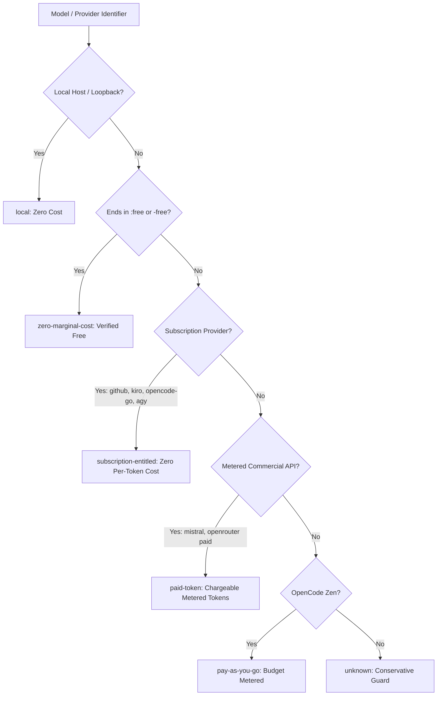

# Limitless Claude 7.0.0 — Billing & Quota Intelligence Report

This report documents the billing classification engine, cost calculation algorithms, and spending safeguard controls implemented in Limitless Claude 7.0.0.

---

## 1. Billing Classification Architecture

Upstream models are categorized into 6 distinct classes in [`src/core/billing-classifier.js`](file:///C:/projects/limitless-claude/src/core/billing-classifier.js):

---

## 2. Token Pricing Reference (Per 1M Tokens)

| Model Key | Billing Class | Input / 1M | Output / 1M | Notes |
| :--- | :--- | :---: | :---: | :--- |
| **`cloudflare-ai/@cf/meta/llama-3.3-70b-instruct-fp8-fast`** | `zero-marginal-cost` | $0.00 | $0.00 | Free developer tier |
| **`kilo-gateway/nvidia/nemotron-3.5-lightning:free`** | `zero-marginal-cost` | $0.00 | $0.00 | Community endpoint |
| **`github/gpt-4o`** | `subscription-entitled` | $0.00 | $0.00 | Covered by Copilot seat |
| **`github/gpt-4o-mini`** | `subscription-entitled` | $0.00 | $0.00 | Covered by Copilot seat |
| **`kiro/claude-sonnet-4.5`** | `subscription-entitled` | $0.00 | $0.00 | Covered by Kiro subscription |
| **`kiro/glm-5`** | `subscription-entitled` | $0.00 | $0.00 | Covered by Kiro subscription |
| **`mistral/codestral-latest`** | `paid-token` | $0.30 | $0.90 | Pay-per-token commercial |
| **`openrouter/deepseek/deepseek-chat`** | `paid-token` | $0.14 | $0.28 | Wholesale funded tier |
| **`openrouter/qwen/qwen-2.5-coder-32b-instruct`** | `paid-token` | $0.08 | $0.16 | Wholesale funded tier |

---

## 3. Spending Safeguards

1. **Free-Only Enforcement (`--exclude-paid`):**
   When passed to `node scripts/setup.js --exclude-paid` or when `LIMITLESS_EXCLUDE_PAID=true` is set, all `paid-token` and `pay-as-you-go` models are filtered out from all routing combos.
2. **Quota Tracking:**
   `BillingClassifier.estimateCost(provider, model, inputTokens, outputTokens)` computes estimated cost per turn.
3. **OpenRouter $10 Balance Multiplier:**
   Depositing $10 credit in OpenRouter expands the free request limit from 50 to 1,000 requests/day, while enabling wholesale models that provide between 35M and 70M high-quality coding tokens.
