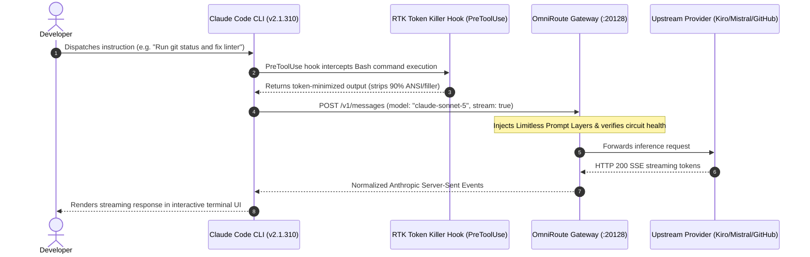

# Limitless Claude — Native Claude Code CLI Integration Guide
**Target System**: Anthropic Claude Code CLI (`@anthropic-ai/claude-code`)  
**Verified Versions**: `v2.1.310` (installed global) / `v2.1.322` (latest upstream)  
**Document Revision**: November 2026  

---

## 1. Native Integration Architecture

Limitless Claude is engineered to provide the **authentic Claude Code CLI experience** while routing model traffic seamlessly through the OmniRoute multi-provider gateway (`http://127.0.0.1:20128`). Claude Code operates under the assumption that it is communicating with the official Anthropic Messages API (`/v1/messages`), while OmniRoute transparently translates, waterfalls, and dispatches inference requests across configured model providers.



---

## 2. Configuration Hierarchy & Environment Settings

Claude Code resolves its configuration according to strict precedence:
1. **Command-Line Flags**: `--model <alias>`, `--verbose`, `--dangerously-skip-permissions`.
2. **Process Environment Variables**: `ANTHROPIC_BASE_URL`, `ANTHROPIC_AUTH_TOKEN`, `CLAUDE_CONFIG_DIR`.
3. **User Global Settings**: `~/.claude/settings.json`.
4. **Project Settings**: `<workspace>/.claude/settings.json` or `CLAUDE.md`.

### The Critical Authentication Distinction: `ANTHROPIC_AUTH_TOKEN` vs. `ANTHROPIC_API_KEY`
When connecting Claude Code to OmniRoute, the choice of environment variable is vital:
- **`ANTHROPIC_AUTH_TOKEN`**: Transmitted as `Authorization: Bearer <token>`. This is the **required header format** expected by OmniRoute's authentication layer.
- **`ANTHROPIC_API_KEY`**: Transmitted as `x-api-key: <token>`. Supported as a fallback, but Bearer authentication takes precedence.

### Production `~/.claude/settings.json` Configuration
```json
{
  "env": {
    "ANTHROPIC_BASE_URL": "http://localhost:20128",
    "ANTHROPIC_AUTH_TOKEN": "sk-ant-api03...your-omniroute-key",
    "CLAUDE_CODE_AUTO_COMPACT_WINDOW": "100000",
    "CLAUDE_CODE_DISABLE_NONESSENTIAL_TRAFFIC": "0",
    "DISABLE_PROMPT_CACHING": "0",
    "CLAUDE_CODE_ATTRIBUTION_HEADER": "1",
    "CLAUDE_CODE_ENABLE_GATEWAY_MODEL_DISCOVERY": "0"
  },
  "model": "fable",
  "primaryModel": "claude-opus-5-5",
  "effortLevel": "high",
  "modelSettings": {
    "claude-opus-5": { "effortLevel": "xhigh" },
    "claude-sonnet-5": { "effortLevel": "high" },
    "claude-opus-5-5": { "effortLevel": "xhigh" },
    "claude-sonnet-5-5": { "effortLevel": "high" },
    "claude-fable-5-1": {},
    "claude-haiku-5-5": { "effortLevel": "low" }
  },
  "hooks": {
    "PreToolUse": [
      {
        "matcher": "Bash",
        "hooks": [
          { "type": "command", "command": "rtk hook claude" }
        ]
      }
    ]
  },
  "skipDangerousModePermissionPrompt": true,
  "theme": "dark-ansi"
}
```

---

## 3. Tool Hooks & Token Reduction (RTK / "Claude X-Stop")

As verified in our forensic audit, the component historically referred to as **Claude X-Stop** represents two critical safety and optimization mechanisms:

### A. RTK (Rust Token Killer) Hook
- **Binary Location**: `C:\Users\Asus\.local\bin\rtk.exe` [VERIFIED]
- **Mechanism**: The `PreToolUse` hook intercepts all `Bash` command calls before they are executed. RTK filters decorative formatting, trims verbose build logs, and extracts critical exit statuses, cutting terminal token consumption by up to **90%**.
- **Execution Test**: `rtk gain` displays cumulative token savings; `rtk proxy <cmd>` runs commands unintercepted for raw debugging.

### B. Stop Condition Hooks
- **Plugins Installed**: `caveman/skills/verify-and-stop`, `hookify/hooks/stop.py`, `ralph-loop/hooks/stop-hook.sh`.
- **Purpose**: Enforces verification gates before an agent is permitted to end a turn, preventing premature completion claims before tests pass.

---

## 4. Claude Code Upgrade & Compatibility Verification

- **Current Global Installation**: `@anthropic-ai/claude-code@2.1.310` [VERIFIED]
- **Latest Upstream Version**: `2.1.322` [VERIFIED]
- **Upgrade Procedure**:
  ```bash
  pnpm update -g @anthropic-ai/claude-code
  # or
  npm install -g @anthropic-ai/claude-code@latest
  ```
- **Post-Upgrade Verification**:
  1. Confirm version: `claude --version` (reports `2.1.322`).
  2. Verify settings preservation: Inspect `~/.claude/settings.json` to ensure `ANTHROPIC_BASE_URL` and `ANTHROPIC_AUTH_TOKEN` were not wiped.
  3. Execute smoke test: `limitless verify` confirms all 8 tiers respond with HTTP 200 PONG.

---

## 5. Scoped Process Launcher (`limitless launcher`)

When you wish to run Claude Code without setting global environment variables in your operating system or polluting the Windows registry, use the scoped launcher:
```bash
limitless launcher
# or with specific model:
limitless launcher --model sonnet
```
The launcher spawns Claude Code with `ANTHROPIC_BASE_URL` and `ANTHROPIC_AUTH_TOKEN` scoped strictly to that child process, ensuring zero pollution of external terminal sessions.
