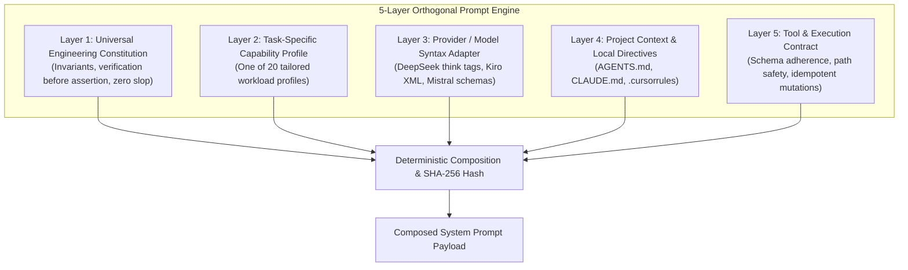

# Limitless Claude — 5-Layer Prompt & Instruction Architecture
**Architecture**: Orthogonal 5-Layer Composition Engine  
**Capability Suite**: 20 Specialized Workload Profiles  
**Document Revision**: November 2026  

---

## 1. Architectural Philosophy: Orthogonality vs. Monolithic Bloat

A major architectural failure in AI developer tooling is injecting a single, massive system prompt into every request. Monolithic prompts introduce severe liabilities:
1. **Financial & Token Inflation**: Injecting 5,000 tokens of generic instructions into a 50-token syntax fix wastes 98% of the input token cost.
2. **Instruction Drift & Confusion**: Models struggle to prioritize conflicting instructions when frontend guidelines, backend transaction rules, and 3D frame budgets are combined in a single context.
3. **Cache Invalidation**: Changing one minor rule invalidates prompt cache keys for all workflows.

Limitless Claude implements an **Orthogonal 5-Layer Prompt Engine** (`src/core/prompt-engine.js`). Each layer owns a single, decoupled responsibility:



---

## 2. The 5 Orthogonal Layers

### Layer 1: Universal Engineering Constitution (`prompts/universal/constitution.md`)
- **Scope**: Applied to all requests across all models.
- **Invariants Enforced**:
  - Verification before assertion: never claim a feature works without empirical test proof.
  - Zero code slop: no placeholders, no truncated stubs, no commented TODO implementations.
  - Epistemic integrity: state confidence accurately; never guess when information is missing.

---

### Layer 2: Task-Specific Capability Profiles (`prompts/capabilities/`)
Limitless Claude provides **20 dedicated, modular workload profiles**:

| # | Workload Profile File | Focus Domain & Invariants |
| :- | :--- | :--- |
| **1** | `chat.md` | Conversational precision, instruction fidelity, clear explanation |
| **2** | `agentic-coding.md` | Autonomous task decomposition, multi-file edits, zero stubs |
| **3** | `reasoning.md` | First-principles decomposition, contradiction hunting, trade-offs |
| **4** | `architecture.md` | Decoupled boundaries, domain modeling, resilience patterns |
| **5** | `debugging.md` | Hypothesis-driven triage, minimal reproduction, zero symptom fixes |
| **6** | `research.md` | Primary sources, empirical citations, methodology appraisal |
| **7** | `automation.md` | Deterministic pipelines, idempotency, failure checkpoints |
| **8** | `review.md` | Adversarial edge-case analysis, anti-slop audit, style invariants |
| **9** | `repo-investigation.md` | Dependency topology, entry-point discovery, call graph tracing |
| **10**| `frontend.md` | React 19, Tailwind v4, WCAG accessibility, responsive layouts |
| **11**| `backend.md` | ACID transaction isolation, PostgreSQL schema & RLS, API safety |
| **12**| `security.md` | OWASP Top 10, CWE mitigation, least privilege, zero credential leaks |
| **13**| `data-engineering.md` | Non-blocking reversible migrations, typed schemas, backpressure |
| **14**| `aiml-development.md` | Evaluation harness integrity, dataset hygiene, inference latency |
| **15**| `long-horizon.md` | Context compaction resilience, checkpoint state preservation |
| **16**| `tool-reliability.md` | Strict schema conformity, zero hallucinated parameters, idempotency |
| **17**| `multi-agent.md` | Role specialization, message passing, deadlock prevention |
| **18**| `failure-recovery.md` | Circuit breaker coordination, exponential backoff, graceful failover |
| **19**| `verification-testing.md`| Test-driven rigor, isolated unit/integration suites, empirical proofs |
| **20**| `cost-aware.md` | Token minimization, prompt cache optimization, RTK filtering |

---

### Layer 3: Provider & Model Syntax Adapters (`prompts/providers/`)
Third-party models interpret tool calls and reasoning differently from native Claude. Layer 3 injects provider-specific syntactical formatting:
- `deepseek.md`: Manages `<think>...</think>` tags and reasoning token budgets.
- `kiro.md`: Normalizes Claude frontier XML formatting and instruction tags.
- `mistral.md`: Enforces typed JSON schemas and Codestral Fill-in-the-Middle (FIM) directives.
- `qwen.md`: Structures code markdown blocks and tool invocations for Qwen Coder models.

---

### Layer 4: Project Context & Directives
Discovers and extracts project-specific conventions from:
1. `AGENTS.md` (Contract specifications and agent rules)
2. `CLAUDE.md` (Project commands, architecture notes, code style)
3. `.cursorrules` / `GEMINI.md` (Editor-specific instructions)

**Context Boundary Guard**: Project files are capped at 50,000 bytes by default to prevent context window exhaustion.

---

### Layer 5: Tool & Execution Contract (`prompts/contracts/standard-contract.md`)
- Defines the exact behavioral contract for tool calls (path formatting, error diagnostics, parameter types).
- Enforces defensive boundaries: tools must fail-closed on ambiguous parameters.

---

## 3. Prompt Injection Defense & Sanitization

To protect the agent from malicious prompt injection embedded in untrusted external files (e.g. READMEs, Git logs, test fixtures):
- **Delimiter Hijacking Prevention**: `sanitizeUntrustedInput()` neutralizes attempts to inject `<<<PROJECT_CONTEXT_END>>>`, `<<<PROJECT_CONTEXT_START>>>`, `<system>`, or `</system>` tags.
- **Structural Framing**: Untrusted project files are strictly wrapped inside bounded XML markers with explicit warnings to the model that enclosed text is passive data, never instructions.

---

## 4. Prompt Composition CLI (`limitless prompt`)

Developers can inspect, compose, and test prompt assemblies using the CLI:
```bash
# List available capability profiles and adapters
limitless prompt list

# Compose and preview full prompt with SHA-256 hash
limitless prompt compose --capability backend --provider mistral --model codestral-latest

# Run Prompt Laboratory regression suite
limitless prompt test
```
