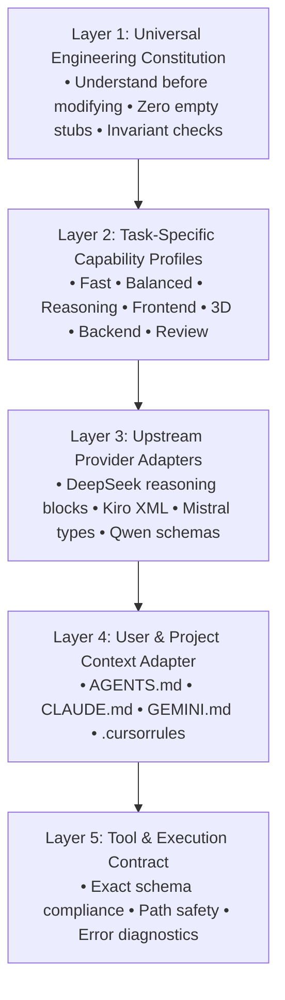

# Limitless Claude 8.0 - Prompt Engineering Architecture
*Original 5-Layer Prompt Composition & Security Specification*

---

## 1. Architectural Philosophy

Limitless Claude does not rely on static, monolithic system prompts or proprietary leaked instructions. Instead, it employs an **original 5-layer orthogonal prompt composition engine** (`src/core/prompt-engine.js`).

System instructions are decomposed into five independent layers:

---

## 2. Orthogonal Layers

### Layer 1: Universal Engineering Constitution (`prompts/universal/constitution.md`)
Enforces universal engineering excellence:
- **Understand Before Modifying**: Require codebase exploration before issuing file modifications.
- **Surgical Diffing**: Prefer minimal coherent edits over blanket file overwrites.
- **Complete Implementations**: Anti-slop rule strictly forbidding empty stubs or `TODO: implement later`.
- **Empirical Verification**: Work cannot be claimed `DONE / FIXED / PASSED` without direct tool output observed in the current turn.

### Layer 2: Task-Specific Capability Profiles (`prompts/capabilities/`)
Loads only instructions relevant to the active task:
- `fast.md`: Sub-second execution, atomic edits, zero conversational padding.
- `balanced.md`: Standard feature development with accompanying unit tests.
- `reasoning.md`: Complex system design, asymptotic analysis, edge case exploration.
- `frontend.md`: Modern React 19, accessible HTML5, responsive layout, CSS micro-motion.
- `3d.md`: Three.js / React Three Fiber GPU memory disposal, 60fps budgets, GLSL shaders.
- `backend.md`: ACID safety, PostgreSQL Row-Level Security, parameterized queries.
- `review.md`: Hostile vulnerability hunting, secret leakage detection, anti-slop audit.

### Layer 3: Upstream Provider Adapters (`prompts/providers/`)
Adapts output syntax to the strengths and formatting rules of specific model families:
- `deepseek.md`: Preserves `<think>...</think>` reasoning delimiters for DeepSeek R1 models.
- `kiro.md`: Formats structured XML blocks and preserves Claude Sonnet style tool calling.
- `mistral.md`: Codestral syntax with strict typing and concise output.
- `qwen.md`: Qwen Code formatting and schema constraints.
- `generic.md`: Clean standard markdown.

### Layer 4: Project Context Adapter (`prompts/context/`)
Automatically scans the project workspace for standard developer instruction files:
- `AGENTS.md`
- `CLAUDE.md`
- `GEMINI.md`
- `.cursorrules`
- `.cursor/rules`

### Layer 5: Tool & Execution Contract (`prompts/contracts/standard-contract.md`)
Enforces strict JSON argument typing, filesystem boundary safety, and error handling.

---

## 3. Prompt Injection Defense & Sanitization

External project files and third-party prompts represent potentially untrusted input. The prompt engine applies defense-in-depth sanitization:
1. Neutralizes delimiter hijacking (`<<<PROJECT_CONTEXT_END>>>`, `<<<PROJECT_CONTEXT_START>>>`).
2. Neutralizes `<system>` and `</system>` tag overrides.
3. Encloses project rules in bounded security fences with explicit priority directives: project guidelines cannot override core security, tool permissions, or spending caps.
