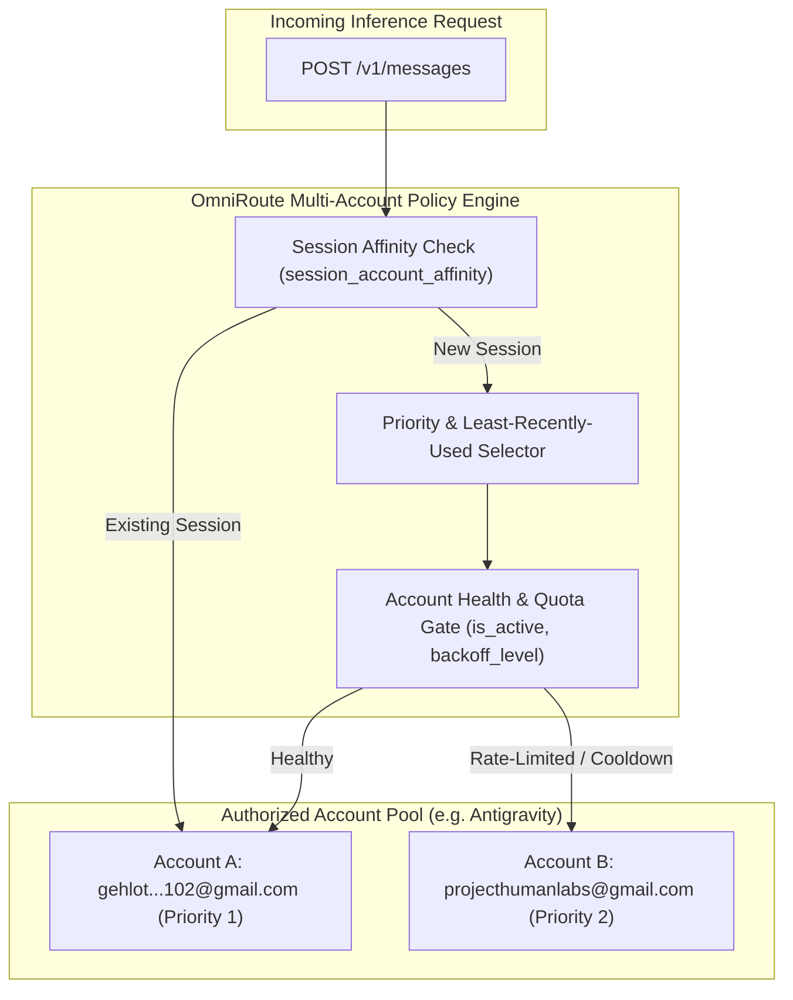

# Limitless Claude — Provider Ecosystem, Multi-Account Governance & Cost Strategy
**Classification**: COMPLIANCE, RATE-LIMIT & FINANCIAL POLICY SPECIFICATION  
**Scope**: Provider Accounts, Multi-Account Pooling, Quota Scheduling, and Compliance  
**Audit Date**: November 2026  

---

## 1. Multi-Account Stacking vs. Legitimate Multi-Account Distribution

### The Compliance Boundary
A critical architectural mandate for Limitless Claude: **Never confuse legitimate multi-account distribution with illicit account stacking or terms-of-service evasion.**
- **Prohibited Evasion (Account Stacking)**: Scripting fake identities, disposable emails, or automated credential rotators to circumvent free-tier rate limits or defeat anti-abuse controls. Limitless Claude strictly refuses to support or implement stealth evasion or identity masking.
- **Sanctioned Multi-Account Distribution**: In professional engineering workflows, developers frequently manage multiple legitimate, paid or authorized accounts across distinct operational contexts:
  - Dedicated personal vs. enterprise organization accounts (e.g., `user@company.com` vs `user@gmail.com`).
  - Distinct Google Cloud project credentials for separate microservice scopes (`aicode-consumers` project A vs project B).
  - Multiple distinct Kiro or Antigravity Pro seats licensed by an engineering team.

### Live Environment Verification
In our forensic baseline audit of `storage.sqlite`, we discovered two verified, legitimate, active Antigravity Pro accounts configured in `provider_connections` [VERIFIED]:
1. Priority 1: `gehlot.mahisingh2006.102@gmail.com` (`tier: "g1-pro-tier"`, `subscriptionTier: "Google AI Pro"`)
2. Priority 2: `projecthumanlabs@gmail.com` (`tier: "g1-pro-tier"`, `subscriptionTier: "Google AI Pro"`)

---

## 2. Safe Multi-Account Architecture

Where multiple authorized accounts exist, Limitless Claude and OmniRoute coordinate safe multi-account utilization according to five principles:



1. **Session Affinity (`session_account_affinity` table)**: Multi-turn agentic workflows maintain affinity to the same account to ensure prompt cache hits and coherent billing attribution.
2. **Failure Isolation**: An HTTP 429 on Account A triggers an isolated cooldown on Account A without impacting Account B or general gateway health.
3. **No Credential Exposure**: Provider refresh tokens and API secrets remain encrypted inside SQLite (`STORAGE_ENCRYPTION_KEY`). CLI reports and telemetry redact all keys.
4. **Transparent Telemetry**: Cost and request ledgers (`request_cost_ledger`) record the exact account identifier servicing each transaction for enterprise cost accounting.
5. **No Universal Multiplication Guarantee**: Documentation must never promise that $N$ accounts equal $N\times$ guaranteed quota, as upstream providers enforce shared IP or concurrent gateway limits.

---

## 3. The Recommended Multi-Provider Stack (Zero-Cost & Low-Cost)

Limitless Claude configures a multi-layered provider topology to maximize availability and output quality while minimizing marginal financial costs:

```
┌──────────────────────────────────────────────────────────────────────────────────┐
│                      RECOMMENDED MULTI-PROVIDER STACK HIERARCHY                  │
├───────────────────┬────────────────────────────────┬─────────────────────────────┤
│ Provider Layer    │ Target Endpoints               │ Billing Characteristic      │
├───────────────────┼────────────────────────────────┼─────────────────────────────┤
│ 1. Subscription-  │ Kiro AI (Claude Sonnet 4.5),   │ Zero marginal cost per      │
│    Entitled       │ Antigravity Pro (Claude Opus), │ token; covered by fixed     │
│                   │ GitHub Models (GPT-4o)         │ developer subscriptions     │
├───────────────────┼────────────────────────────────┼─────────────────────────────┤
│ 2. Zero-Marginal- │ Cloudflare Workers AI          │ Zero token cost; fast free  │
│    Cost Cloud     │ (Llama 3.3 70B, DeepSeek R1),  │ edge inference under daily  │
│                   │ Groq (GPT-OSS-20B)             │ cloud quotas                │
├───────────────────┼────────────────────────────────┼─────────────────────────────┤
│ 3. Verified $10   │ OpenRouter Free Fleet          │ 1,000 requests/day unlocked │
│    Deposit Tier   │ (Nemotron 550B, LFM, Cohere)   │ with $10 one-time deposit   │
├───────────────────┼────────────────────────────────┼─────────────────────────────┤
│ 4. Commercial     │ Mistral AI (Codestral Latest), │ Pay-per-token metered;      │
│    Metered Backup │ Paid OpenRouter Models         │ fail-closed with safety flag│
├───────────────────┼────────────────────────────────┼─────────────────────────────┤
│ 5. Local Private  │ Local Ollama (127.0.0.1:11434) │ 100% offline, zero marginal │
│    Fallback       │ (DeepSeek R1 32B, Qwen Coder)  │ cost, private workstation   │
└───────────────────┴────────────────────────────────┴─────────────────────────────┘
```

---

## 4. OpenRouter $10 Deposit Policy Deep Dive

- **The Verified Mechanism**: OpenRouter provides free access to dozens of leading open-weight models tagged `:free` (e.g. `nvidia/nemotron-3-ultra-550b-a55b:free`, `cohere/north-mini-code:free`).
- **Free vs. Funded Tier**:
  - **Unfunded Account ($0 balance)**: 50 requests per day, 20 requests per minute.
  - **Funded Account ($\ge \$10$ lifetime deposit)**: **1,000 requests per day**, 20 requests per minute.
- **Essential Operational Rules**:
  1. The $10 deposit is **not a subscription**; it remains in your account balance as credit for paid models.
  2. The account balance must remain positive ($> \$0.00$). If paid usage depletes your balance to zero, access to all free models is locked.
  3. The 20 requests/minute rate limit applies equally to funded accounts. Rapid-fire automated loops must respect throttling.
  4. Individual upstream server load can cause occasional HTTP 429 errors even when daily quota remains available.
