# Limitless Claude 7.0.0 — Canonical Architecture Diagrams

This document contains the complete collection of 22 canonical Mermaid architecture diagrams illustrating the subsystems, pipelines, and failover flows of Limitless Claude 7.0.0.

---

### 1. Overall System Architecture
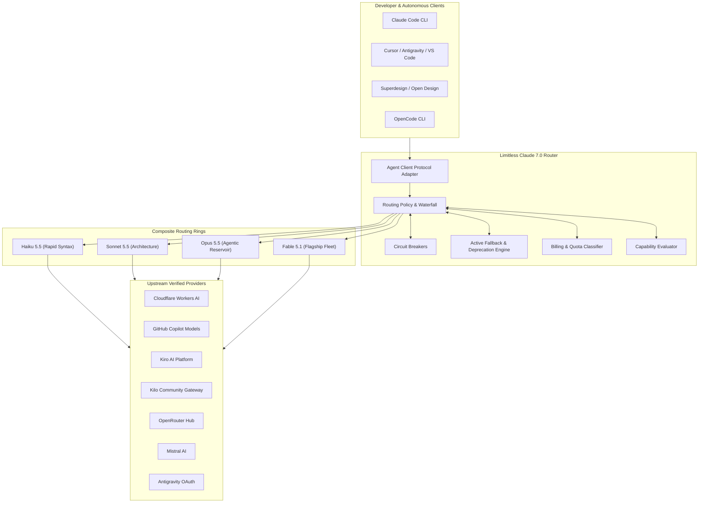

---

### 2. OmniRoute Gateway Architecture
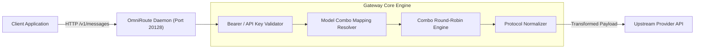

---

### 3. Provider Discovery Pipeline
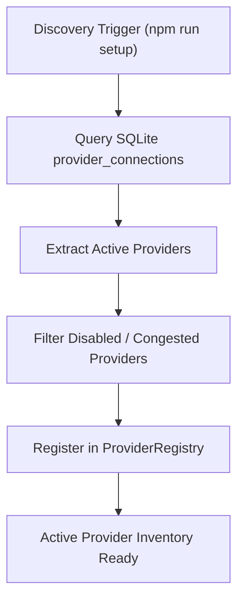

---

### 4. Model Discovery Pipeline
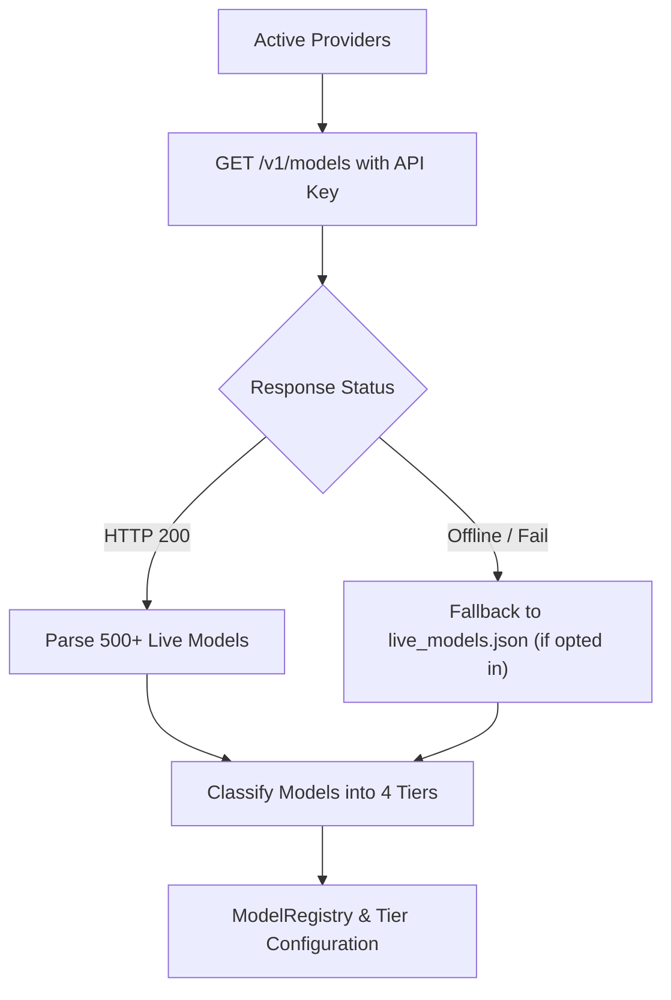

---

### 5. Model Capability Evaluation
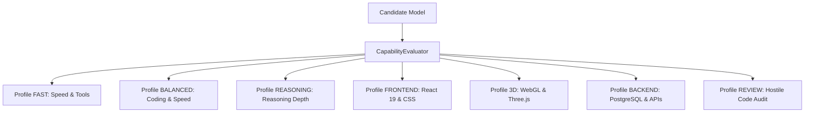

---

### 6. Composite Tier Architecture
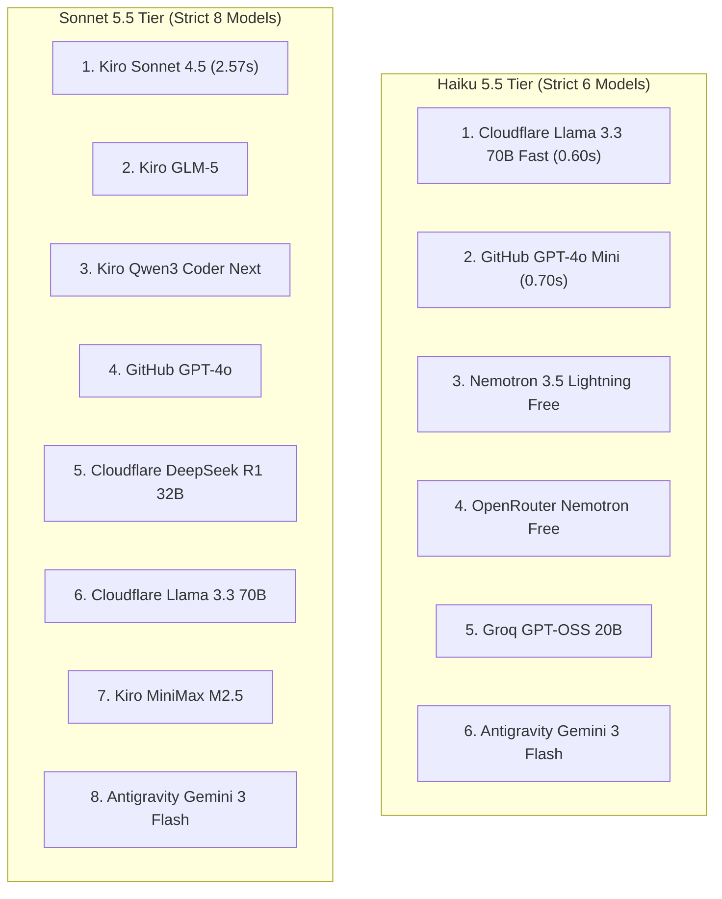

---

### 7. Quality-Aware Routing Policy
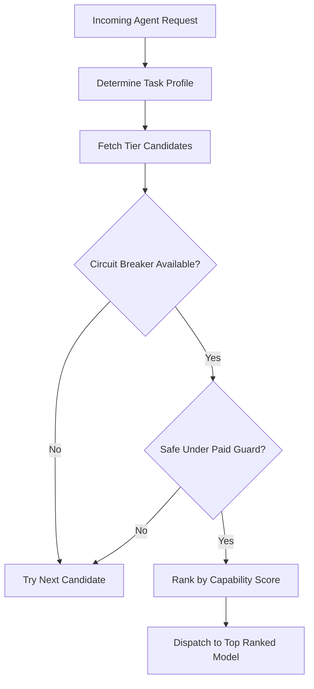

---

### 8. Fallback and Circuit Breakers
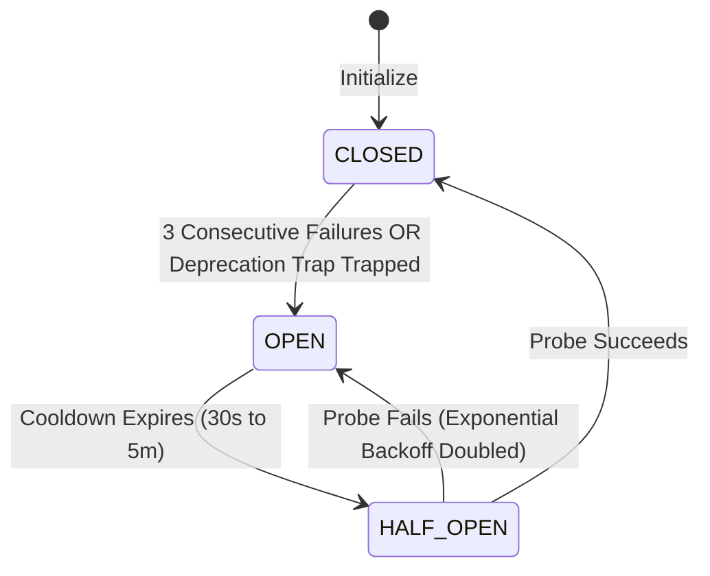

---

### 9. Billing & Quota System
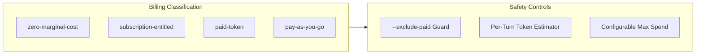

---

### 10. Agent-Client Compatibility
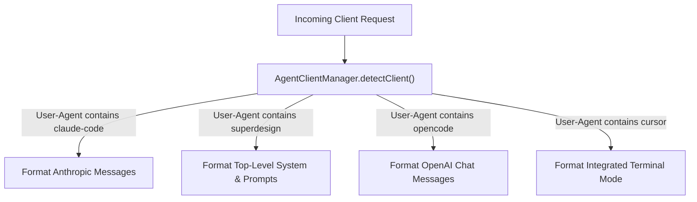

---

### 11. Claude Code CLI Integration
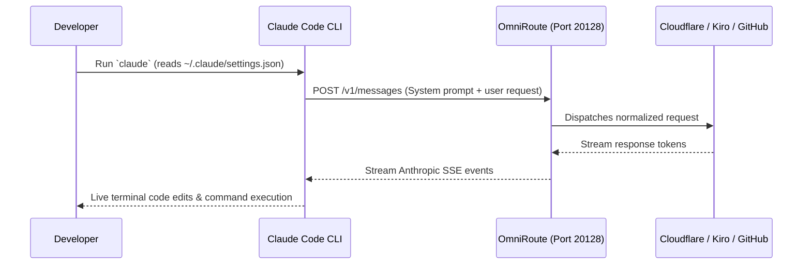

---

### 12. OpenCode Go & Zen Integration
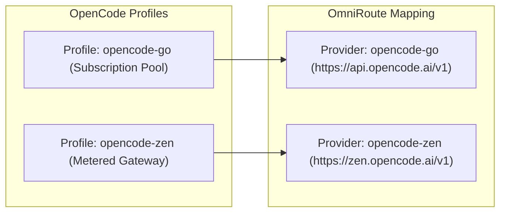

---

### 13. OpenRouter Integration Architecture
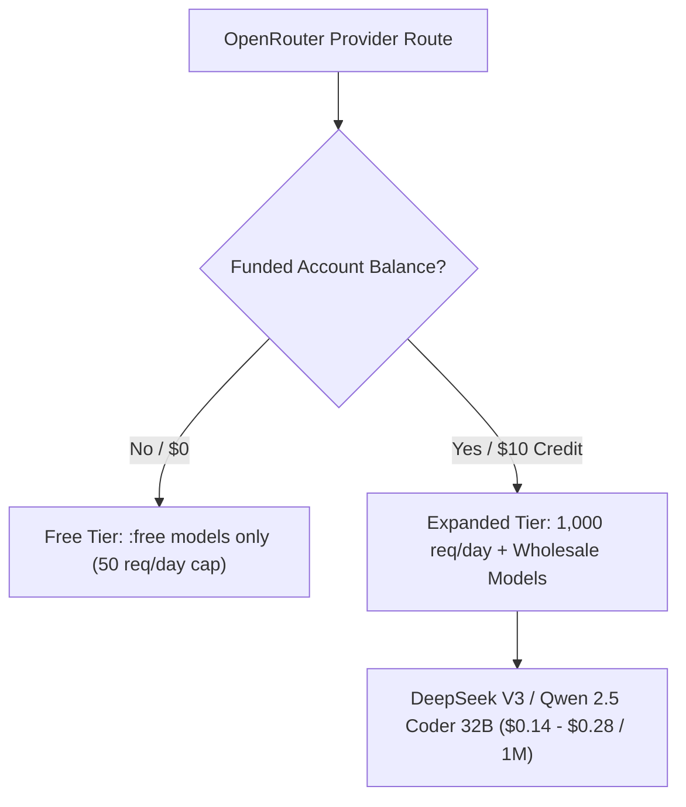

---

### 14. Profile Switching Flow
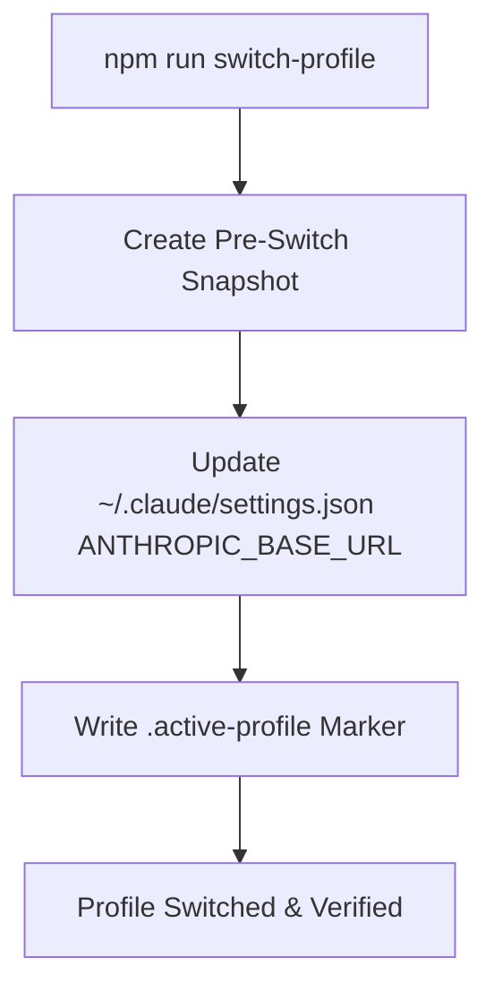

---

### 15. Credential Isolation & Redaction
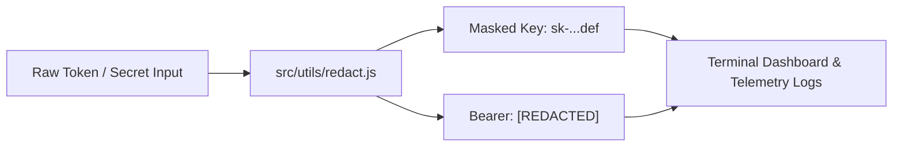

---

### 16. Configuration Lifecycle
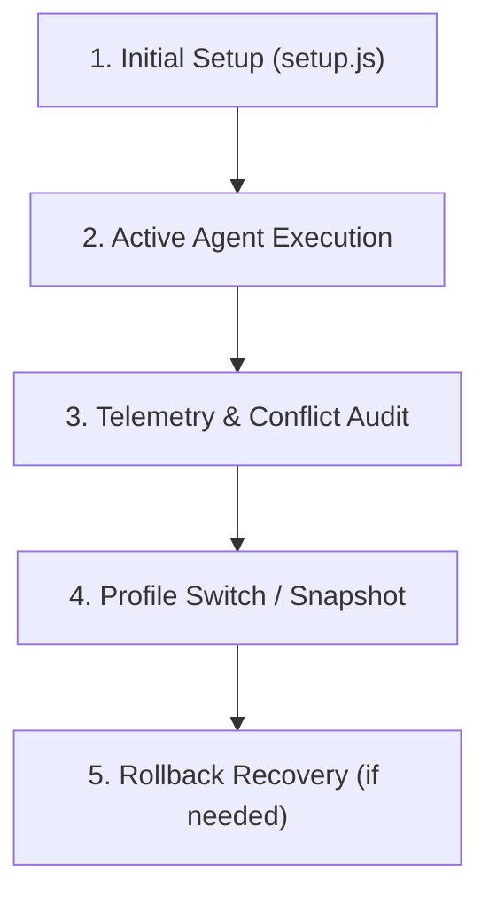

---

### 17. Telemetry & Observability Pipeline
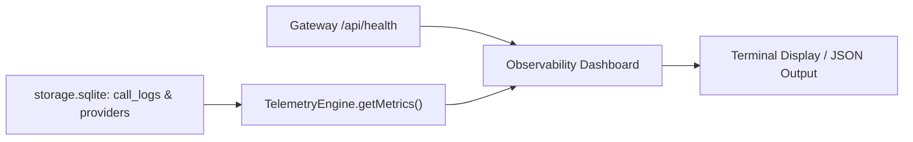

---

### 18. Capability Benchmarking Architecture
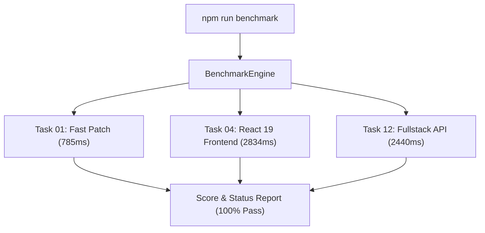

---

### 19. Testing Architecture
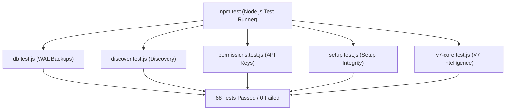

---

### 20. Orchestra Interoperability Architecture
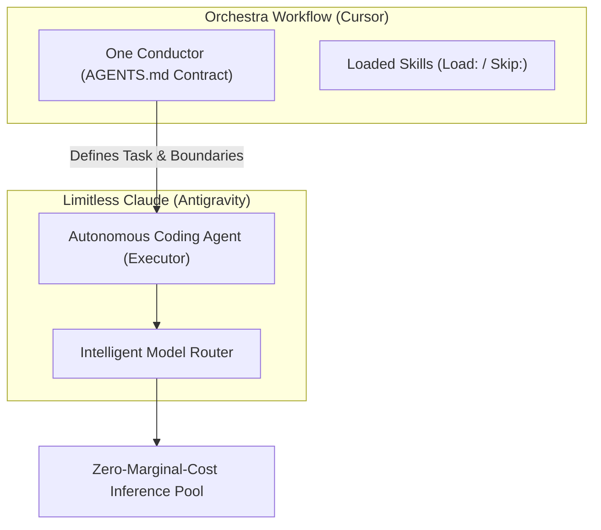

---

### 21. Installation & Migration Architecture
```mermaid
flowchart TD
    GIT_CLONE["git clone limitless-claude"] --> NPM_I["npm install"]
    NPM_I --> PRE_SNAP["Create Baseline Snapshot"]
    PRE_SNAP --> RUN_SETUP["npm run setup (WAL Transaction)"]
    RUN_SETUP --> VERIFY["npm run verify (8/8 Live Tests)"]
    VERIFY --> READY["System Ready for Claude Code"]
```

---

### 22. Error Handling & Active Recovery
```mermaid
flowchart TD
    ERR["Upstream Error Encountered"] --> CLASSIFY["RoutingPolicy.classifyFailure()"]
    CLASSIFY -->|Deprecation Notice Trapped| TRIP["Immediate Breaker OPEN & Cooldown"]
    CLASSIFY -->|HTTP 429 Rate Limit| BACKOFF["Exponential Backoff (30s - 5m)"]
    CLASSIFY -->|HTTP 401 Auth Fatal| DISABLE["Mark Model UNAVAILABLE"]
    TRIP --> FAILOVER["Instant Failover to Healthy Candidate"]
    BACKOFF --> FAILOVER
    DISABLE --> FAILOVER
```
